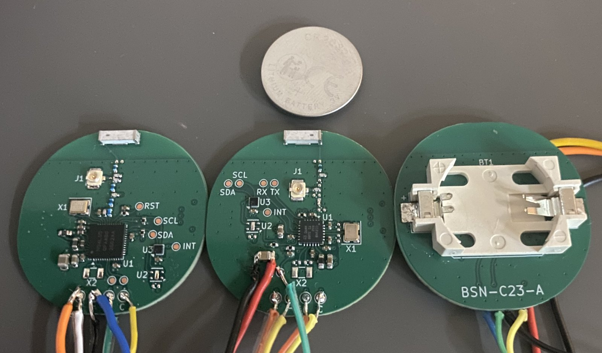
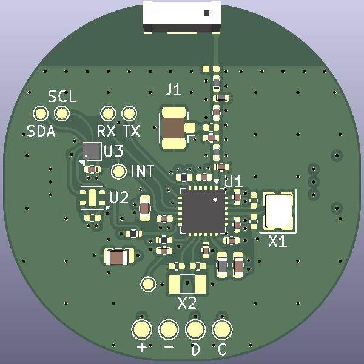
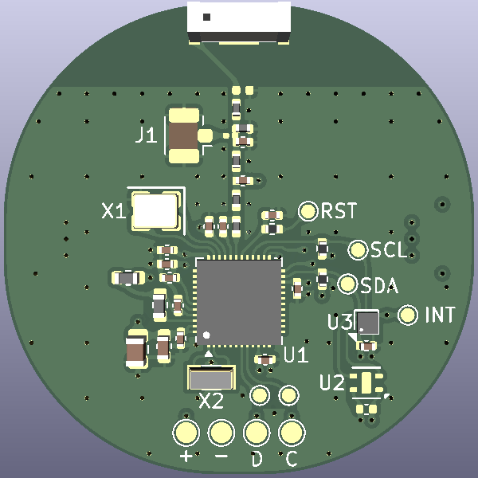

# BLE Sensor Node

**BEng in Electronics Engineering thesis project, focused on low-power design and RF performance.**

A compact, coin-cell-powered Bluetooth Low Energy sensor node that measures temperature and humidity and broadcasts
the data as [BTHome](https://bthome.io/) advertisements, without needing a persistent connection.



*Rev A: `BSN-N54-A` (left), `BSN-C23-A` (middle) and the back of `BSN-C23-A` with the coin-cell holder.*

## Goal

Keep the average current low enough for multi-year operation on a single CR2032 cell, in a board no bigger than the
cell holder. Main areas of work: low-power firmware and advertising strategy, antenna/RF performance (chip vs. trace
antenna), and power budgeting around the coin cell's current limits.

## Highlights

- **Two MCUs designed, built and measured side by side** on rev A: Nordic nRF54L05 (`BSN-N54`) and TI CC2340R5
  (`BSN-C23`), with the same sensors, antenna and board outline. The CC2340R5 was chosen for rev B from the
  measurements ([`MCU_DECISION.md`](hardware/MCU_DECISION.md)).
- **0.37 µA sleep floor** on BSN-C23-A, below the CC2340R5's own datasheet typical. Every event (advert, sensor
  reading, cold boot) was measured as a charge, which gives a current model for any setting: about 3.3 µA at a
  5 s advertising interval, or roughly 7 years on a 225 mAh CR2032 before derating
  ([power measurements](hardware/C23/testing/Power/POWER_MEASUREMENTS.md)).
- **Antenna matched on the VNA** with the battery holder fitted, step by step from the unmatched chip antenna
  ([antenna matching](hardware/C23/testing/RF/ANTENNA_MATCHING.md)).
- **Conducted harmonics measured on a spectrum analyser** against the FCC restricted-band limit. The C23 passes with
  9.5 dB margin; the N54 fails H3 by 17 dB without a filter ([RF carrier](hardware/C23/testing/RF/RF_CARRIER.md)).
- **Firmware for both MCUs** written to the same structure (bring-up self-test, BLE sensor, CW RF test, one power
  state per build) so the two can be measured the same way.

## Design

| `BSN-C23-A` (TI CC2340R5) | `BSN-N54-A` (Nordic nRF54L05) |
|---|---|
|  |  |
| [Schematic](hardware/C23/schematic.pdf) · [PCB](hardware/C23/PCB.pdf) · [README](hardware/C23/README.md) | [Schematic](hardware/N54/schematic.pdf) · [PCB](hardware/N54/PCB.pdf) · [README](hardware/N54/README.md) |

4-layer, 34 × 34 mm board with 15.5 mm corner radii (close to round). Chip antenna with a pi matching network and an optional U.FL connector for conducted
RF tests, HDC2010 temperature/humidity sensor (SHTC3 footprint as an alternative), CR2032 holder on the back.
Test points for SWD, UART, I2C and the sensor interrupt.

## Status

Rev A of both variants was compared (thesis test T0). **Rev B uses the TI CC2340R5 (`BSN-C23-B`)** with a PCB trace
antenna; the N54 variant stops at rev A. Rev C is the final prototype with the rev B fixes.

| | `BSN-C23-A` | `BSN-N54-A` |
|---|---|---|
| Sleep floor | 0.366 µA | 4.20 µA (System OFF 2.05 µA; about 1.4 µA above the datasheet on both boards, cause not found) |
| Charge per advert, 0 dBm | 12.6 µC | 7.6 µC |
| Charge per sensor reading, timer / DRDY wake | 9.56 / 3.72 µC | 2.01 / 1.78 µC |
| Conducted power at the 0 dBm setting | −2.1 dBm | 0.0 dBm (PA network bypassed) |
| Harmonics (conducted, FCC restricted-band limit −41.2 dBm) | Pass with the pi network at +8 dBm (2440 and 2480 MHz), 9.5 dB margin (H5). Without it, H3 −28.6 dBm at +8 dBm | H3 −24.3 dBm at 0 dBm with no filter (fails by 17 dB); no working filter on this layout yet |
| Notes | [`hardware/C23/testing`](hardware/C23/testing) | [`hardware/N54/testing`](hardware/N54/testing) |

Rev A boards:

| Board | MCU | Status |
|---|---|---|
| `BSN-N54-A` | nRF54L05 | Ordered and assembled (2 boards). Board #1 advertising BTHome. Board #2 (U.FL): HFXO trimmed to 11.75 pF, PA network bypassed (the rev A layout of it loses 10 dB), 0.0 dBm at the 0 dBm setting. Floor 4.20 µA, 7.6 µC per advert |
| `BSN-C23-A` | CC2340R5 | Ordered and assembled. Board #1 flashed and advertising BTHome; antenna matched with the battery connector fitted (L2 4.3 nH, L3 2.1 pF). Floor 0.366 µA, 12.6 µC per advert. CW boards with and without the PA pi network |

Open questions:

- A full-firmware run at a 5 s interval on one C23 board read 6.55 µA against a model of 3.85 µA. The board's
  floor is ruled out; the payload reload is the main suspect.
- The N54 floor sits about 1.4 µA above the datasheet on both boards. Not needed for the MCU choice, but still being
  looked into for the thesis.

### Next

- **Rev B** (`BSN-C23-B`): PCB trace antenna instead of the chip antenna, plus the rev A fixes.
- **Rev C**: the final prototype.
- Battery tests on fresh boards with a real CR2032, line-of-sight range tests and radiated measurements.

## Repository Structure

```
hardware/
  MCU_DECISION.md   Why rev B uses the CC2340R5
  C23/              BSN-C23 - TI CC2340R5 variant: KiCad project, schematic/PCB PDFs, testing/
  N54/              BSN-N54 - Nordic nRF54L variant (concluded at rev A)
firmware/
  C23/              Firmware for BSN-C23 boards (TI SimpleLink SDK)
  N54/              Firmware for BSN-N54 boards (nRF Connect SDK)
docs/
  datasheets/       Links to the datasheets and application notes used
  images/           Photos
```

The two MCU candidates are different chips (different pinout, power tree and BOM) rather than build options of one
board, so each has its own KiCad project under `hardware/<variant>/` and its own `firmware/<variant>/`. The N54
folders stay as the record of the rev A comparison; only the C23 variant continues.

Test results live next to the board they were measured on, in `hardware/<variant>/testing/`, with the bring-up
procedures in `firmware/<variant>/BRINGUP.md`. The schematic and PCB PDFs always show the latest revision of each
board; older revisions are in the KiCad files at their `hw/BSN-<variant>-<rev>` tags.

## Naming Scheme

Each board is identified as **`BSN-<variant>-<revision>`**, e.g. `BSN-C23-A`.

```
BSN-C23-A
 │   │  └─ PCB revision  (A, B, C …)
 │   └──── MCU variant   (C23 = TI CC2340R5, N54 = Nordic nRF54L)
 └──────── Board name    (BSN = BLE Sensor Node)
```

- **Variant:** first letter of the MCU part prefix (**n**RF54 → N, **C**C2340 → C) + MCU family number. Each variant
  has its own revision counter.
- **Revision:** bare-PCB revision, bumped only when new boards are ordered. Once gerbers are sent to the fab that
  letter is frozen. The ordered commit is tagged `hw/BSN-<variant>-<rev>`.
- **Assembly option** *(optional)*, e.g. `-UFL`: a population option on the same bare PCB. Does not change the
  revision.
- **Reworked boards** are marked `A*`, with the rework noted in the variant README.
- **The ID is on the board itself:** set in the KiCad title block and printed on the silkscreen. The firmware board
  target is `BSN_C23` / `BSN_N54`.
