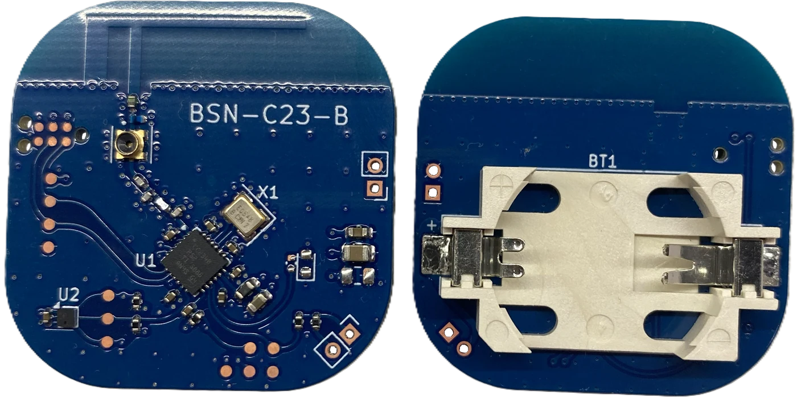
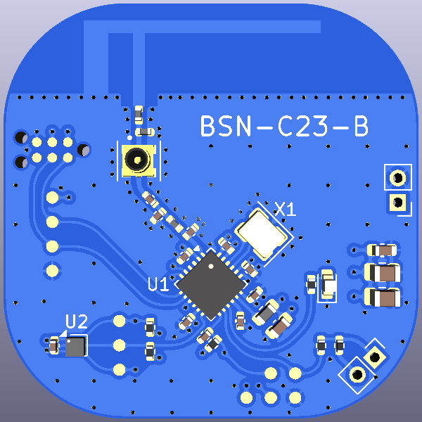
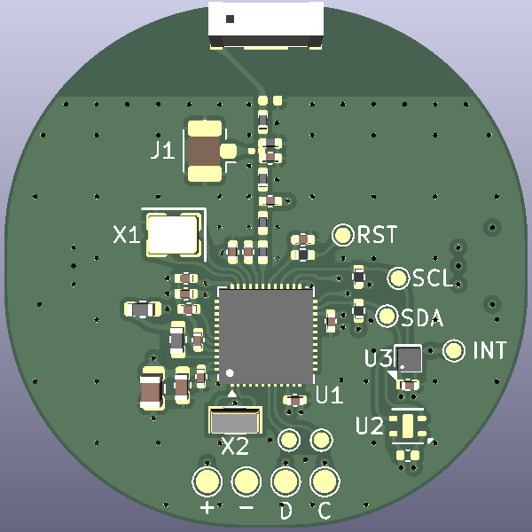
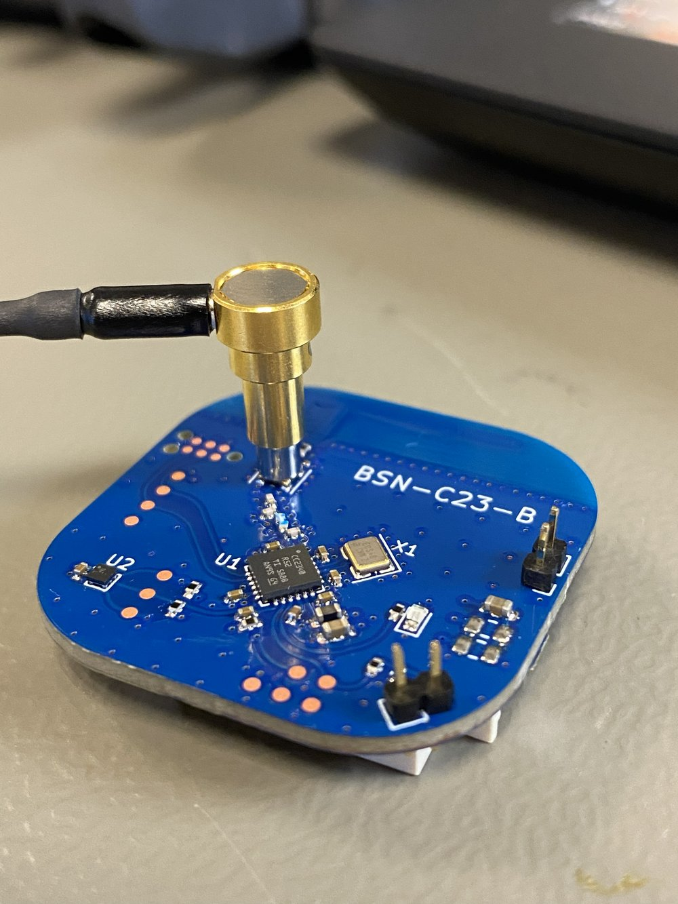
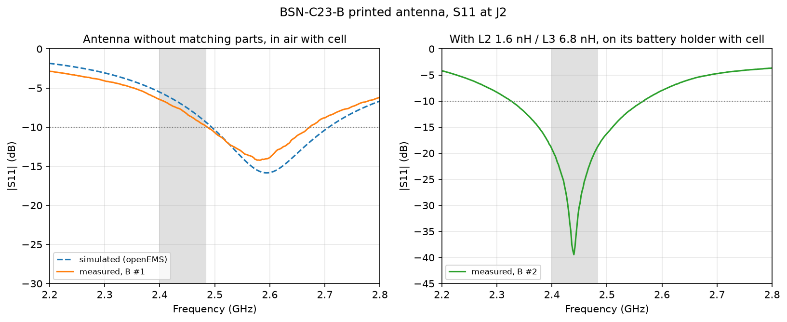
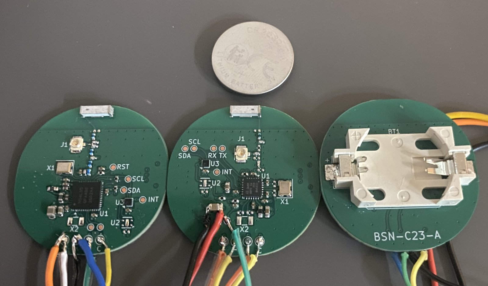

# BLE Sensor Node

**BEng in Electronics Engineering thesis project, focused on low-power design and RF performance.**

A compact, coin-cell-powered Bluetooth Low Energy sensor node that measures temperature and humidity and broadcasts
the data as [BTHome](https://bthome.io/) advertisements, without needing a persistent connection.



*Rev B, `BSN-C23-B`: the top with the printed antenna along the upper edge (left) and the back with the coin-cell
holder (right). 34 × 34 mm.*

## Goal

Keep the average current low enough for multi-year operation on a single CR2032 cell, in a compact size. Main areas
of work: low-power firmware and advertising strategy, antenna/RF performance (chip vs. trace antenna), and power
budgeting around the coin cell's current limits.

## Highlights

- **Two MCUs designed, built and measured side by side** on rev A: Nordic nRF54L05 (`BSN-N54`) and TI CC2340R5
  (`BSN-C23`), with the same sensors, antenna and board outline. The CC2340R5 was chosen for rev B, mainly on sleep
  current and with RF performance as a second factor ([`MCU_DECISION.md`](hardware/MCU_DECISION.md)).
- **4.8 µA average at a 5 s advertising interval, measured** on BSN-C23-A, with firmware that sends one advert
  per sensor reading and writes the new reading into the running advert. Every event (advert, sensor reading,
  payload reload, cold boot) was measured as a charge, which gives a current model for any setting. The model
  predicts 4.9 µA for this case. Sleep floor about 0.7 µA. At 4.8 µA a 225 mAh CR2032 would last about 5 years
  before derating ([power measurements](hardware/C23/testing/rev_A/Power/POWER_MEASUREMENTS.md)).
- **Rev A chip antenna matched on the VNA**, step by step from the unmatched antenna, with the board lifted off the
  bench (the wooden table under it had detuned the antenna) ([antenna matching](hardware/C23/testing/rev_A/RF/ANTENNA_MATCHING.md)).
- **Conducted harmonics measured on a spectrum analyser** and compared with ETSI EN 300 328 (−30 dBm, the
  standard for an EU product) and the stricter FCC restricted-band limit (−41.2 dBm). Formal EMC testing is out
  of scope, so the limits are a reference and results are given as margins. With no filter, H3 at 0 dBm is
  10.6 dB under ETSI and 0.6 dB over FCC on the C23, and 5.7 dB over ETSI on the N54. With the simple pi network
  from TI's reference design the C23 keeps at least 9.5 dB to FCC at +8 dBm. Nordic's reference design uses
  0201 parts. The N54 board uses 0402, so the PA network layout had to be adapted, which likely caused its loss
  of about 10 dB of output power. It was bypassed for the measurements ([C23](hardware/C23/testing/rev_A/RF/RF_CARRIER.md), [N54](hardware/N54/testing/RF/RF_CARRIER.md)).
- **Rev B trace antenna designed in openEMS on the real board, then measured.** A scripted pipeline exports the
  KiCad board (all four copper layers, vias, stack-up, the CR2032) to the FDTD solver on a compute server. The
  chosen inverted-F antenna simulated at −14.9 dB S11 or better across the BLE band with two matching parts. On
  the built board the VNA measured −12.0 dB or better with the simulated parts unchanged, with the resonance
  within 1.5 % of the simulated frequency. The simulated total efficiency is 80 to 91 %, not yet measured
  ([antenna write-up](hardware/C23/testing/RF/antenna_C23-B/README.md), [simulation pipeline](hardware/C23/testing/RF/sim/README.md),
  [VNA measurement](hardware/C23/testing/rev_B/RF/ANTENNA_MATCHING.md)).
- **Nine rev B boards hand-assembled and brought up**, all passing the 13-point hardware self-test. Seven
  have been seen advertising BTHome readings, decoded by a PC script. Rev B RF was checked on a spectrum analyser: carrier within
  ±0.7 ppm of the analyser reference on all three advertising channels, harmonics H2 to H4 below −54 dBm
  ([spectrum](hardware/C23/testing/rev_B/RF/SPECTRUM.md)).
- **Firmware for both MCUs** written to the same structure (bring-up self-test, BLE sensor, CW RF test, one power
  state per build) so the two can be measured the same way.

## Design

| `BSN-C23-B` (TI CC2340R5) | `BSN-N54-A` (Nordic nRF54L05) |
|---|---|
|  |  |
| [Schematic](hardware/C23/schematic.pdf) · [PCB](hardware/C23/PCB.pdf) · [README](hardware/C23/README.md) | [Schematic](hardware/N54/schematic.pdf) · [PCB](hardware/N54/PCB.pdf) · [README](hardware/N54/README.md) |

4-layer, 34 × 34 mm board with an HDC2010 temperature/humidity sensor, the CR2032 holder on the back and test
points for SWD, UART, I2C and the sensor interrupt.

- **Rev A (both variants):** 15.5 mm corner radii (close to round), chip antenna with a pi matching network, an
  optional U.FL connector for conducted RF tests and an SHTC3 footprint as an alternative sensor.
- **Rev B (C23 only):** 10 mm corner radii, an inverted-F antenna printed on the top layer, an MM8130 switch
  connector for VNA measurements of the antenna match, a Tag-Connect footprint for SWD, UART TX and a BOOT pin for
  the ROM bootloader, and a 0 Ω link in the supply for the ammeter. The pi network is unchanged from rev A.

## Status

Rev A of both variants was compared (thesis test T0). **Rev B uses the TI CC2340R5 (`BSN-C23-B`)** with a PCB trace
antenna, and the N54 variant stops at rev A. Rev B was ordered on 2026-11-04 (tag `hw/BSN-C23-B`) and assembled
from 2026-11-13. A rev C will only be made if the rev B tests show it is needed and there is time.

Why the CC2340R5:

- **Lower average current at the intervals this node uses.** The N54 needs 40–50 % less charge per advert and per
  reading, but its 4.2 µA sleep floor outweighs that from about a 1.3 s interval upwards. At 5 s the C23 measured
  4.8 µA and the N54 6.1 µA (table below). The C23 got there in two steps. The first full firmware measured 6.5 µA,
  because in the TI stack every payload reload (stopping the advert, loading the new reading, restarting it) costs
  about 20 µC. The firmware was then changed to skip the reload and write each new reading into the running
  advert, which brought it down to 4.83 µA.
- **A working RF chain.** The C23 keeps a margin to the harmonic limits with the simple pi network from TI's
  reference design, so rev B could start from an RF chain that works. The N54 would need a new harmonic filter and
  another RF iteration.
- **A simpler, cheaper part.** A 4 × 4 mm, 24-pin package against 6 × 6 mm and 48 pins for the nRF54L05, and a
  lower unit price.

Together that made the C23 the simpler and lower-risk base for the next revision.

### Rev B results



The antenna match is measured through an MM8130 switch connector between the chip and the antenna. Plugging in
the probe (right) disconnects the chip side, so the VNA sees only the antenna and its two matching parts, with
no parts moved.



*S11 of the rev B antenna at the MM8130 connector. Left: the antenna without matching parts, openEMS simulation
against measurement. Right: with L2 1.6 nH and L3 6.8 nH from the simulation, measured with the board standing on
its battery holder with the cell, the typical placement. Worst S11 in the BLE band (grey) −18.8 dB.*

The antenna is sensitive to what is around it. Lying flat on a table it is detuned by about 330 MHz. A plastic
enclosure close to the antenna would also lower the resonance, so the match would need retuning in the final
housing. The enclosure is out of scope, as this project covers the electronics and not the mechanical design.

| | `BSN-C23-B` | Notes |
|---|---|---|
| Bring-up | 9 boards, all 13/13 in the hardware self-test | Hand-assembled |
| Antenna match, worst S11 in 2.40–2.48 GHz | −12.0 dB in the air, −18.8 dB standing on the battery holder | Simulated −14.9 dB. Lying flat on a table detunes it by about 330 MHz |
| Carrier frequency | Within ±0.7 ppm of the analyser reference | 2402, 2440 and 2480 MHz, no crystal retrim needed |
| Conducted power at the antenna connector | +2.4 dBm at the +8 dBm setting, −4.7 dBm at the 0 dBm setting | Probe loss not yet corrected |
| Harmonics at +8 dBm, conducted | H2 to H4 below −54 dBm. H5 −40.9 dBm: 10.9 dB under ETSI, 0.3 dB under FCC | Probe loss not corrected, the true level is higher. H5 is about 10 dB worse than rev A with the same filter parts, cause not investigated |
| Supply current, continuous carrier at 3.0 V | 6.14 mA at 0 dBm, 14.20 mA at +8 dBm | Sets the coin-cell budget for a radiated test |

Details: [`hardware/C23/README.md`](hardware/C23/README.md), [`hardware/C23/testing/rev_B`](hardware/C23/testing/rev_B).

### Rev A comparison



*Rev A: `BSN-N54-A` (left), `BSN-C23-A` (middle) and the back of `BSN-C23-A` with the coin-cell holder.*

| | `BSN-C23-A` | `BSN-N54-A` |
|---|---|---|
| **Average current, 5 s advertising, measured (model)** | **4.83 µA** (4.9 µA). One advert per sensor reading, reading written into the running advert | **6.1 µA** (6.01 µA). Sensor every 10 s |
| Sleep floor | About 0.7 µA (0.70 µA on the no-filter board, the datasheet typical is 0.71 µA. An early 0.37 µA on board #1 did not repeat) | 4.20 µA (System OFF 2.05 µA, both about 1.4 µA above the datasheet, cause not found) |
| Charge per advert, 0 dBm | 12.6 µC | 7.6 µC |
| Charge per sensor reading, timer / DRDY wake | 9.56 / 3.72 µC | 2.01 / 1.78 µC |
| Charge per payload reload | About 20 µC in the TI stack (6.5 µA at 5 s with a reload every 10 s). Later skipped by writing the reading into the running advert | No such cost |
| Conducted power at the 0 dBm setting, no filter (same spectrum analyser setup, cable loss not corrected) | −1.7 dBm (−3.2 dBm with the pi network) | −0.7 dBm (PA network bypassed) |
| Harmonics with no filter, 0 dBm (conducted, worst is H3) | H3 −40.6 dBm: 10.6 dB under ETSI (−30 dBm), 0.6 dB over FCC (−41.2 dBm) | H3 −24.3 dBm: 5.7 dB over ETSI, 17 dB over FCC |
| Harmonic filter | Pi network from TI's reference design. At +8 dBm (2440 and 2480 MHz) at least 9.5 dB under FCC (H5) | Nordic's reference design uses 0201 parts, this board uses 0402, so the PA network layout was adapted. It lost 10–11 dB of output power, likely because of the adapted layout, and was bypassed. No working filter on this layout |
| Notes | [`hardware/C23/testing`](hardware/C23/testing) | [`hardware/N54/testing`](hardware/N54/testing) |

Rev A boards:

| Board | MCU | Status |
|---|---|---|
| `BSN-N54-A` | nRF54L05 | Ordered and assembled (2 boards). Board #1 advertising BTHome. Board #2 (U.FL): HFXO trimmed to 11.75 pF, PA network bypassed (the rev A layout of it loses 10 dB), 0.0 dBm at the 0 dBm setting. Floor 4.20 µA, 7.6 µC per advert |
| `BSN-C23-A` | CC2340R5 | Ordered and assembled. Board #1 flashed and advertising BTHome, antenna matched with the board lifted off the bench (L2 4.3 nH, L3 2.1 pF). Floor about 0.7 µA, 12.6 µC per advert, about 20 µC per payload reload in the TI stack, 4.83 µA at 5 s with the reading written into the running advert. CW boards with and without the PA pi network |

Open questions:

- The N54 floor sits about 1.4 µA above the datasheet on both boards. Not needed for the MCU choice, but still being
  looked into for the thesis.

### Next

- **Rev B power:** average current on a real CR2032 at a 5 s interval, the VDD dip during TX, and the battery-life
  projection.
- **Range:** line-of-sight range test of the rev A chip antenna and the rev B trace antenna in one session.
- **Radiated:** pattern, total radiated power and the radiated H5 level in the anechoic chamber at the university,
  if a slot can be arranged.
- **Rev C** (optional): only if rev B needs fixes and time allows.

## Repository Structure

```
hardware/
  MCU_DECISION.md   Why rev B uses the CC2340R5
  C23/              BSN-C23 - TI CC2340R5 variant: KiCad project, schematic/PCB PDFs, testing/
  N54/              BSN-N54 - Nordic nRF54L variant (concluded at rev A)
firmware/
  C23/              Firmware for BSN-C23 boards (TI SimpleLink SDK)
  N54/              Firmware for BSN-N54 boards (nRF Connect SDK)
docs/
  datasheets/       Links to the datasheets and application notes used
  images/           Photos
```

The two MCU candidates are different chips (different pinout, power tree and BOM) rather than build options of one
board, so each has its own KiCad project under `hardware/<variant>/` and its own `firmware/<variant>/`. The N54
folders stay as the record of the rev A comparison. Only the C23 variant continues.

Test results live next to the board they were measured on, in `hardware/<variant>/testing/`, with the bring-up
procedures in `firmware/<variant>/BRINGUP.md`. The C23 rev A measurements are in `hardware/C23/testing/rev_A/`, the
rev B antenna simulations in `hardware/C23/testing/RF/`. The schematic and PCB PDFs always show the latest revision of each
board. Older revisions are in the KiCad files at their `hw/BSN-<variant>-<rev>` tags.

## Naming Scheme

Each board is identified as **`BSN-<variant>-<revision>`**, e.g. `BSN-C23-A`.

```
BSN-C23-A
 │   │  └─ PCB revision  (A, B, C …)
 │   └──── MCU variant   (C23 = TI CC2340R5, N54 = Nordic nRF54L)
 └──────── Board name    (BSN = BLE Sensor Node)
```

- **Variant:** first letter of the MCU part prefix (**n**RF54 → N, **C**C2340 → C) + MCU family number. Each variant
  has its own revision counter.
- **Revision:** bare-PCB revision, bumped only when new boards are ordered. Once gerbers are sent to the fab that
  letter is frozen. The ordered commit is tagged `hw/BSN-<variant>-<rev>`.
- **Assembly option** *(optional)*, e.g. `-UFL`: a population option on the same bare PCB. Does not change the
  revision.
- **Reworked boards** are marked `A*`, with the rework noted in the variant README.
- **The ID is on the board itself:** set in the KiCad title block and printed on the silkscreen. The firmware board
  target is `BSN_C23` / `BSN_N54`.
