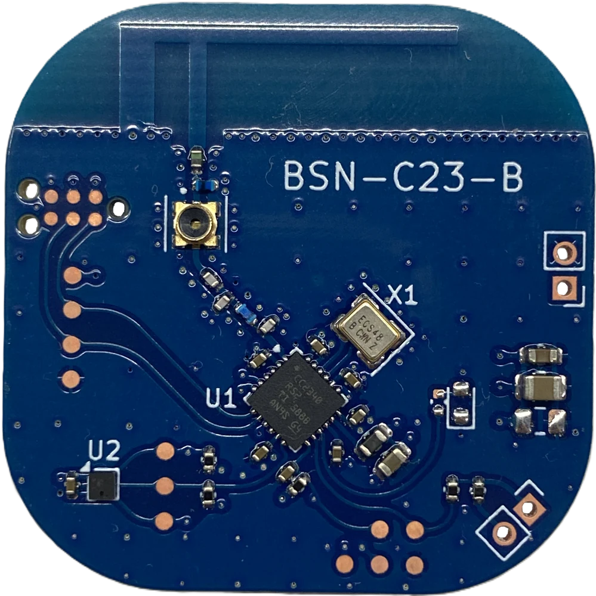

# BSN-C23 (TI CC2340R5 variant)

KiCad project: `BSN-C23.kicad_pro`. See the root README for the board naming scheme. The KiCad files, the
schematic and PCB PDFs and the render show rev B. Rev A is at the tag `hw/BSN-C23-A`.

## Rev B (`BSN-C23-B`)

Ordered 2026-11-04 (tag `hw/BSN-C23-B`), nine boards hand-assembled from 2026-11-13. Same 34 × 34 mm, 4-layer board as rev A, with the
changes the rev A tests asked for. Several reference designators changed from rev A, the tables below use the rev B
names.

**Changes from rev A:**

- **Printed inverted-F antenna** (AE1, footprint `IFA_2G4`) on F.Cu along the top edge instead of the chip
  antenna. Designed with openEMS on the real board, see the [antenna write-up](testing/RF/antenna_C23-B/README.md)
  and the [simulation pipeline](testing/RF/sim/README.md). The footprint is generated by
  [`library/gen_ifa_footprint.py`](library/gen_ifa_footprint.py).
- **Corner radius 10 mm** (15.5 mm on rev A). It gives the IFA a straight ground edge of about 14 mm.
- **MM8130 switch connector (J2) instead of the U.FL.** Inserting the probe disconnects the chip side, so the VNA
  sees only the antenna and its match (L2, L3), without moving parts. The 15 pF DC block (C7) stays between the
  chip and J2.
- **Pi network, same parts** (C8, L1, C9, the rev A C7, L1, C8), but the RF path around it is not identical to
  rev A: J2 (MM8130) now sits between the pi network and the antenna, the routing bends, there is no U.FL stub,
  and the vias are placed differently. The rev B harmonics were measured on 2026-11-17 (see
  [`testing/rev_B/RF/SPECTRUM.md`](testing/rev_B/RF/SPECTRUM.md)): H5 is about 10 dB worse than rev A relative
  to the carrier, cause not investigated.
- **0 Ω link R1 in the supply** (VBAT to VDD), with the 2-pin header J1 across it for the ammeter. J4 is a 2-pin
  VDD/GND header for an external supply.
- **Programming and UART:** Tag-Connect TC2030-NL footprint (J3) for SWD. UART TX moved to DIO6, so with RX on
  DIO20 the ROM bootloader works over a plain USB-UART adapter. BOOT pin on DIO3 with a 100 kΩ pull-up (R4) and TP1.
- **LED D1** (with R2 1 kΩ) on DIO4, DNP by default.
- **HDC2010 INT moved from DIO21 to DIO13.** DIO21 is also the ROM bootloader's default trigger pin.
- **Removed:** U2 SHTC3 footprint, X2 (32 kHz crystal) and its load caps, the external 48 MHz load caps (the
  internal HFXT cap array trims X1). The HDC2010 is now U2.

**Population:** DNP = C6 (100 µF), D1, R2, J1, J4. AE1, J3 and the test points are copper only.

**RF network as fitted** (antenna-side values from the simulation, kept after the VNA measurement of 2026-11-13,
see [`testing/rev_B/RF/ANTENNA_MATCHING.md`](testing/rev_B/RF/ANTENNA_MATCHING.md)):

| Ref | Value | Part | Function |
|---|---|---|---|
| C8, C9 | 1.5 pF | 490-8087-1-ND | Pi network, shunt (as rev A) |
| L1 | 2.8 nH | LQW15AN2N8G80D | Pi network, series (as rev A) |
| C7 | 15 pF | 490-11191-1-ND | DC block |
| J2 | MM8130-2600RA2 | 490-4981-1-ND | Switch connector, VNA probe on the antenna side |
| L2 | 1.6 nH | LQG15WZ1N6B02D | Antenna match, series |
| L3 | 6.8 nH | LQW15AN6N8G80D | Antenna match, shunt at J2 |
| AE1 | IFA | `IFA_2G4` (printed) | Antenna |

**Pin map** (CC2340R5 VQFN-24):

| Signal | DIO | Pin | Test point | Change from rev A |
|---|---|---|---|---|
| I2C SDA | DIO12 | 5 | TP3 | |
| I2C SCL | DIO24 | 12 | TP9 | |
| HDC2010 INT | DIO13 | 6 | TP4 | was DIO21 |
| UART TX | DIO6 | 19 | TP2 | was DIO13 |
| UART RX | DIO20 | 9 | TP8 | |
| BOOT | DIO3 | 14 | TP1 | new |
| LED | DIO4 | 15 | | new |
| SWDIO / SWCLK | DIO16 / DIO17 | 7 / 8 | TP5 / TP7 | |
| nRESET | | 13 | TP6 | |

### Rev B boards and rework log

Bring-up details per board are in [`BRINGUP.md`](../../firmware/C23/BRINGUP.md). Measurements are in
[`testing/rev_B`](testing/rev_B).

| Board | Built as | Rework | Self-test | Use |
|---|---|---|---|---|
| B #1 | No 100 µF cap, J2 to the antenna, no R1 (supply through the J1 jumper) | 2026-11-13: L2 0 Ω and L3 open for the bare-antenna sweep, then L2 1.6 nH and L3 6.8 nH fitted | 13/13 (2026-11-16) | Antenna without parts, current measurements |
| B #2 | One 100 µF cap, J2 to the antenna, no R1 | 2026-11-19: battery holder torn off, solder mask scraped and the holder soldered back on. Pi network removed: C8 and C9 off, L1 bridged with solder. Later the same day the pi network refitted (C8, C9 1.5 pF, L1 2.8 nH, bridge removed) | 13/13 (2026-11-13), not repeated after the rework | VNA match with L2 1.6 nH and L3 6.8 nH. Radiated pattern and harmonics in the chamber (2026-11-19), with and without the pi network |
| B #3 | Two 100 µF caps, J2 rotated 180° about the axis normal to the board, so the probe sees the PA side and disconnects the antenna, no R1 | 2026-11-13: L2 1.6 nH and L3 6.8 nH fitted | 13/13 (2026-11-16) | Continuous carrier: conducted power, harmonics, supply current |
| B #4 | One 100 µF cap, J2 to the antenna, R1 0 Ω | 2026-11-16: U2 (HDC2010) replaced after a hand-soldering fault found by `hwtest` | 13/13 (2026-11-16) | `ble_sensor` |
| B #5 to B #9 | One 100 µF cap, J2 to the antenna, R1 0 Ω | – | 13/13 (2026-11-16) | `ble_sensor` |

All nine boards have L2 1.6 nH and L3 6.8 nH. B #1 to B #3 run from the coin cell only with the jumper on J1.

## Rev A (`BSN-C23-A`)

This project started as a copy of `BSN-N54-A` (board outline, power, sensors, antenna and
test points), with the MCU, power tree, 48 MHz crystal, RF network and SWD pins replaced for the
CC2340R5. Rev A was exported and ordered as a separate design (not panelized).

**Population:** DNP = U2 (SHTC3), X2 (32 kHz, LFOSC is used instead), C9, C14, C15, C16, C19, C20,
J1 (U.FL), L4. Everything else is fitted.

**RF network as fitted** (π network C7, C8, L1 from the TI reference design, L2 and L3 from the evaluation board in the
AANI-CH-0138-Q datasheet, not tuned for this board):

| Ref | Value | Part |
|---|---|---|
| C7, C8 | 1.5 pF | 490-8087-1-ND |
| L1 | 2.8 nH | LQW15AN2N8G80D |
| C6 | 15 pF | 490-11191-1-ND |
| L2 | 6.7 nH | LQW15AN6N7B00D |
| L3 | 7.3 nH | 490-6844-1-ND |
| AE1 | Chip antenna | AANI-CH-0138-Q-T |

**Tuned antenna match** (VNA, board lifted off the bench, see below): L2 = **4.3 nH**, **2.1 pF** on the
L3 pads instead of the 7.3 nH. Fitted on board #1 (2026-10-26).

### Bring-up status

Procedure and per-board results: [`firmware/C23/BRINGUP.md`](../../firmware/C23/BRINGUP.md).

| Board | BLE address | Status |
|---|---|---|
| #1 | FC:DE:C5:73:2F:4E | Flashes over SWD. `hwtest` 13/13 PASS. `ble_sensor` advertises BTHome and readings are received on the PC with `tools/bsn_scan.py`. A\*: antenna side matched (L2 4.3 nH, 2.1 pF on the L3 pads). **U2 (SHTC3) is fitted.** Floor 0.366 µA on 2026-10-26, 0.94 µA on 2026-11-10 (cause not found), 16.1 µA with 1 s advertising, see [Current measurements](#current-measurements). |
| RF test | (no MCU) | Antenna-only board used for VNA matching, see below. |
| RF CW | | MCU, X1, pi network (C7/L1/C8) and J1 only, no antenna. Used with `cwtest` for the carrier frequency and output power, see [`testing/rev_A/RF/RF_CARRIER.md`](testing/rev_A/RF/RF_CARRIER.md): HFXT trim set to 44 (+2.2 ppm), +6.7 dBm at the +8 dBm setting. |
| RF CW no-pi | | As RF CW, but with the PA-side pi network removed (see the rework log). `hwtest` PASS. For the conducted power and harmonics comparison with RF CW. |

### Current measurements

Full notes and data: [`testing/rev_A/Power/POWER_MEASUREMENTS.md`](testing/rev_A/Power/POWER_MEASUREMENTS.md).

Board #1 at 3.0 V: sleep floor **0.366 µA** (with or without the BLE stack). This did not repeat: on 2026-11-10 board #1 read 0.94 µA and the no-pi board 0.70 µA, close to the datasheet typical of 0.71 µA, so the floor is taken as about 0.7 µA. With one advert per sensor reading and the reading written into the running advert, the average at 5 s is **4.83 µA** (model 4.9 µA). One advertising event at 0 dBm costs
**12.6 µC** (+34 % at 2.0 V, −8 % at −8 dBm, +116 % at +8 dBm). A sensor reading costs **9.56 µC** with timer polling
and **3.72 µC** when the HDC2010 auto mode wakes the MCU over DRDY. The full `ble_sensor` (1 s advertising, sensor
every 10 s) averages **16.1 µA**. The SHTC3, if fitted, idles at about 45 µA after power-on until the firmware puts it
to sleep. Always clear the debug state with a full power-on reset before measuring (see the notes).

### Antenna matching

Full notes and data: [`testing/rev_A/RF/ANTENNA_MATCHING.md`](testing/rev_A/RF/ANTENNA_MATCHING.md).

The datasheet values for L2 and L3 don't fit this layout. At 2.44 GHz the bare antenna is about 6.4 − j13 Ω (flat on
the table), and 6.7 nH for L2 is about 1.5 times the 4.3 nH of the final match. On the RF-only test board (Keysight P9370B through J1):

| Date | Configuration | L2 (series) | L3 pads (shunt) | S11 at 2.44 GHz | Worst in 2.40–2.48 GHz |
|---|---|---|---|---|---|
| — | Antenna datasheet | 6.7 nH | 7.3 nH | not measured | — |
| 2026-10-23 | Matched, flat on a wooden table | 3.3 nH | 2.0 pF | −18.8 dB | −11.0 dB |
| 2026-10-23 | Same, lifted | 3.3 nH | 2.0 pF | −3.1 dB (9.5 + j12.3 Ω) | — |
| 2026-10-26 | **Matched, lifted** | **4.3 nH** | **2.1 pF** | **−32.1 dB** | **−10.3 dB** |

The first match was tuned flat on a wooden table, which detuned the antenna. Lifted about 5 mm (by the battery
holder), the impedance was about the same as with the board hanging in the air, and the coin cell in or out made
almost no difference. **Use 4.3 nH + 2.1 pF**, and tune with the board lifted or in its final position.
Until they are fitted on a working board, RSSI and range numbers from board #1 (reference values) are
only a pre-tuning baseline.

### Rework log

Hand-modified boards are marked `A*` (see the root README).

| Board | Date | Change | Reason |
|---|---|---|---|
| RF test | 2026-10-23 | No MCU, C8 or L1. J1 (U.FL) fitted, one 15 pF series bridged, L2 = 3.3 nH, 2.0 pF on the L3 pads | Antenna matching with a VNA |
| RF test | 2026-10-26 | Battery holder fitted, L2 = 4.3 nH, 2.1 pF on the L3 pads | Re-match with the board lifted off the table |
| #1 | 2026-10-26 | L2 = 4.3 nH, 2.1 pF on the L3 pads (antenna side). PA-side pi network unchanged (TI reference) | Fit the tuned match |
| RF CW no-pi | 2026-10-27 | MCU, X1 and J1 only. C7 and C8 not fitted, L1 shorted with solder, 15 pF series cap to J1 kept as the DC block | Check whether the pi network is needed for harmonics, and its effect on output power |
| FC:DE:C5:73:2F:53 (by the user's memory the RF CW board, to confirm) | 2026-11-19 | `hwtest` before the rework: HDC2010 ID FAIL, nothing on the I2C bus, because U3 was not fitted. L5 (10 µH DC/DC inductor) found missing and fitted. U3 (HDC2010) fitted and the board powered without a short check. SDA and SCL were shorted, found and removed after, **the MCU or U3 may be damaged**. After the rework the application does not start: after two clean power cycles (J-Link off the header, 30 s off) the CPU sits in the boot ROM (PC 0x0F0024E8) with the `hwtest` image intact in flash. Cause not found | Bring the board to a working state for the soak and range tests. If L5 was missing during earlier measurements on this board, those ran without the DC/DC converter (not checked which measurements) |

Known issues to fix in rev B are listed at the end of [`BRINGUP.md`](../../firmware/C23/BRINGUP.md#notes-for-rev-b).

## CC2340R5 design resources

There is no CC2340 part in the official KiCad library and no TI equivalent of Nordic's
KiCad design blocks, so the design blocks table is empty for now.

| Resource | Format | Link |
|---|---|---|
| CC2340R5 symbol + footprint + STEP (RGE VQFN-24 4x4) | KiCad v6+ export via Ultra Librarian (free login) | https://vendor.ultralibrarian.com/TI/embedded/?gpn=CC2340R5&package=RGE&pin=24 |
| LP-EM-CC2340R53 LaunchPad design files (uses the 40-pin RKP package, but the RF, crystal and DC/DC circuits carry over) | Allegro/OrCAD + schematic/layout PDF, BOM, Gerbers, ODB++ | https://www.ti.com/lit/zip/SWRC397 |
| LP-EM-CC2340R53 user guide | PDF | https://www.ti.com/lit/pdf/SWRU637 |
| CC234x/CC27xx hardware configuration & PCB design (SWRA834) | PDF | https://www.ti.com/lit/pdf/SWRA834 |
| Product page (packages, docs) | Web | https://www.ti.com/product/CC2340R5 |

### CC2340R5 part in the `BSN-C23` library

| Part | Symbol | Footprint | 3D model |
|---|---|---|---|
| CC2340R52E0RGER (VQFN-24 4x4) | `CC2340R52E0RGER` | `Texas_RGE0024B_VQFN-24-1EP_4x4mm_P0.5mm_EP2.45x2.45mm_ThermalVias` | `Texas_RGE0024H_VQFN-24-1EP_4x4mm_P0.5mm_EP2.7x2.7mm.step` |

These were made here from the datasheet and KiCad's stock library rather than downloaded:

- **Symbol:** drawn from the datasheet (SWRS272F), Figure 6-2 and Tables 6-1 to 6-13. The exposed pad is pin 25 (GND).
- **Footprint:** KiCad's stock `VQFN-24-1EP_4x4mm_P0.5mm_EP2.45x2.45mm_ThermalVias`, renamed. It matches TI's RGE0024B land pattern (2.45 mm pad, 9 vias on a 0.975 mm grid). The signal pads are 0.775 mm long versus 0.6 mm in TI's example.
- **3D model:** KiCad has no STEP file for the 2.45 mm pad version. This one is the TI RGE0024H body, which is identical apart from a 2.7 mm exposed pad hidden under the package.