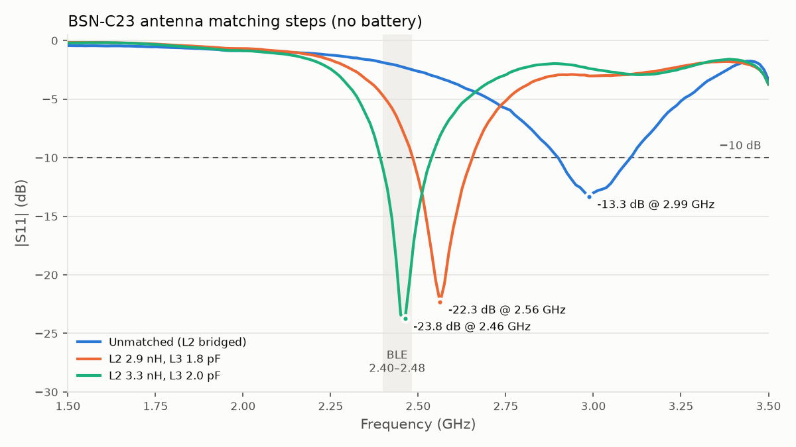

# BSN-C23-A antenna matching (2026-10-23)

Matching the AE1 chip antenna (Abracon AANI-CH-0138-Q-T) to 50 Ω on a Rev A board, measured with a
Keysight P9370B VNA through J1 (U.FL).

**Result:** with **L2 = 3.3 nH (series)** and **2.0 pF on the L3 pads (shunt)**, S11 is better than
−11 dB across 2.40–2.48 GHz and −18.8 dB at 2.44 GHz, **without the battery**. Fitting the battery
detunes the antenna to 9.5 + j12.3 Ω (−3.1 dB) at 2.44 GHz, so the match still has to be redone with
the battery in place (see [Open items](#open-items)).



## Test board and network

The board is an RF-only test board: no MCU, no C8 and no L1. Only J1, the matching network and AE1
are fitted, so J1 sees just the antenna path.

Topology (schematic reference designators):

```
J1 (U.FL) ── 15 pF series (DC block, C9/C6) ── node ── L2 series ── AE1 feed
                                                │
                                         L3 pads (shunt to GND)
```

- One 15 pF series cap was kept as a DC block, and the other series position was bridged. At 2.44 GHz a 0402
  15 pF cap is close to its self-resonance, and swapping it for a short made no measurable difference
  (3.1 + j18.2 vs 3.1 + j18.1 Ω).
- The shunt position used is the L3 pads (between the DC block and L2). The L4 pads (shunt at the
  antenna side) stayed empty. Shunt-first at the antenna can't reach 50 Ω here because the antenna's
  parallel resistance is below 50 Ω.
- Starting point was the TI reference values (C6 15 pF, L2 6.7 nH, L3 7.3 nH shunt), which were not
  tuned for this layout.

## Measurement setup

- Keysight P9370B, 1 port, 1.0–3.5 GHz, 201 points.
- 1-port calibration at the end of the cable, then the reference plane moved to the board with port
  extension (open, including loss).
- Checks of the reference plane (files 01 and 02):
  - Short: 1.5 + j0.0 Ω at 2.44 GHz, so the reference plane is at the board. About 1.5 Ω of residual
    loss/error remains.
  - Open: |Γ| ≈ 1.06 at 2.44 GHz (slightly above 1, so the loss compensation is a bit too high). Good
    enough to tune with, but resistances of a few ohms near the chart edge aren't accurate.
- Moving or holding the cable barely changed the readings, so cable-shield currents are not a
  significant error on this setup.

### First attempt: uncorrected cable (data not kept)

The first readings were single points taken with the reference plane at the VNA, not at the board:

| Network | Z at 2.44 GHz |
|---|---|
| 2 × 15 pF + 6.7 nH, L3 removed | 3.1 + j18.2 Ω |
| same + 3.9 pF on L3 pads | 50 − j265 Ω |
| 15 pF caps shorted, 6.7 nH, no shunt | 3.1 + j18.1 Ω |
| same + 5.1 pF on L3 pads | 18.4 − j126 Ω |

Values calculated from these readings never landed where predicted. A 1.0–3.5 GHz sweep then showed
series and parallel resonances repeating every ~0.25 GHz, which is the signature of an extra line, not
of an antenna. The S11 phase slope gave a round-trip delay of about 2.1 ns, i.e. about 22 cm of
uncorrected coax. All the readings above are rotated by that cable and can't be used. After moving
the reference plane to the board (previous section), the measurements below are consistent.

## Measurements

All files are the VNA's CSV export (frequency, R, X in ohms). Z at 2.40 / 2.44 / 2.48 GHz, with S11
in brackets:

| File | Network | 2.40 GHz | 2.44 GHz | 2.48 GHz | Worst in band | Best match |
|---|---|---|---|---|---|---|
| [`s11_01_check_short.csv`](s11_01_check_short.csv) | Short at the board (check) | 1.3 − j0.7 | 1.5 + j0.0 | 1.7 + j0.7 | — | — |
| [`s11_02_check_open.csv`](s11_02_check_open.csv) | Open (check) | \|Γ\| 1.05 | \|Γ\| 1.06 | \|Γ\| 1.07 | — | — |
| [`s11_03_antenna_unmatched.csv`](s11_03_antenna_unmatched.csv) | 15 pF, L2 solder-bridged, no shunt | 5.9 − j14.7 (−1.9 dB) | 6.4 − j13.0 (−2.1 dB) | 7.3 − j11.3 (−2.4 dB) | −1.9 dB | −13.3 dB @ 2.99 GHz |
| [`s11_04_L2-2n2.csv`](s11_04_L2-2n2.csv) | 15 pF, L2 2.2 nH | 13.8 + j6.0 (−4.8 dB) | 16.5 + j11.1 (−5.6 dB) | 20.2 + j16.5 (−6.5 dB) | −4.8 dB | −8.4 dB @ 2.64 GHz |
| [`s11_05_L2-2n9.csv`](s11_05_L2-2n9.csv) | 15 pF, L2 2.9 nH | 16.0 + j11.1 (−5.4 dB) | 19.5 + j17.3 (−6.2 dB) | 24.7 + j23.9 (−7.1 dB) | −5.4 dB | — |
| [`s11_06_L2-2n9_L3-1p8.csv`](s11_06_L2-2n9_L3-1p8.csv) | 15 pF, L2 2.9 nH, L3 1.8 pF | 13.9 + j10.2 (−4.7 dB) | 19.3 + j13.7 (−6.4 dB) | 26.9 + j14.9 (−9.1 dB) | −4.7 dB | −22.3 dB @ 2.56 GHz |
| [`s11_07_L2-3n3_L3-2p0.csv`](s11_07_L2-3n3_L3-2p0.csv) | **15 pF, L2 3.3 nH, L3 2.0 pF** | 30.1 + j11.2 (−11.0 dB) | **41.3 + j5.8 (−18.8 dB)** | 45.2 − j7.5 (−20.6 dB) | **−11.0 dB** | **−23.8 dB @ 2.46 GHz** |
| (no file, single reading) | same as 07, **battery fitted** | — | **9.5 + j12.3 (−3.1 dB)** | — | — | — |

Impedances in ohms. "In band" is 2.40–2.48 GHz.

## What was learned

1. **Unmatched antenna (03):** on this board AE1 has its series resonance at 2.69 GHz. At 2.44 GHz it
   is about 6.4 − j13 Ω: low resistance and slightly capacitive. The TI reference value of 6.7 nH for
   L2 is about three times too much inductance for this layout.
2. **Solder bridge vs. real part (03 → 04):** going from a solder blob to a 2.2 nH inductor at L2 also
   changed the *resistance* curve (6.4 → 16.5 Ω at 2.44 GHz, and the antenna's resonances moved about
   300 MHz lower). A series inductor can only add reactance, so the large blob itself changed how the
   antenna is fed. **Use a 0 Ω 0402 resistor instead of a solder blob for "bridged" measurements.**
3. **Calculated values only approximately hold:** each step was predicted from the previous sweep,
   but the parts, pads and rework shift the result by about one standard value. Tuning worked by
   changing one or two parts at a time, sweeping, and reading where the match had moved.
4. **Shifting the matched frequency (06 → 07):** with 2.9 nH + 1.8 pF the network was already matched
   (−22 dB), but at 2.56 GHz. Scaling both parts by (2.56 / 2.44)² ≈ 1.1 (→ 3.3 nH + 2.0 pF) moved the
   match to 2.46 GHz as predicted.
5. **Battery (07 vs. battery reading):** with the network values removed, the antenna alone goes from about
   13.8 − j31 Ω without the battery to about 4.8 − j41 Ω with it. Its resistance roughly drops to a
   third, because the battery sits in the antenna's near field. That costs efficiency that matching
   can't recover.

## Open items

- [ ] **Re-match with the battery in its final position.** From the single battery reading, the
      calculated match is about L2 = 3.6 nH and 3.9–4.0 pF on the L3 pads. Expect to trim by one
      value. Save a full sweep (`s11_08_...csv`) with the battery fitted.
- [ ] Check the final match in the enclosure, if there is one.
- [ ] Confirm on a working board with the radio: compare RSSI with `tools/bsn_scan.py` at a fixed
      distance and orientation for the TI reference values, the new values, and one step either side.
- [ ] Rev B: move the battery further from AE1, or at least outside the antenna keep-out area in the
      AANI-CH-0138 datasheet.
- [ ] Update the RF network table in [`../README.md`](../README.md) once the battery-in values are final.
