# C23 rev B antenna: the chosen design

Simulation results of the rev B antenna as ordered (2026-11-04): an inverted-F antenna printed on F.Cu along the
top edge of the 34 x 34 mm board (footprint `IFA_2G4`, ref AE1), matched with L2 1.6 nH in series and L3 6.8 nH
as a shunt at J2. The design search and the reasons for this choice are in
[`../sim/results/RECOMMENDATION.md`](../sim/results/RECOMMENDATION.md). Everything here is simulated with openEMS
(FDTD). Nothing has been measured yet.

## Summary

| quantity | value | from |
|---|---|---|
| frequency band | BLE 2400-2483.5 MHz | |
| antenna self-resonance (L2 0R, L3 open) | 2.594 GHz, -15.8 dB | 1-port run |
| impedance at J2, 2.44 GHz, no parts | 28.1 - 29.7j Ω | 1-port run |
| matching | L2 1.6 nH series (Murata LQG15WZ1N6B02D), L3 6.8 nH shunt (Murata LQW15AN6N8G80D) | |
| matched S11, worst BLE channel | -14.9 dB | 3-port + part models |
| matched S11 minimum | -47.3 dB at 2.443 GHz | 3-port + part models |
| -10 dB bandwidth | 2367-2530 MHz (163 MHz) | 3-port + part models |
| worst BLE S11 with part tolerance and ±1 % frequency shift | -10.8 to -12.8 dB | 3-port + part models |
| total efficiency (50 Ω source at J2 to radiated power) | 85 / 89 / 88 % (-0.72 / -0.52 / -0.57 dB) at 2.40 / 2.44 / 2.48 GHz | efficiency budget |
| radiation efficiency of the board (no parts) | 90.5 / 91.5 / 92.5 % | 1-port run, calibrated |
| loss in L2 + L3 | 3.1 / 3.0 / 3.0 % | part models (Q 25 and 45) |
| directivity | 1.95-1.98 dBi | 1-port run |
| peak realised gain | 1.2 / 1.5 / 1.4 dBi | efficiency budget |

The efficiency numbers carry about ±5 % uncertainty from the far-field calibration (see Assumptions).

## Antenna and board

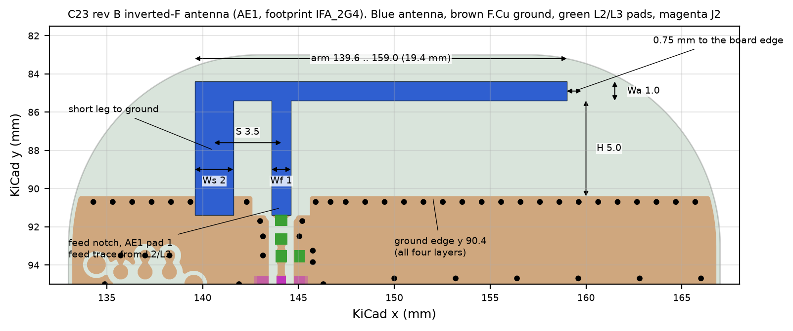

| dimension | value |
|---|---|
| arm height above the ground edge (H) | 5.0 mm (ground edge KiCad y 90.4, arm KiCad y 84.4-85.4) |
| arm width (Wa) | 1.0 mm |
| arm open end | KiCad x 159.0 (arm from x 139.6 to 159.0) |
| short leg width (Ws) | 2.0 mm |
| feed leg width (Wf) | 1.0 mm, at KiCad x 144.1 (sim x -5.9) |
| short leg to feed leg, centre to centre (S) | 3.5 mm |
| clearance to the board edge | 0.75 mm |

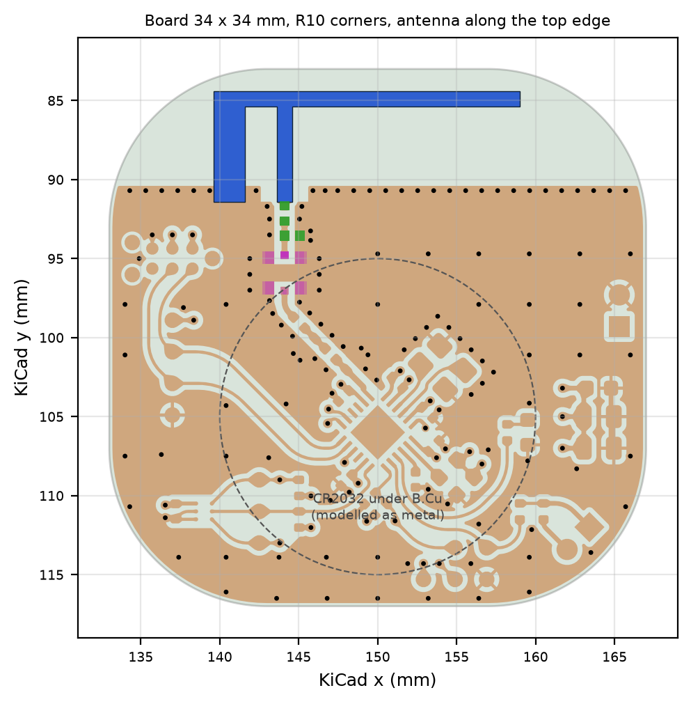

The board is 34 x 34 mm with R10 corners, 4 layers (JLC stack-up). The ground edge under the antenna is at
KiCad y 90.4, with a via fence at y 90.7. The CR2032 cell sits under B.Cu. L2 and L3 are between AE1 and J2 (the MM8130 test
connector on the antenna side). The pi network between J2 and the chip is not part of these simulations.

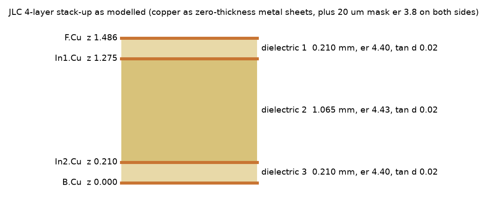

## Simulation model and assumptions

- **Board geometry** from the KiCad file with rounded tracks (export `../sim/build/b3/board.json`, 2026-11-04 11:01).
  The board file was saved again at 11:31. A re-export showed one change: 1.3 mm² less F.Cu pour around KiCad
  x 144-148, y 104-108, about 14 mm below the ground edge. Its effect on the antenna is likely negligible (not simulated).
- **Copper** zero-thickness perfect conductor. Copper loss is not in the model.
- **Dielectric** prepreg εr 4.4, core 4.43, tanδ 0.02 (JLC data). 20 µm solder mask modelled explicitly (εr 3.8).
- **Vias** solid metal barrels of the drill size.
- **CR2032** modelled as a metal disc, r 10 mm, 3.2 mm thick, 0.5 mm under B.Cu.
- **Port** at J2 pad 1, 50 Ω, from the J2 ground pads. L2 = 0R and L3 open in the 1-port run.
- **Matching (cascade)**: the 3-port run (ports at J2, across the L2 gap and across the L3 pads) is terminated with
  the part models Z = jωL + R, R = 2π · 2.44 GHz · L / Q, Q 25 for L2 and 45 for L3 (the values used when the
  parts were chosen).
  This keeps the real pad positions and the coupling between them.
- **Full-wave check**: one run with L2 and L3 as lumped series R-L elements inside the FDTD model.
  It uses the normal mesh, no solder mask, and 150 mm of air. The planned check with the parts on the fine mesh
  and mask (`29f9f0e89f`) was unstable. Its energy grew after the pulse, so it was stopped. The cause is likely the
  lumped elements together with the 19 µm cells, not investigated.
- **Mesh** of the 1-port and 3-port runs: 0.15 mm antenna window, 0.08 / 0.1 mm around the RF parts, 20 µm in z
  for the mask, 6.9 M cells, 30 mm of air plus 8 PML cells. Each run stops at -40 dB energy.
- **Far field and efficiency** from our own near-to-far-field transform of the frequency-domain dumps
  (`../sim/farfield.py`). The openEMS built-in transform gives wrong results on this layered board.
  On a lossless test case with the battery model, the own transform reads 108.9 %, so all efficiencies are
  divided by 1.089. With this calibration the uncertainty is about ±5 %.
- **Tolerance**: L2 ±0.1 nH, L3 ±2 %, and the whole response shifted ±0.5 and ±1 % in frequency for the
  board material and stack-up spread.

## Reflection (S11), VSWR and impedance

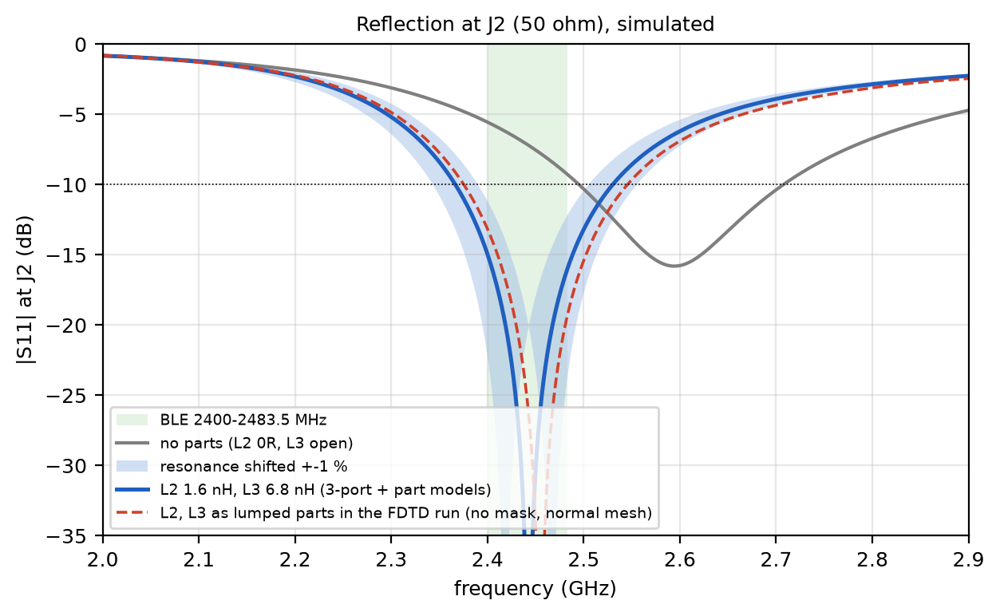

The antenna resonates on its own at 2.594 GHz, about 110 MHz above the top of the band. That was the design rule:
put the self-resonance above the band so that one shunt L (plus a small series L) matches the whole band. L2 and L3 move the
match into the band. The full-wave run with the parts (red dashed) agrees with the cascade (blue). Its dip is 12 MHz
higher (2.455 against 2.443 GHz). That fits the missing solder mask in that run: in the earlier runs the mask
shifted the response down by 19 MHz.

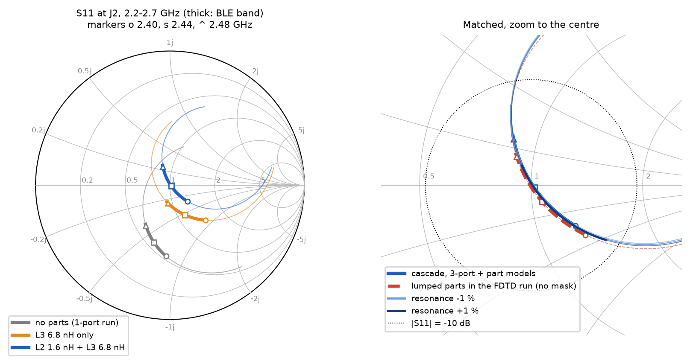

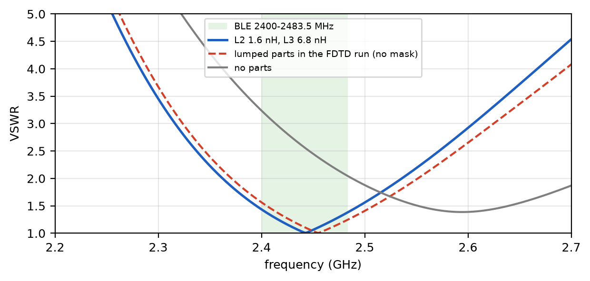

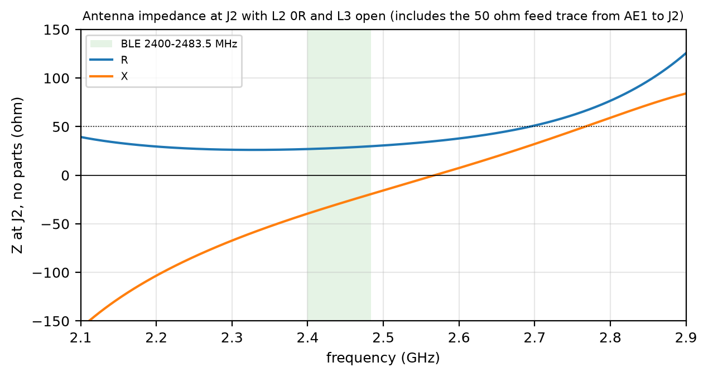

## Tolerance

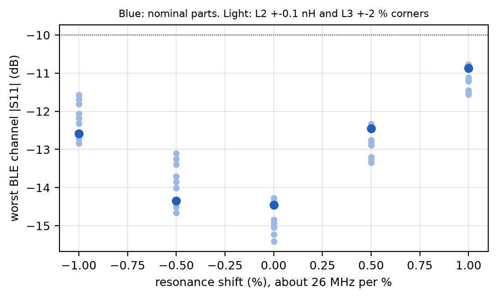

| frequency shift | worst BLE S11 over part tolerance |
|---|---|
| -1 % | -11.6 to -12.8 dB |
| -0.5 % | -13.1 to -14.7 dB |
| 0 | -14.3 to -15.4 dB |
| +0.5 % | -12.3 to -13.3 dB |
| +1 % | -10.8 to -11.6 dB |

The match stays better than -10 dB over the whole band in all cases. The matched band is limited by the
antenna Q, not by the match. Moving the response by 1 % (24 MHz) costs about 3-4 dB at the band edge.

## Efficiency

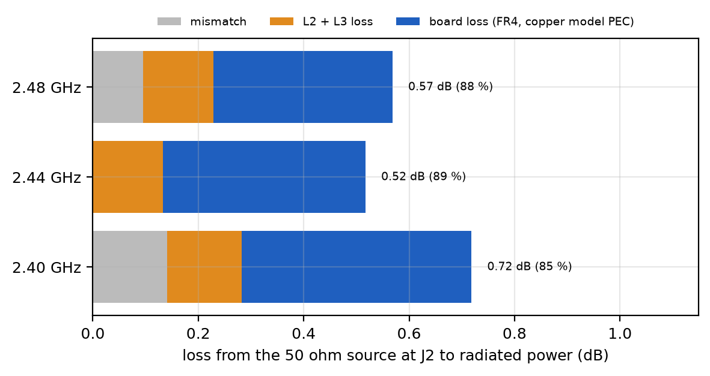

| | 2.40 GHz | 2.44 GHz | 2.48 GHz |
|---|---|---|---|
| power accepted (1 - \|Γ\|²) | 96.8 % | 100.0 % | 97.8 % |
| lost in L2 | 1.7 % | 2.0 % | 2.1 % |
| lost in L3 | 1.4 % | 1.0 % | 0.8 % |
| radiation efficiency of the board | 90.5 % | 91.5 % | 92.5 % |
| **total efficiency** | **84.8 % (-0.72 dB)** | **88.8 % (-0.52 dB)** | **87.7 % (-0.57 dB)** |

The board loss is dielectric loss in the FR4 (tanδ 0.02). Copper loss is not modelled, so the real numbers are
likely a little lower.

The full-wave run with the parts gives a radiation efficiency of 80 / 82 / 83 %. The cascade predicts 85 / 89 / 88 %
for the same quantity (power delivered to the board times its radiation efficiency). The gap of 5-6 % is not
investigated. Possible causes are the 150 mm air box (the 1.089 calibration was measured with 30 mm of air),
the missing mask, or the lumped-element model. Treat the efficiency as 80-89 %.

## Radiation pattern

Directivity at 2.44 GHz, antenna without parts (1-port run). Coordinates: x along the arm, y from the board
centre towards the antenna, z out of F.Cu.

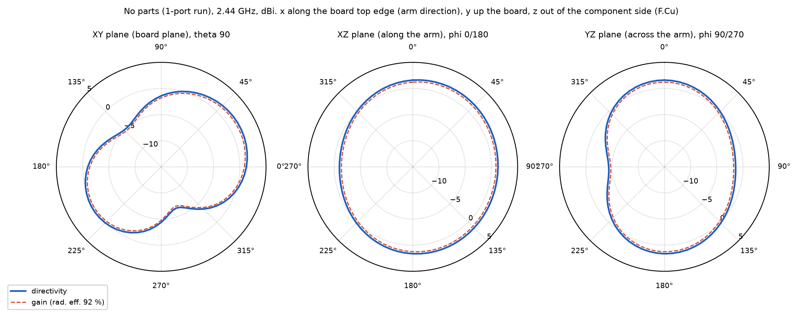

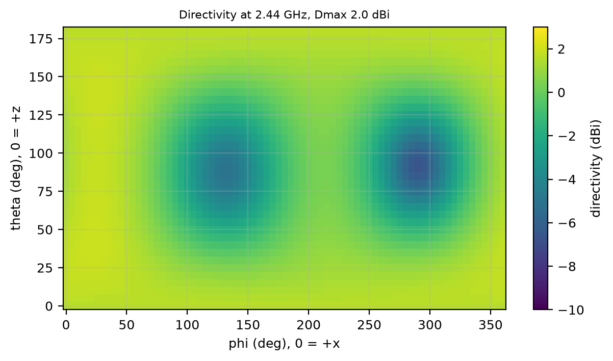

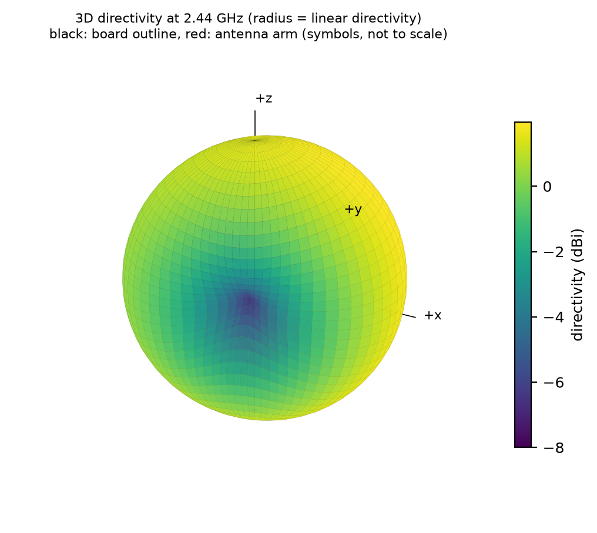

The same with L2 and L3 in the model (full-wave run, no mask):

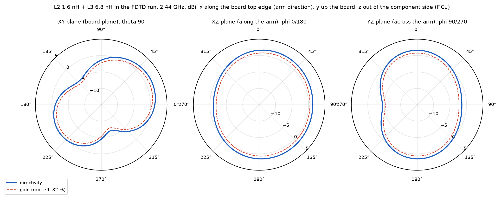

At 2.44 GHz the maximum is 1.97 dBi at theta 45°, phi 25°, above the board towards the open end of the arm.
The cut along the arm (XZ) is close to round. The deepest dips are in the board plane: the minimum is -6.6 dBi
at phi 290° (towards the lower right of the board), with a second dip near phi 135°. Over the whole sphere,
93 % of the directions are within 6 dB of the maximum and 88 % are above -3 dBi. The data is in
`data/pattern_2440MHz.csv` and `data/pattern_2440MHz_matched.csv`.

## Fields around the antenna

All fields are at 2.44 GHz from the full-wave run with L2 and L3 (`8b668025c7`). Values are relative, because
the source is the openEMS excitation, not a set power. The magnitude pictures are in dB, with 0 dB at the 99.5th
percentile of the picture. Without that, a few cells at the parts and the port would set the scale.

Current on F.Cu. It runs along the inner edges of the feed leg, the short leg and the arm, and along the ground edge:

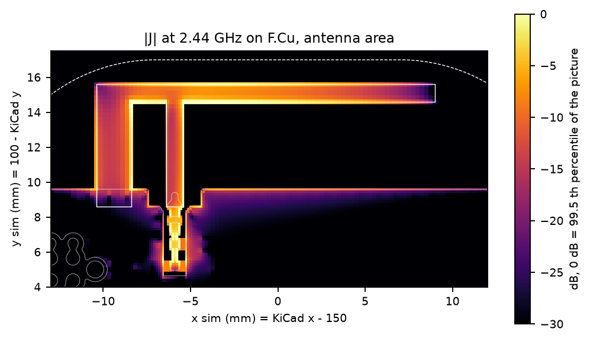

Electric field in a cross-section through the open arm. The field closes from the arm across the 5 mm gap to the
ground edge:

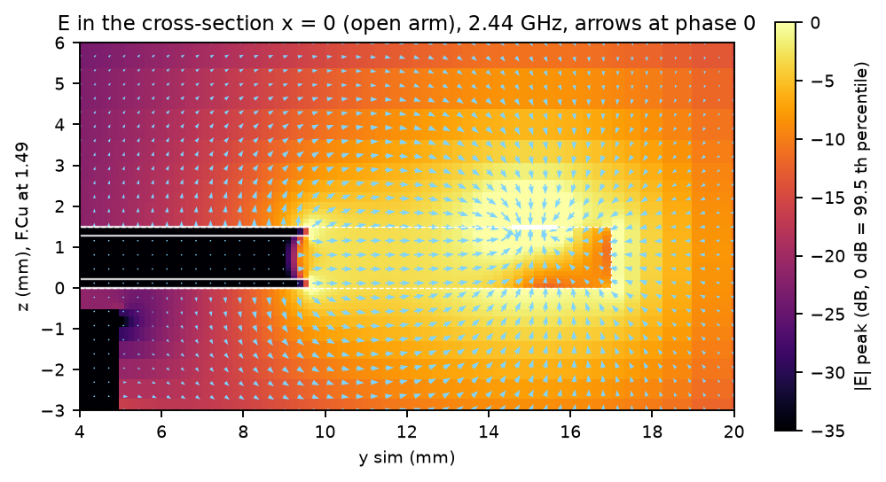

More pictures in [`figures/fields/`](figures/fields/): the field just above F.Cu and in the prepreg, the gap between
the ground edge and the arm, the feed leg, the magnetic field, and three GIFs of Ez over one period.

### Movies

In [`figures/movies/`](figures/movies/), each as MP4, GIF (half size) and a still:

| movie | shows |
|---|---|
| `Ez_top_phase` | Ez just above F.Cu over one 2.44 GHz period (loops) |
| `Ez_yz_phase`, `Ez_xz_phase` | Ez in the side planes near the board |
| `E_yz_near_phase` | \|E\| between the arm and the ground edge |
| `Ey_r_yz_wave`, `Ey_r_xz_wave` | the radiated wave out to ±169 mm (about 1.4 wavelengths). Ey is multiplied by the distance from the antenna so the 1/r fall-off does not hide the wavefronts. A picture of the wave, not a field value. |
| `td_E_top`, `td_E_yz`, `td_E_xz` | the Gaussian pulse (1.45-3.45 GHz) near the board, log scale |
| `td_E_yz_wide`, `td_E_xz_wide` | the pulse leaving the board and the antenna ringing down, whole domain |

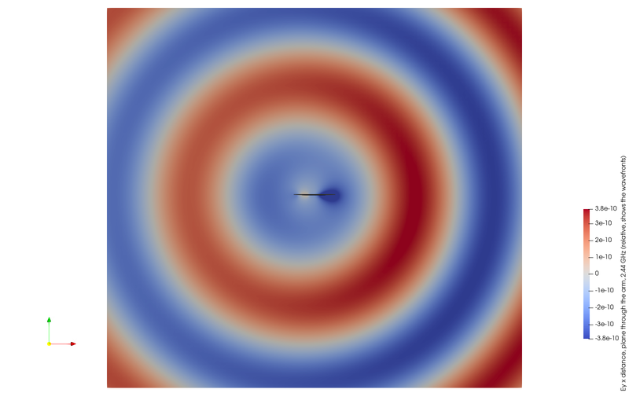

## Field data for ParaView

The field dumps (290 MB) and the ParaView files made from them (563 MB) are not in git. To make them again:

```
scp the run's sim_e0/fd_*, sim_e0/td_* and run.log from the server (runs/8b668025c7)
python fields_to_vtk.py <sim_e0> <out>        # ParaView files
python make_movies.py <sim_e0> <work>         # also renders and encodes the movies
python field_pictures.py <sim_e0>             # the stills in figures/fields
```

In ParaView:

- `fd/fd_E_top.pvd` (or any `fd_*.pvd`), colour by `E`, component Z, press Play for one period at 2.44 GHz.
- `geometry/antenna_AE1_outline.vtk` and `board_outline_top.vtk` for the copper outline on top.
- `fd/fd_E_vol.vtr` is the volume around the board, with `E_re`, `E_im` and `E_peak`. Slice it, or use a Calculator
  `E_re*cos(t) - E_im*sin(t)` for one phase t.
- `td/td_E_*.pvd` is the pulse over time in ns. Use a log colour scale on `E_mag`.
- Coordinates are in mm: x = KiCad x - 150, y = 100 - KiCad y, z up from B.Cu, F.Cu at z 1.486.

## Runs

| run | what | mesh |
|---|---|---|
| `d349ba0674` | 1-port at J2, L2 0R, L3 open | fine + mask |
| `819dfacd2e` | 3-port J2 / L2 / L3 (S3P in `data/board_J2_L2_L3.s3p`) | fine + mask |
| `8b668025c7` | L2, L3 as lumped parts, 150 mm air, field dumps | normal, no mask |
| `29f9f0e89f` | L2, L3 as lumped parts, fine + mask, stopped (unstable) | fine + mask |

Case lists: `../sim/cases/b3_*.json`. Results and design records: `../sim/results/runs/<run>/`.

## Files

| file | does |
|---|---|
| `make_figures.py` | S11, Smith chart, impedance, VSWR, tolerance, pattern, efficiency budget, drawings -> `figures/`, `data/` |
| `field_pictures.py` | field stills and GIFs from the field dumps (matplotlib) -> `figures/fields/` |
| `fields_to_vtk.py` | field dumps -> ParaView files (2.44 GHz phase series, volume, time-domain pulse, geometry) |
| `td_convert_pv.py` | helper run with ParaView's pvpython, converts the openEMS time-domain files to mm |
| `render_pv.py` | renders the movie frames with pvpython |
| `make_movies.py` | runs the two above and encodes MP4 and GIF (ffmpeg from imageio-ffmpeg) |
| `data/` | S11 curves, efficiency, tolerance, pattern, S3P and `summary.json` |
