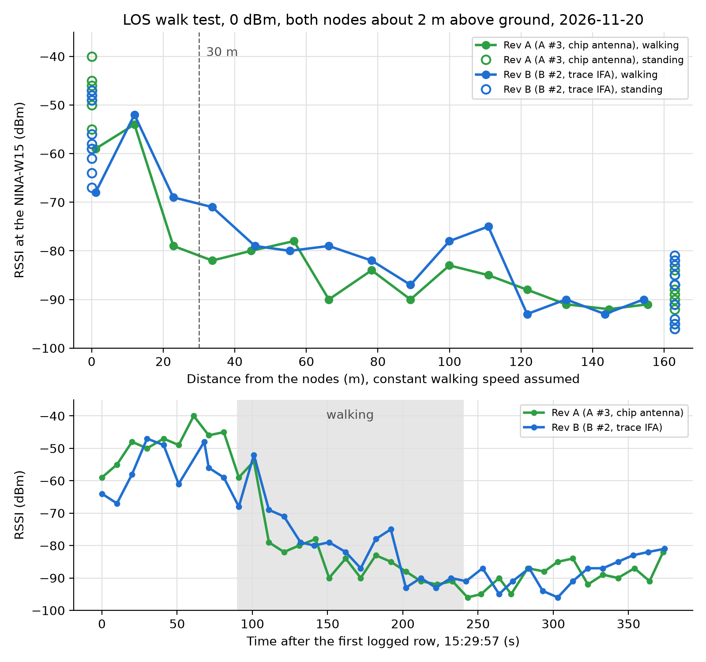

# BSN-C23 line-of-sight range (walk test)

Rev A (chip antenna) and rev B (trace IFA) side by side, outdoors, received by a u-blox NINA-W15 while walking
away. First session on 2026-11-20.

## Result (2026-11-20)

- **Both boards were received the whole way out to 163 m and while standing there.** Every 10 s slot of the
  log has a reading from both boards, from the start to the end of the run. The lowest logged RSSI is -96 dBm on
  both boards.
- **Around 30 m** (the points at about 23 m and 34 m): rev A -79 and -82 dBm, rev B -69 and -71 dBm. That is
  15 to 25 dB above the weakest readings that were still received at 163 m.
- Standing at 163 m for about 2 min 10 s: rev A -82 to -96 dBm, rev B -81 to -96 dBm.
- Rev B reads higher than rev A on most points up to about 110 m, by up to about 15 dB, and the two are close
  beyond that. With one reading per board every 10 s and a spread of 5 to 10 dB between neighbouring points, this
  is not a measured antenna difference. Cause of the spread not investigated (multipath and the ground
  reflection are likely candidates).
- The log does not give a packet error rate, see [Limits](#limits-of-this-run).

## Setup

| | |
|---|---|
| Rev A | A #3, FC:DE:C5:73:2F:7B, chip antenna, L 4.3 nH and C 2.1 pF by the user's memory (2.0 pF if this is the board that had no matching parts at first). Firmware `B10`. RH reads 0 % on this board (see `hardware/C23/README.md`) |
| Rev B | B #2, FC:DE:C5:73:2F:5A, trace IFA, L2 1.6 nH, L3 6.8 nH, pi network refitted 2026-11-19 |
| TX power | 0 dBm on both |
| Advert rate | about 4.7 adverts per second on both (packet counter about +47 per 10 s), so the 0.2 s interval |
| Node placement | both about 2 m above ground, Z axis pointing at the receiver (the direction of highest measured gain) |
| Receiver | NINA-W15 module, carried by hand at about chest height, Z axis pointing at the nodes, `bsn_scan_nina.py --csv` on the laptop. Moved up and down while standing at the end point |
| Site | relatively flat field, wet grass, some trees along the sides |
| Distance | 163 m to a known landmark, from a compass app screen recording |
| Timing | scanner and screen recording started together. Walking from 1:30 to 4:00 into the recording (163 m in 2.5 min) |
| Weather | node temperature 10.1 °C falling to 5.8 °C during the run (from the nodes) |
| Supply | CR2032 on both boards. VDD reported 2.98 V (B #2) and 2.91 V (A #3), flat over the run. One B #2 reading at 15:31:05 shows 2.887 V |

## Data and processing

- [`dt_01_C23-AvB_5s_0s2_0dBm.csv`](dt_01_C23-AvB_5s_0s2_0dBm.csv): 15:29:57 to 15:36:11, 38 rows per board.
  Columns (no header): time, address, RSSI (dBm), packet id, temperature (°C), RH (%), VDD (V), battery (%).
- [`plot_range.py`](plot_range.py) makes the figure. Distance is not logged per point. It is computed as a
  constant walking speed (163 m / 150 s, about 1.09 m/s) between 90 s and 240 s after the first CSV row.
  Readings before the walk are drawn at 0 m and readings after it at 163 m, as hollow markers.
- The scanner start time is not in the log. The first CSV row (15:29:57) is used as time zero. The scanner
  started at most a few seconds earlier, so the distance axis can be off by a few metres. With the walking speed
  not being constant on top of that, the distances are good to roughly ±10 m, not better. The RSSI starts to fall
  in the first readings after the assumed walk start, which agrees with the timing.

## Limits of this run

- **No packet error rate.** The scanner logged one advert per board about every 10 s while the boards sent about
  47 in that time. So the log shows the link was there in every 10 s slot, not how many adverts were lost. Cause found
  on 2026-11-20: the scanner used discovery type 1 (`AT+UBTD=1`), which on NINA-W15 firmware 4.2.0 reports a
  device once per discovery window. Type 4 reports every advert and the scanner now uses it. With type 4, a node
  near the NINA at home (42 BLE devices in range) still showed 13 to 18 % of packet ids missing in 40 s runs, at
  both 115200 and 921600 baud. So the receiver itself misses adverts, and a rerun needs a close-range reference
  for this loss. Where it comes from (scan duty cycle of the module, busy channel, the node) is not
  investigated.
- One pass, one orientation, one board of each revision.
- The planned rev A board was A #1. A #3 was used, with the same match parts by the user's memory (see Setup).
- The range limit was not reached. 163 m was the end of the field, not the point where the link dropped.
- At 163 m the receiver was moved up and down, so the readings after the walk are not at one fixed height.

## Open with the user

- Photos of the setup and the screen recording exist, not added yet.
- A rerun with a scanner that logs every advert, to get a packet error rate against distance.
