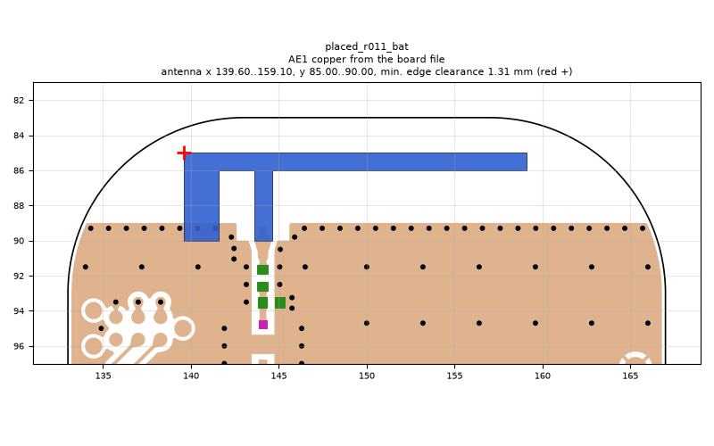
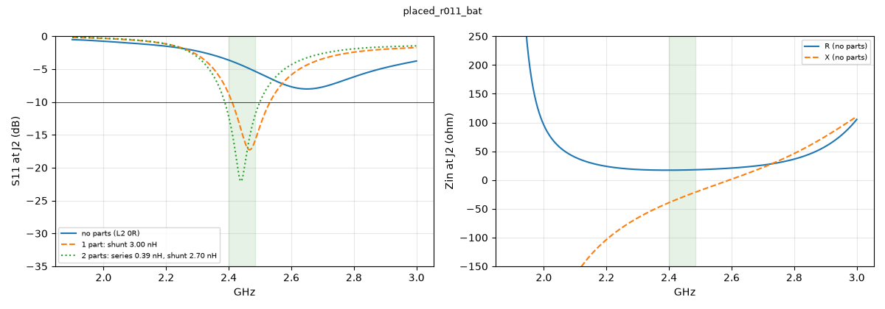

# placed_r011_bat

**Why this run:** not recorded

Run `041998a7b3`, tag `p2`, model v2, board `build/board.json`, battery yes, mask none.

## Antenna

placed (AE1 copper from the board file)

Copper extent x 139.60..159.10, y 85.00..90.00 (KiCad), smallest distance to the board edge 1.31 mm.

## Impedance and match at J2

Best match without parts -8.0 dB at 2.650 GHz, worst BLE channel -3.6 dB, -10 dB band none MHz.

Z at J2: 2.40 GHz 17.1-39.3j ohm, 2.44 GHz 17.3-30.4j ohm, 2.48 GHz 17.8-22.1j ohm

| matching (ideal parts at J2, L2 series, L3 shunt) | worst BLE S11 |
|---|---|
| none (L2 0R) | -3.6 dB |
| 1 part: shunt 3.00 nH | -8.8 dB |
| 2 parts: series 0.39 nH, shunt 2.70 nH | -12.2 dB |

## Efficiency and pattern

Not valid: this run used the openEMS NF2FF transform (model v2), which is wrong for this board.

Mesh 2092896 cells, run time 0 min.
