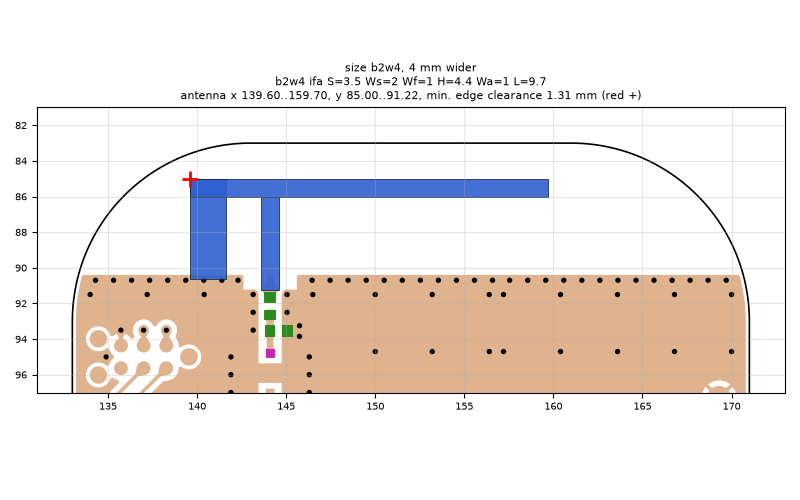
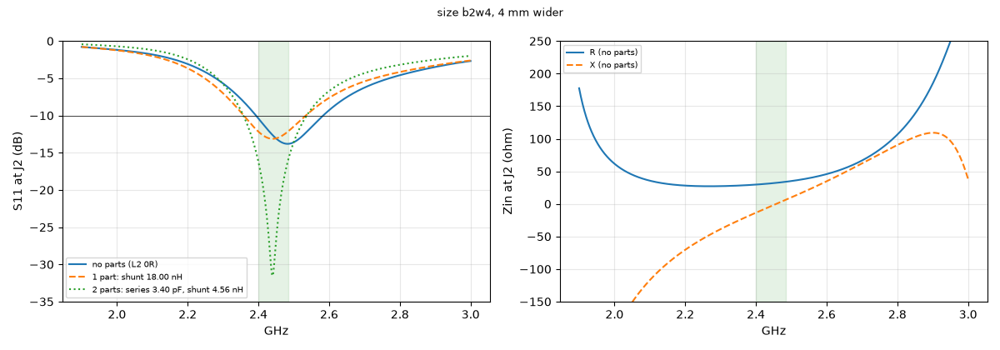
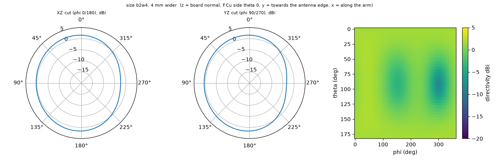

# size b2w4, 4 mm wider

**Why this run:** Bigger board: how much does a larger ground plane improve the matched bandwidth and efficiency of the same IFA (H4.4 L9.7)?

Run `0505a294bb`, tag `size1`, model v5, board `build/b2w4/board.json`, battery yes, mask none.

## Antenna

ifa, ground edge base b2w4: S 3.5 mm, Ws 2 mm, Wf 1 mm, H 4.4 mm, Wa 1 mm, L 9.7 mm

| part | KiCad x0 | y0 | x1 | y1 |
|---|---|---|---|---|
| short leg | 139.60 | 85.00 | 141.60 | 90.65 |
| feed leg | 143.60 | 86.00 | 144.60 | 91.22 |
| arm | 139.60 | 85.00 | 159.70 | 86.00 |

Copper extent x 139.60..159.70, y 85.00..91.22 (KiCad), smallest distance to the board edge 1.31 mm.

## Impedance and match at J2

Best match without parts -13.8 dB at 2.482 GHz, worst BLE channel -10.4 dB, -10 dB band [2394, 2583] MHz.

Z at J2: 2.40 GHz 29.7-13.5j ohm, 2.44 GHz 31.4-4.1j ohm, 2.48 GHz 33.7+5.2j ohm

| matching (ideal parts at J2, L2 series, L3 shunt) | worst BLE S11 |
|---|---|
| none (L2 0R) | -10.4 dB |
| 1 part: shunt 18.00 nH | -12.2 dB |
| 2 parts: series 3.40 pF, shunt 4.56 nH | -16.2 dB |

## Efficiency and pattern

| f GHz | radiation eff. | total eff. (no parts) | Dmax dBi |
|---|---|---|---|
| 2.40 | 88 % | 80 % | 1.9 |
| 2.44 | 89 % | 84 % | 1.9 |
| 2.48 | 90 % | 86 % | 2.0 |

Own far-field transform, about ±15 % (validation in farfield.py). Total efficiency is without matching parts.

Mesh 2031120 cells, run time 48 min.
