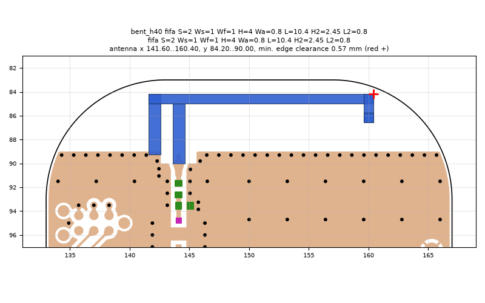
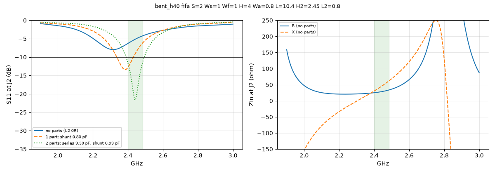

# bent_h40 fifa S=2 Ws=1 Wf=1 H=4 Wa=0.8 L=10.4 H2=2.45 L2=0.8

**Why this run:** Tuner start points: bent-end IFA with the arm 4 mm above the ground edge (b1).

Run `06caf9af7b`, tag `tune_bent_h40`, model v4, board `build/board.json`, battery yes, mask none.

## Antenna

fifa, ground edge base b1: S 2 mm, Ws 1 mm, Wf 1 mm, H 4 mm, Wa 0.8 mm, L 10.4 mm, H2 2.45 mm, L2 0.8 mm

| part | KiCad x0 | y0 | x1 | y1 |
|---|---|---|---|---|
| short leg | 141.60 | 84.20 | 142.60 | 89.25 |
| feed leg | 143.60 | 85.00 | 144.60 | 90.00 |
| arm | 141.60 | 84.20 | 160.40 | 85.00 |
| drop | 159.60 | 84.20 | 160.40 | 86.55 |
| return | 159.60 | 85.75 | 160.40 | 86.55 |

Copper extent x 141.60..160.40, y 84.20..90.00 (KiCad), smallest distance to the board edge 0.57 mm.

## Impedance and match at J2

Best match without parts -8.0 dB at 2.316 GHz, worst BLE channel -4.2 dB, -10 dB band none MHz.

Z at J2: 2.40 GHz 25.0+30.3j ohm, 2.44 GHz 28.1+44.4j ohm, 2.48 GHz 32.9+60.0j ohm

| matching (ideal parts at J2, L2 series, L3 shunt) | worst BLE S11 |
|---|---|
| none (L2 0R) | -4.2 dB |
| 1 part: shunt 0.80 pF | -6.2 dB |
| 2 parts: series 3.30 pF, shunt 0.93 pF | -11.6 dB |

## Efficiency and pattern

Not valid: this run used the openEMS NF2FF transform (model v4), which is wrong for this board.

Mesh 2020590 cells, run time 32 min.
