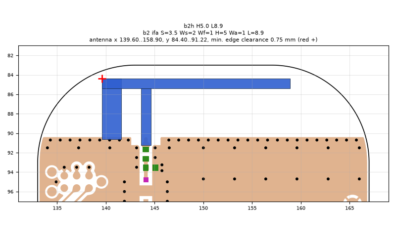
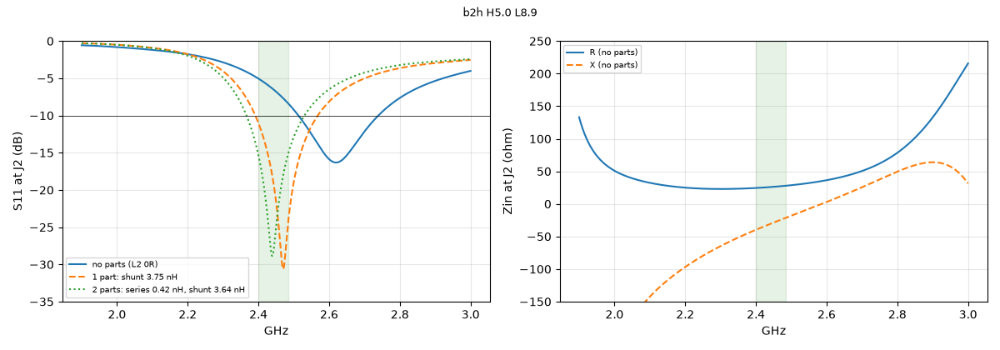
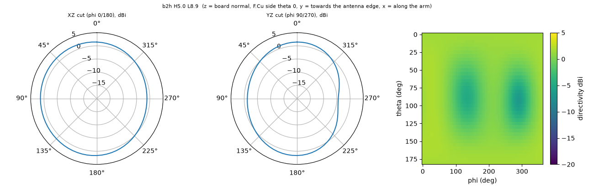

# b2h H5.0 L8.9

**Why this run:** Push the arm higher (height is the main lever for the matched band). Self-resonance aimed at about 2.58 GHz so one shunt inductor on L3 matches the band.

Run `38c3fd00a9`, tag `b2_high1`, model v5, board `build/b2/board.json`, battery yes, mask none.

## Antenna

ifa, ground edge base b2: S 3.5 mm, Ws 2 mm, Wf 1 mm, H 5 mm, Wa 1 mm, L 8.9 mm

| part | KiCad x0 | y0 | x1 | y1 |
|---|---|---|---|---|
| short leg | 139.60 | 84.40 | 141.60 | 90.65 |
| feed leg | 143.60 | 85.40 | 144.60 | 91.22 |
| arm | 139.60 | 84.40 | 158.90 | 85.40 |

Copper extent x 139.60..158.90, y 84.40..91.22 (KiCad), smallest distance to the board edge 0.75 mm.

## Impedance and match at J2

Best match without parts -16.3 dB at 2.620 GHz, worst BLE channel -5.0 dB, -10 dB band [2514, 2739] MHz.

Z at J2: 2.40 GHz 24.4-39.8j ohm, 2.44 GHz 25.8-30.9j ohm, 2.48 GHz 27.6-22.3j ohm

| matching (ideal parts at J2, L2 series, L3 shunt) | worst BLE S11 |
|---|---|
| none (L2 0R) | -5.0 dB |
| 1 part: shunt 3.75 nH | -11.0 dB |
| 2 parts: series 0.42 nH, shunt 3.64 nH | -15.3 dB |

## Efficiency and pattern

| f GHz | radiation eff. | total eff. (no parts) | Dmax dBi |
|---|---|---|---|
| 2.40 | 87 % | 60 % | 2.0 |
| 2.44 | 88 % | 68 % | 2.0 |
| 2.48 | 89 % | 75 % | 2.0 |

Own far-field transform, about ±15 % (validation in farfield.py). Total efficiency is without matching parts.

Mesh 1983384 cells, run time 44 min.
