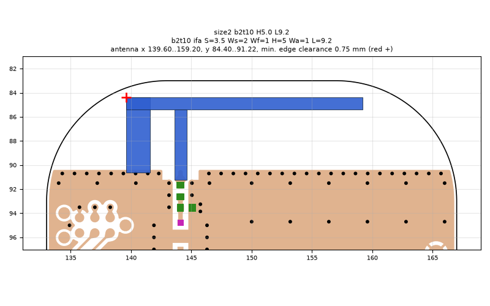
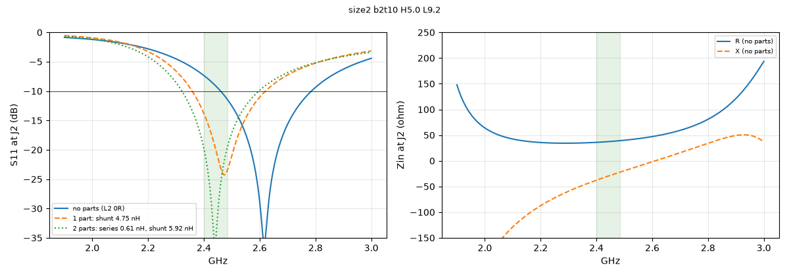
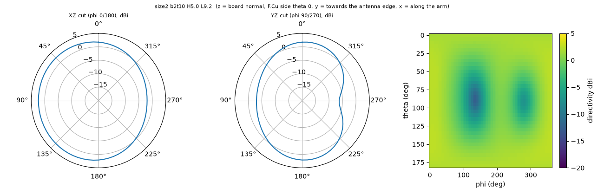

# size2 b2t10 H5.0 L9.2

**Why this run:** Bigger board combined with the best 34 mm design (arm H5.0 L9.2): does the board-size gain add to the arm-height gain?

Run `419080f7de`, tag `size2`, model v5, board `build/b2t10/board.json`, battery yes, mask none.

## Antenna

ifa, ground edge base b2t10: S 3.5 mm, Ws 2 mm, Wf 1 mm, H 5 mm, Wa 1 mm, L 9.2 mm

| part | KiCad x0 | y0 | x1 | y1 |
|---|---|---|---|---|
| short leg | 139.60 | 84.40 | 141.60 | 90.65 |
| feed leg | 143.60 | 85.40 | 144.60 | 91.22 |
| arm | 139.60 | 84.40 | 159.20 | 85.40 |

Copper extent x 139.60..159.20, y 84.40..91.22 (KiCad), smallest distance to the board edge 0.75 mm.

## Impedance and match at J2

Best match without parts -36.1 dB at 2.616 GHz, worst BLE channel -7.3 dB, -10 dB band [2460, 2785] MHz.

Z at J2: 2.40 GHz 35.9-37.7j ohm, 2.44 GHz 37.2-30.1j ohm, 2.48 GHz 39.0-22.9j ohm

| matching (ideal parts at J2, L2 series, L3 shunt) | worst BLE S11 |
|---|---|
| none (L2 0R) | -7.3 dB |
| 1 part: shunt 4.75 nH | -13.8 dB |
| 2 parts: series 0.61 nH, shunt 5.92 nH | -19.8 dB |

## Efficiency and pattern

| f GHz | radiation eff. | total eff. (no parts) | Dmax dBi |
|---|---|---|---|
| 2.40 | 89 % | 73 % | 2.5 |
| 2.44 | 90 % | 79 % | 2.5 |
| 2.48 | 90 % | 84 % | 2.6 |

Own far-field transform, about ±15 % (validation in farfield.py). Total efficiency is without matching parts.

Mesh 2135952 cells, run time 32 min.
