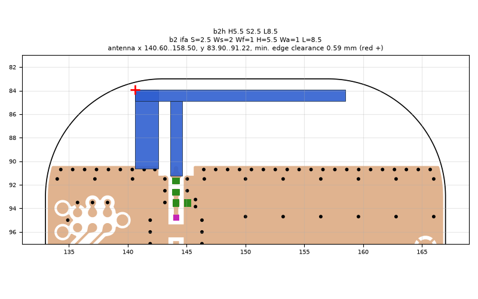
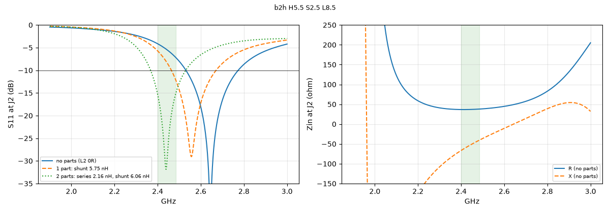
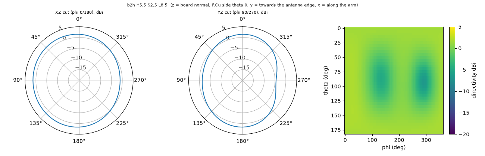

# b2h H5.5 S2.5 L8.5

**Why this run:** Push the arm higher (height is the main lever for the matched band). Self-resonance aimed at about 2.58 GHz so one shunt inductor on L3 matches the band.

Run `44b591eeb5`, tag `b2_high1`, model v5, board `build/b2/board.json`, battery yes, mask none.

## Antenna

ifa, ground edge base b2: S 2.5 mm, Ws 2 mm, Wf 1 mm, H 5.5 mm, Wa 1 mm, L 8.5 mm

| part | KiCad x0 | y0 | x1 | y1 |
|---|---|---|---|---|
| short leg | 140.60 | 83.90 | 142.60 | 90.65 |
| feed leg | 143.60 | 84.90 | 144.60 | 91.22 |
| arm | 140.60 | 83.90 | 158.50 | 84.90 |

Copper extent x 140.60..158.50, y 83.90..91.22 (KiCad), smallest distance to the board edge 0.59 mm.

## Impedance and match at J2

Best match without parts -42.5 dB at 2.645 GHz, worst BLE channel -4.1 dB, -10 dB band [2532, 2773] MHz.

Z at J2: 2.40 GHz 36.7-66.5j ohm, 2.44 GHz 36.9-53.5j ohm, 2.48 GHz 37.8-41.8j ohm

| matching (ideal parts at J2, L2 series, L3 shunt) | worst BLE S11 |
|---|---|
| none (L2 0R) | -4.1 dB |
| 1 part: shunt 5.75 nH | -5.7 dB |
| 2 parts: series 2.16 nH, shunt 6.06 nH | -15.3 dB |

## Efficiency and pattern

| f GHz | radiation eff. | total eff. (no parts) | Dmax dBi |
|---|---|---|---|
| 2.40 | 87 % | 53 % | 2.0 |
| 2.44 | 88 % | 62 % | 2.0 |
| 2.48 | 89 % | 71 % | 2.0 |

Own far-field transform, about ±15 % (validation in farfield.py). Total efficiency is without matching parts.

Mesh 1983384 cells, run time 44 min.
