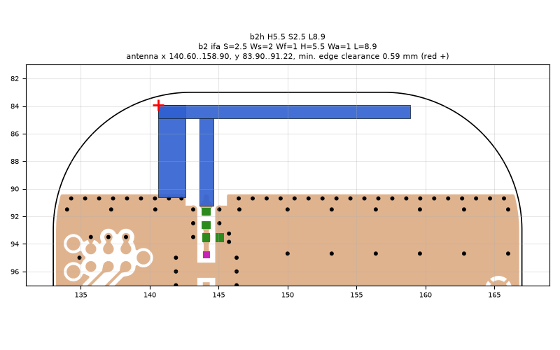
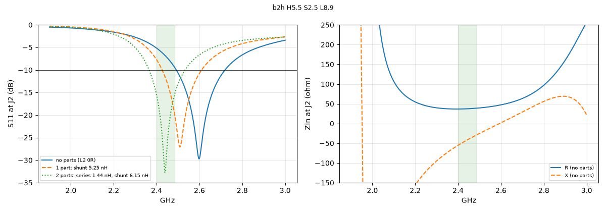
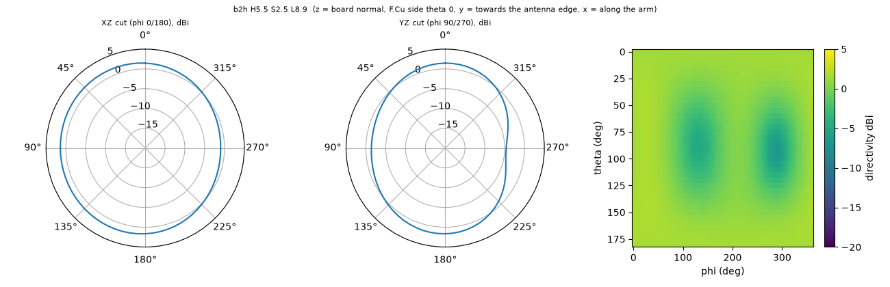

# b2h H5.5 S2.5 L8.9

**Why this run:** Push the arm higher (height is the main lever for the matched band). Self-resonance aimed at about 2.58 GHz so one shunt inductor on L3 matches the band.

Run `4957079d0c`, tag `b2_high1`, model v5, board `build/b2/board.json`, battery yes, mask none.

## Antenna

ifa, ground edge base b2: S 2.5 mm, Ws 2 mm, Wf 1 mm, H 5.5 mm, Wa 1 mm, L 8.9 mm

| part | KiCad x0 | y0 | x1 | y1 |
|---|---|---|---|---|
| short leg | 140.60 | 83.90 | 142.60 | 90.65 |
| feed leg | 143.60 | 84.90 | 144.60 | 91.22 |
| arm | 140.60 | 83.90 | 158.90 | 84.90 |

Copper extent x 140.60..158.90, y 83.90..91.22 (KiCad), smallest distance to the board edge 0.59 mm.

## Impedance and match at J2

Best match without parts -29.7 dB at 2.598 GHz, worst BLE channel -5.2 dB, -10 dB band [2492, 2719] MHz.

Z at J2: 2.40 GHz 36.8-55.2j ohm, 2.44 GHz 37.3-42.5j ohm, 2.48 GHz 38.6-30.7j ohm

| matching (ideal parts at J2, L2 series, L3 shunt) | worst BLE S11 |
|---|---|
| none (L2 0R) | -5.2 dB |
| 1 part: shunt 5.25 nH | -7.7 dB |
| 2 parts: series 1.44 nH, shunt 6.15 nH | -15.6 dB |

## Efficiency and pattern

| f GHz | radiation eff. | total eff. (no parts) | Dmax dBi |
|---|---|---|---|
| 2.40 | 88 % | 61 % | 2.0 |
| 2.44 | 89 % | 70 % | 2.0 |
| 2.48 | 89 % | 79 % | 2.0 |

Own far-field transform, about ±15 % (validation in farfield.py). Total efficiency is without matching parts.

Mesh 1995552 cells, run time 45 min.
