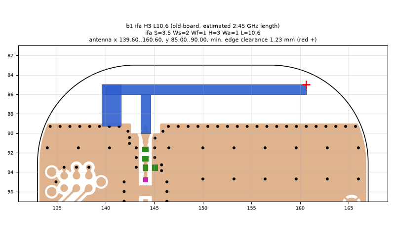
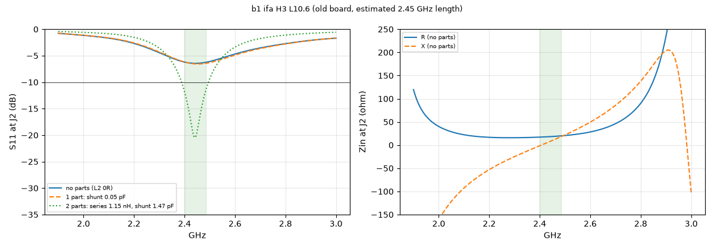

# b1 ifa H3 L10.6 (old board, estimated 2.45 GHz length)

**Why this run:** First look at the b2 layout (antenna-side shunt pads removed, ground edge 1.4 mm lower): does the lower ground edge help?

Run `515fccca87`, tag `b2_quick`, model v4, board `build/board.json`, battery yes, mask none.

## Antenna

ifa, ground edge base b1: S 3.5 mm, Ws 2 mm, Wf 1 mm, H 3 mm, Wa 1 mm, L 10.6 mm

| part | KiCad x0 | y0 | x1 | y1 |
|---|---|---|---|---|
| short leg | 139.60 | 85.00 | 141.60 | 89.25 |
| feed leg | 143.60 | 86.00 | 144.60 | 90.00 |
| arm | 139.60 | 85.00 | 160.60 | 86.00 |

Copper extent x 139.60..160.60, y 85.00..90.00 (KiCad), smallest distance to the board edge 1.23 mm.

## Impedance and match at J2

Best match without parts -6.4 dB at 2.443 GHz, worst BLE channel -6.2 dB, -10 dB band none MHz.

Z at J2: 2.40 GHz 17.2-1.5j ohm, 2.44 GHz 18.2+7.6j ohm, 2.48 GHz 19.6+17.0j ohm

| matching (ideal parts at J2, L2 series, L3 shunt) | worst BLE S11 |
|---|---|
| none (L2 0R) | -6.2 dB |
| 1 part: shunt 0.05 pF | -6.2 dB |
| 2 parts: series 1.15 nH, shunt 1.47 pF | -11.8 dB |

## Efficiency and pattern

Not valid: this run used the openEMS NF2FF transform (model v4), which is wrong for this board.

Mesh 1970670 cells, run time 49 min.
