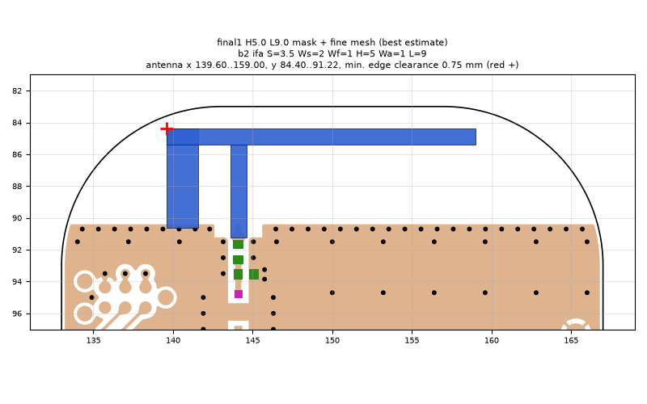
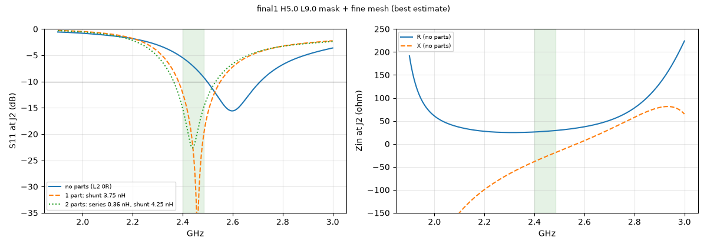
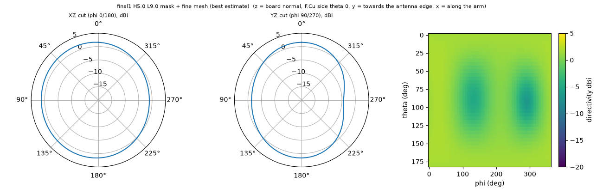

# final1 H5.0 L9.0 mask + fine mesh (best estimate)

**Why this run:** Best estimate of the as-built final candidate: explicit 20 um solder mask and the finer mesh together, on all threads

Run `5393b94279`, tag `final3`, model v5, board `build/b2/board.json`, battery yes, mask explicit.

## Antenna

ifa, ground edge base b2: S 3.5 mm, Ws 2 mm, Wf 1 mm, H 5 mm, Wa 1 mm, L 9 mm

| part | KiCad x0 | y0 | x1 | y1 |
|---|---|---|---|---|
| short leg | 139.60 | 84.40 | 141.60 | 90.65 |
| feed leg | 143.60 | 85.40 | 144.60 | 91.22 |
| arm | 139.60 | 84.40 | 159.00 | 85.40 |

Copper extent x 139.60..159.00, y 84.40..91.22 (KiCad), smallest distance to the board edge 0.75 mm.

## Impedance and match at J2

Best match without parts -15.6 dB at 2.598 GHz, worst BLE channel -5.5 dB, -10 dB band [2498, 2710] MHz.

Z at J2: 2.40 GHz 25.9-38.3j ohm, 2.44 GHz 27.2-28.9j ohm, 2.48 GHz 28.9-19.8j ohm

| matching (ideal parts at J2, L2 series, L3 shunt) | worst BLE S11 |
|---|---|
| none (L2 0R) | -5.5 dB |
| 1 part: shunt 3.75 nH | -12.2 dB |
| 2 parts: series 0.36 nH, shunt 4.25 nH | -15.1 dB |

## Efficiency and pattern

| f GHz | radiation eff. | total eff. (no parts) | Dmax dBi |
|---|---|---|---|
| 2.40 | 90 % | 65 % | 2.0 |
| 2.44 | 91 % | 73 % | 2.0 |
| 2.48 | 92 % | 80 % | 2.0 |

Own far-field transform, about ±15 % (validation in farfield.py). Total efficiency is without matching parts.

Mesh 6905654 cells, run time 67 min.
