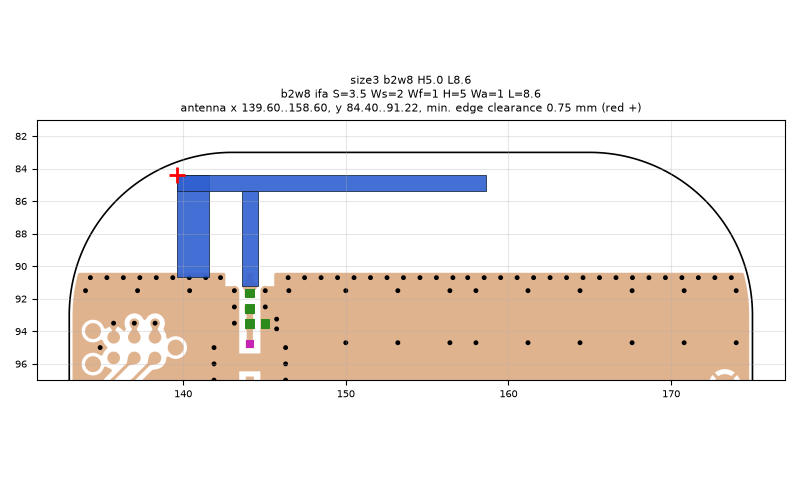
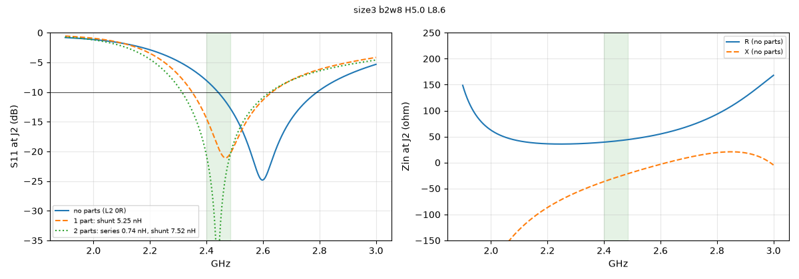
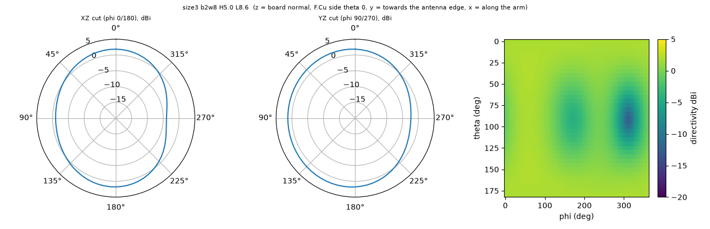

# size3 b2w8 H5.0 L8.6

**Why this run:** Bigger board at its best: arm length re-tuned for the larger ground (resonance moves down on a bigger board)

Run `5835c83701`, tag `size3`, model v5, board `build/b2w8/board.json`, battery yes, mask none.

## Antenna

ifa, ground edge base b2w8: S 3.5 mm, Ws 2 mm, Wf 1 mm, H 5 mm, Wa 1 mm, L 8.6 mm

| part | KiCad x0 | y0 | x1 | y1 |
|---|---|---|---|---|
| short leg | 139.60 | 84.40 | 141.60 | 90.65 |
| feed leg | 143.60 | 85.40 | 144.60 | 91.22 |
| arm | 139.60 | 84.40 | 158.60 | 85.40 |

Copper extent x 139.60..158.60, y 84.40..91.22 (KiCad), smallest distance to the board edge 0.75 mm.

## Impedance and match at J2

Best match without parts -24.8 dB at 2.598 GHz, worst BLE channel -8.1 dB, -10 dB band [2441, 2791] MHz.

Z at J2: 2.40 GHz 39.3-36.6j ohm, 2.44 GHz 41.3-29.2j ohm, 2.48 GHz 43.8-22.2j ohm

| matching (ideal parts at J2, L2 series, L3 shunt) | worst BLE S11 |
|---|---|
| none (L2 0R) | -8.1 dB |
| 1 part: shunt 5.25 nH | -14.4 dB |
| 2 parts: series 0.74 nH, shunt 7.52 nH | -20.7 dB |

## Efficiency and pattern

| f GHz | radiation eff. | total eff. (no parts) | Dmax dBi |
|---|---|---|---|
| 2.40 | 91 % | 77 % | 2.1 |
| 2.44 | 92 % | 83 % | 2.1 |
| 2.48 | 93 % | 87 % | 2.1 |

Own far-field transform, about ±15 % (validation in farfield.py). Total efficiency is without matching parts.

Mesh 2105064 cells, run time 43 min.
