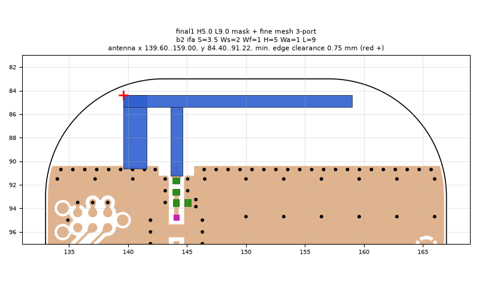
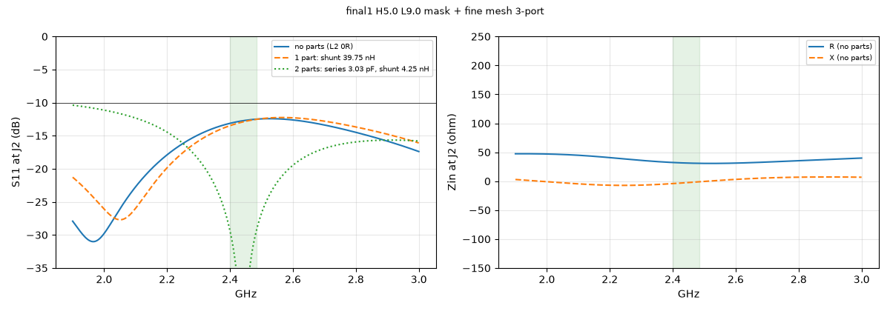
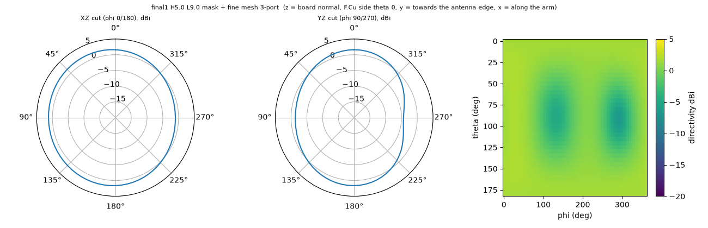

# final1 H5.0 L9.0 mask + fine mesh 3-port

**Why this run:** Definitive parts table for the order: 3-port (J2, L2, L3) with the explicit mask and the finer mesh, instead of scaling the normal-mesh 3-port data by 0.4 %

Run `5b8536e8e4`, tag `final4_3port`, model v5, board `build/b2/board.json`, battery yes, mask explicit.

## Antenna

ifa, ground edge base b2: S 3.5 mm, Ws 2 mm, Wf 1 mm, H 5 mm, Wa 1 mm, L 9 mm

| part | KiCad x0 | y0 | x1 | y1 |
|---|---|---|---|---|
| short leg | 139.60 | 84.40 | 141.60 | 90.65 |
| feed leg | 143.60 | 85.40 | 144.60 | 91.22 |
| arm | 139.60 | 84.40 | 159.00 | 85.40 |

Copper extent x 139.60..159.00, y 84.40..91.22 (KiCad), smallest distance to the board edge 0.75 mm.

## Impedance and match at J2

Best match without parts -31.0 dB at 1.965 GHz, worst BLE channel -12.5 dB, -10 dB band [1900, 3000] MHz.

Z at J2: 2.40 GHz 32.3-4.1j ohm, 2.44 GHz 31.4-2.7j ohm, 2.48 GHz 30.9-1.2j ohm

| matching (ideal parts at J2, L2 series, L3 shunt) | worst BLE S11 |
|---|---|
| none (L2 0R) | -12.5 dB |
| 1 part: shunt 39.75 nH | -12.5 dB |
| 2 parts: series 3.03 pF, shunt 4.25 nH | -29.4 dB |

## Efficiency and pattern

| f GHz | radiation eff. | total eff. (no parts) | Dmax dBi |
|---|---|---|---|
| 2.40 | 13 % | 12 % | 2.0 |
| 2.44 | 14 % | 13 % | 2.0 |
| 2.48 | 14 % | 14 % | 2.0 |

Own far-field transform, about ±15 % (validation in farfield.py). Total efficiency is without matching parts.

Mesh 6939672 cells, run time 205 min.
