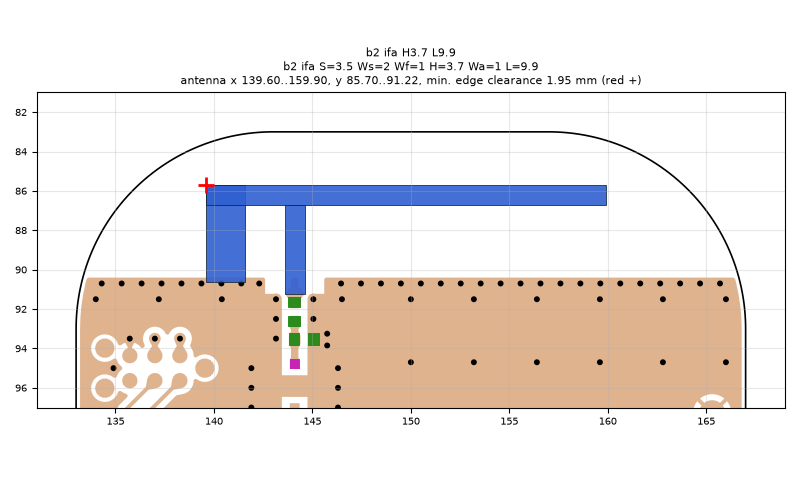
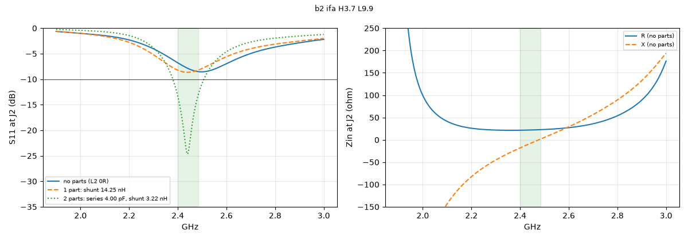

# b2 ifa H3.7 L9.9

**Why this run:** First look at the b2 layout (L4 removed, ground edge 1.4 mm lower): does the lower ground edge help?

Run `606fe1de07`, tag `b2_quick`, model v4, board `build/b2/board.json`, battery yes, mask none.

## Antenna

ifa, ground edge base b2: S 3.5 mm, Ws 2 mm, Wf 1 mm, H 3.7 mm, Wa 1 mm, L 9.9 mm

| part | KiCad x0 | y0 | x1 | y1 |
|---|---|---|---|---|
| short leg | 139.60 | 85.70 | 141.60 | 90.65 |
| feed leg | 143.60 | 86.70 | 144.60 | 91.22 |
| arm | 139.60 | 85.70 | 159.90 | 86.70 |

Copper extent x 139.60..159.90, y 85.70..91.22 (KiCad), smallest distance to the board edge 1.95 mm.

## Impedance and match at J2

Best match without parts -8.6 dB at 2.498 GHz, worst BLE channel -6.8 dB, -10 dB band none MHz.

Z at J2: 2.40 GHz 21.5-18.1j ohm, 2.44 GHz 21.9-8.5j ohm, 2.48 GHz 22.7+0.7j ohm

| matching (ideal parts at J2, L2 series, L3 shunt) | worst BLE S11 |
|---|---|
| none (L2 0R) | -6.8 dB |
| 1 part: shunt 14.25 nH | -8.2 dB |
| 2 parts: series 4.00 pF, shunt 3.22 nH | -13.2 dB |

## Efficiency and pattern

Not valid: this run used the openEMS NF2FF transform (model v4), which is wrong for this board.

Mesh 1983384 cells, run time 48 min.
