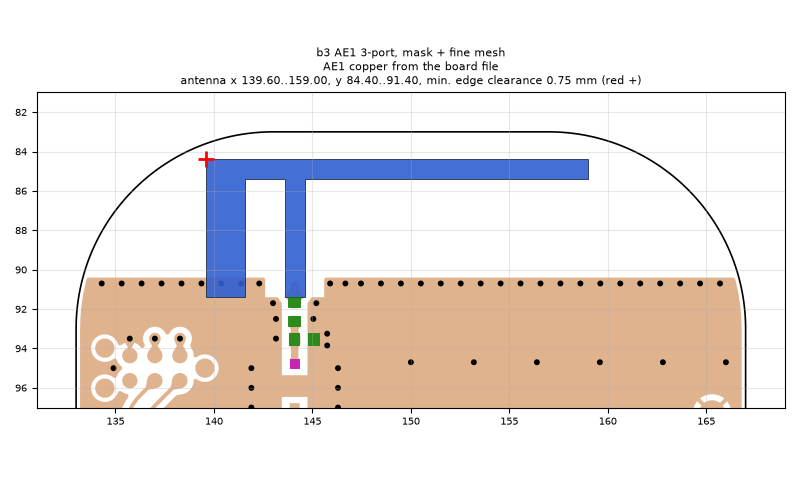
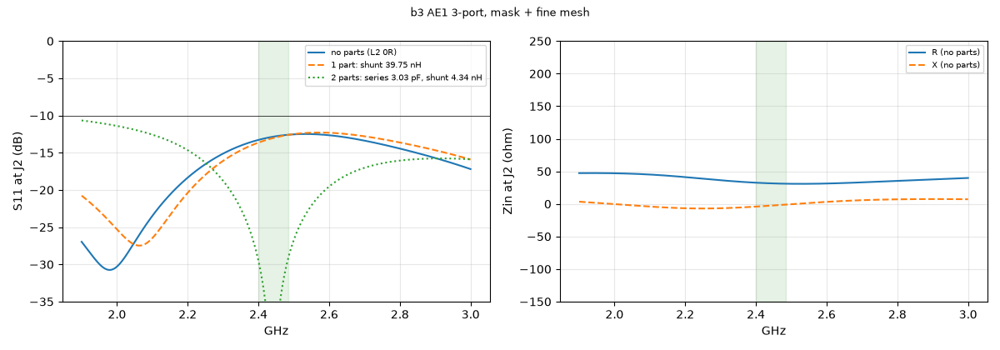
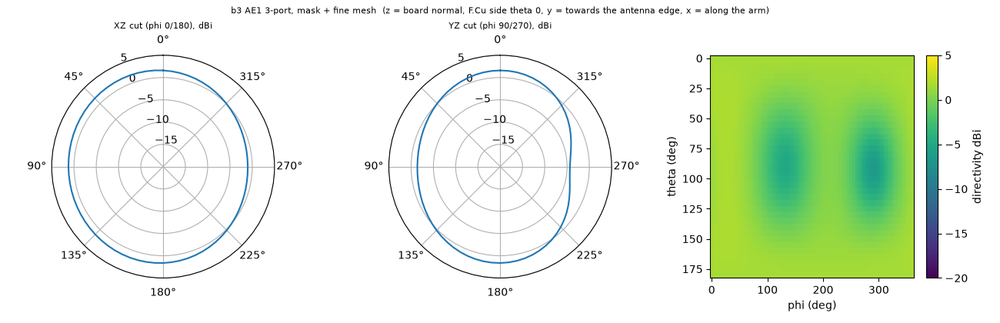

# b3 AE1 3-port, mask + fine mesh

**Why this run:** Report run: 3-port J2 / L2 / L3 on the board as ordered, for the part cascade, part loss and tolerance

Run `819dfacd2e`, tag `b3_4_3port`, model v5, board `build/b3/board.json`, battery yes, mask explicit.

## Antenna

placed (AE1 copper from the board file)

Copper extent x 139.60..159.00, y 84.40..91.40 (KiCad), smallest distance to the board edge 0.75 mm.

## Impedance and match at J2

Best match without parts -30.7 dB at 1.979 GHz, worst BLE channel -12.6 dB, -10 dB band [1900, 3000] MHz.

Z at J2: 2.40 GHz 32.6-4.1j ohm, 2.44 GHz 31.6-2.7j ohm, 2.48 GHz 31.0-1.2j ohm

| matching (ideal parts at J2, L2 series, L3 shunt) | worst BLE S11 |
|---|---|
| none (L2 0R) | -12.6 dB |
| 1 part: shunt 39.75 nH | -12.6 dB |
| 2 parts: series 3.03 pF, shunt 4.34 nH | -29.4 dB |

## Efficiency and pattern

| f GHz | radiation eff. | total eff. (no parts) | Dmax dBi |
|---|---|---|---|
| 2.40 | 13 % | 12 % | 1.9 |
| 2.44 | 14 % | 13 % | 2.0 |
| 2.48 | 15 % | 14 % | 2.0 |

Own far-field transform, about ±15 % (validation in farfield.py). Total efficiency is without matching parts.

Mesh 6939672 cells, run time 213 min.
