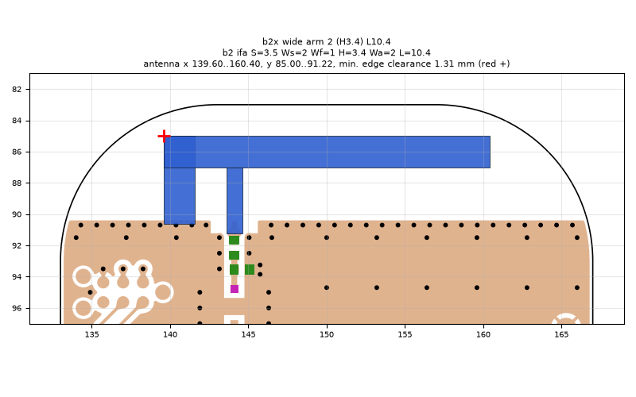
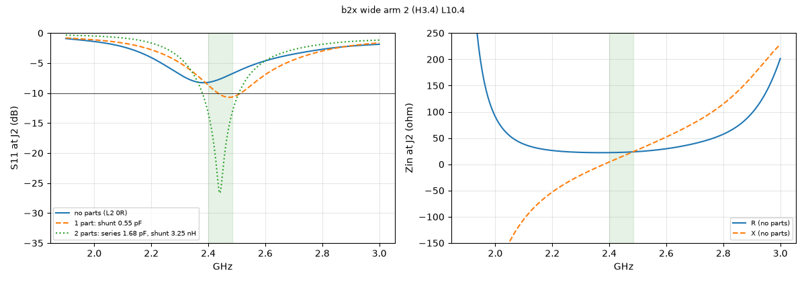
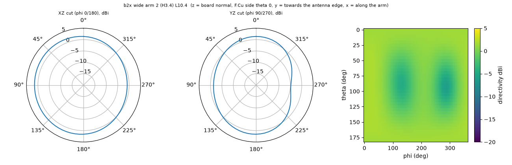

# b2x wide arm 2 (H3.4) L10.4

**Why this run:** Length bracket for the 2 mm arm

Run `85f884932b`, tag `b2_explore1`, model v5, board `build/b2/board.json`, battery yes, mask none.

## Antenna

ifa, ground edge base b2: S 3.5 mm, Ws 2 mm, Wf 1 mm, H 3.4 mm, Wa 2 mm, L 10.4 mm

| part | KiCad x0 | y0 | x1 | y1 |
|---|---|---|---|---|
| short leg | 139.60 | 85.00 | 141.60 | 90.65 |
| feed leg | 143.60 | 87.00 | 144.60 | 91.22 |
| arm | 139.60 | 85.00 | 160.40 | 87.00 |

Copper extent x 139.60..160.40, y 85.00..91.22 (KiCad), smallest distance to the board edge 1.31 mm.

## Impedance and match at J2

Best match without parts -8.3 dB at 2.384 GHz, worst BLE channel -6.8 dB, -10 dB band none MHz.

Z at J2: 2.40 GHz 22.2+4.4j ohm, 2.44 GHz 22.7+13.7j ohm, 2.48 GHz 23.6+23.0j ohm

| matching (ideal parts at J2, L2 series, L3 shunt) | worst BLE S11 |
|---|---|
| none (L2 0R) | -6.8 dB |
| 1 part: shunt 0.55 pF | -8.7 dB |
| 2 parts: series 1.68 pF, shunt 3.25 nH | -13.4 dB |

## Efficiency and pattern

| f GHz | radiation eff. | total eff. (no parts) | Dmax dBi |
|---|---|---|---|
| 2.40 | 86 % | 73 % | 1.9 |
| 2.44 | 88 % | 73 % | 1.9 |
| 2.48 | 89 % | 70 % | 2.0 |

Own far-field transform, about ±15 % (validation in farfield.py). Total efficiency is without matching parts.

Mesh 1970670 cells, run time 56 min.
