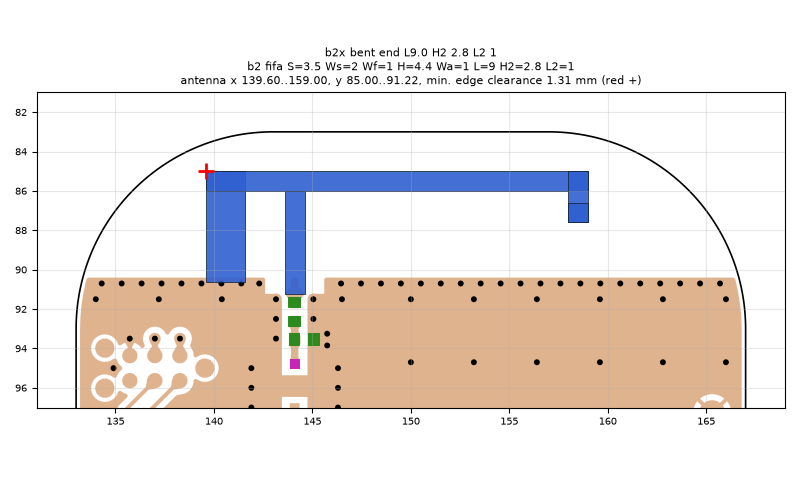
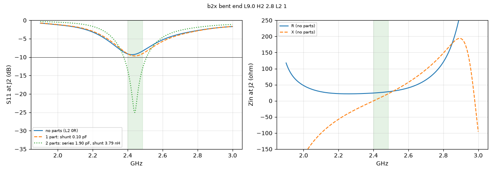
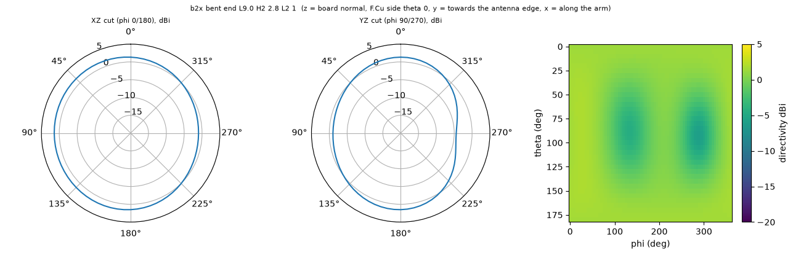

# b2x bent end L9.0 H2 2.8 L2 1

**Why this run:** Bent end at about the same electrical length as the straight L9.7: does bending the end down change bandwidth?

Run `896c3ba7bd`, tag `b2_explore1`, model v5, board `build/b2/board.json`, battery yes, mask none.

## Antenna

fifa, ground edge base b2: S 3.5 mm, Ws 2 mm, Wf 1 mm, H 4.4 mm, Wa 1 mm, L 9 mm, H2 2.8 mm, L2 1 mm

| part | KiCad x0 | y0 | x1 | y1 |
|---|---|---|---|---|
| short leg | 139.60 | 85.00 | 141.60 | 90.65 |
| feed leg | 143.60 | 86.00 | 144.60 | 91.22 |
| arm | 139.60 | 85.00 | 159.00 | 86.00 |
| drop | 158.00 | 85.00 | 159.00 | 87.60 |
| return | 158.00 | 86.60 | 159.00 | 87.60 |

Copper extent x 139.60..159.00, y 85.00..91.22 (KiCad), smallest distance to the board edge 1.31 mm.

## Impedance and match at J2

Best match without parts -9.3 dB at 2.425 GHz, worst BLE channel -8.4 dB, -10 dB band none MHz.

Z at J2: 2.40 GHz 24.1-0.4j ohm, 2.44 GHz 25.7+9.9j ohm, 2.48 GHz 27.8+20.6j ohm

| matching (ideal parts at J2, L2 series, L3 shunt) | worst BLE S11 |
|---|---|
| none (L2 0R) | -8.4 dB |
| 1 part: shunt 0.10 pF | -9.1 dB |
| 2 parts: series 1.90 pF, shunt 3.79 nH | -13.5 dB |

## Efficiency and pattern

| f GHz | radiation eff. | total eff. (no parts) | Dmax dBi |
|---|---|---|---|
| 2.40 | 85 % | 74 % | 1.9 |
| 2.44 | 86 % | 76 % | 1.9 |
| 2.48 | 87 % | 75 % | 2.0 |

Own far-field transform, about ±15 % (validation in farfield.py). Total efficiency is without matching parts.

Mesh 1971216 cells, run time 56 min.
