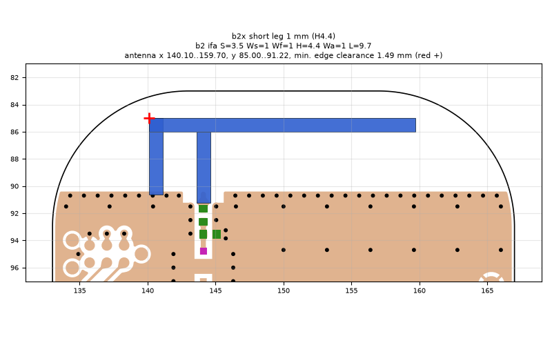
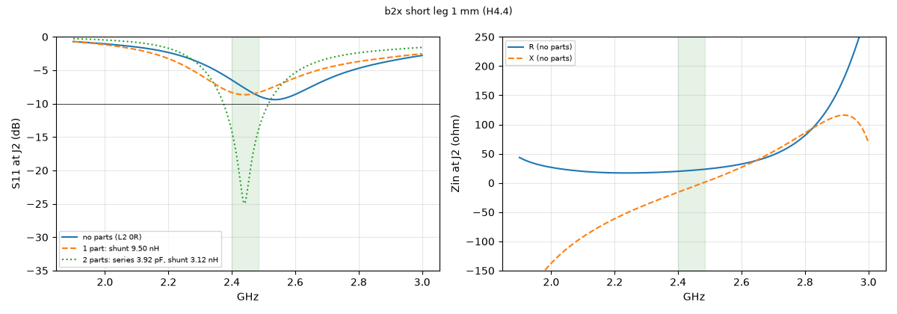
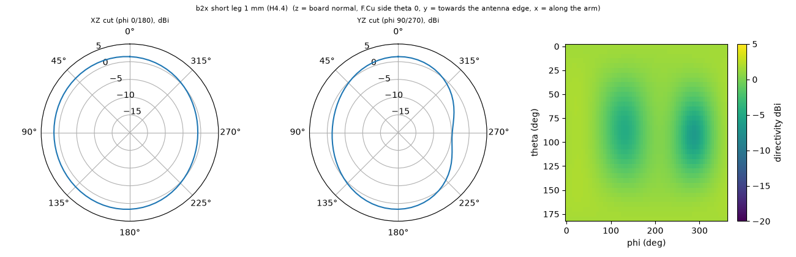

# b2x short leg 1 mm (H4.4)

**Why this run:** Short-leg width: thinner short leg raises R at the feed?

Run `8a6d05f0fe`, tag `b2_explore1`, model v5, board `build/b2/board.json`, battery yes, mask none.

## Antenna

ifa, ground edge base b2: S 3.5 mm, Ws 1 mm, Wf 1 mm, H 4.4 mm, Wa 1 mm, L 9.7 mm

| part | KiCad x0 | y0 | x1 | y1 |
|---|---|---|---|---|
| short leg | 140.10 | 85.00 | 141.10 | 90.65 |
| feed leg | 143.60 | 86.00 | 144.60 | 91.22 |
| arm | 140.10 | 85.00 | 159.70 | 86.00 |

Copper extent x 140.10..159.70, y 85.00..91.22 (KiCad), smallest distance to the board edge 1.49 mm.

## Impedance and match at J2

Best match without parts -9.4 dB at 2.535 GHz, worst BLE channel -6.5 dB, -10 dB band none MHz.

Z at J2: 2.40 GHz 19.9-15.9j ohm, 2.44 GHz 21.4-7.9j ohm, 2.48 GHz 23.2+0.3j ohm

| matching (ideal parts at J2, L2 series, L3 shunt) | worst BLE S11 |
|---|---|
| none (L2 0R) | -6.5 dB |
| 1 part: shunt 9.50 nH | -8.3 dB |
| 2 parts: series 3.92 pF, shunt 3.12 nH | -14.1 dB |

## Efficiency and pattern

| f GHz | radiation eff. | total eff. (no parts) | Dmax dBi |
|---|---|---|---|
| 2.40 | 85 % | 66 % | 1.9 |
| 2.44 | 86 % | 72 % | 1.9 |
| 2.48 | 87 % | 76 % | 2.0 |

Own far-field transform, about ±15 % (validation in farfield.py). Total efficiency is without matching parts.

Mesh 1970670 cells, run time 54 min.
