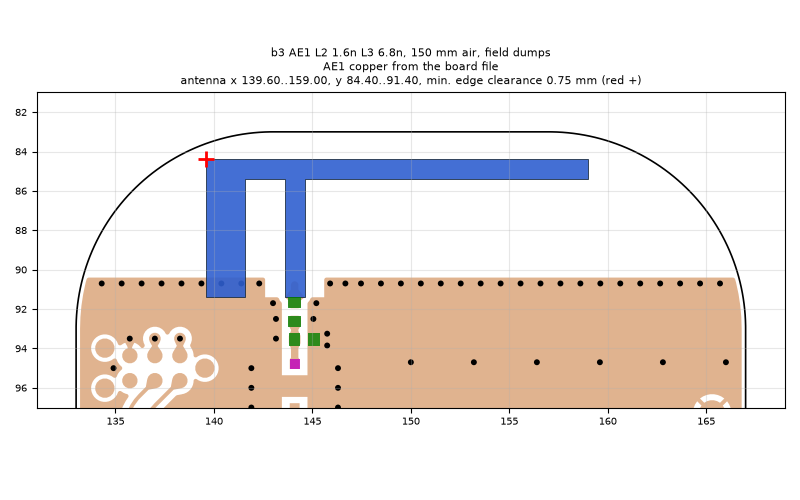
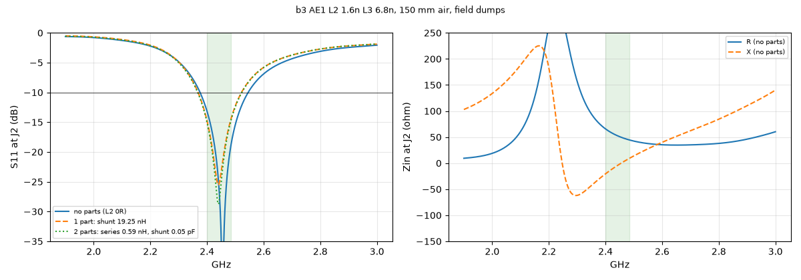
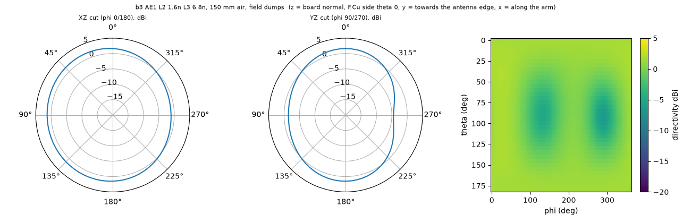

# b3 AE1 L2 1.6n L3 6.8n, 150 mm air, field dumps

**Why this run:** Visualisation run: matched antenna with 150 mm of air around the board (about 1.2 wavelengths) so the field movies show the radiated wave. Normal mesh, no mask, not used for the numbers

Run `8b668025c7`, tag `b3_3_wave`, model v5, board `build/b3/board.json`, battery yes, mask none.

## Antenna

placed (AE1 copper from the board file)

Copper extent x 139.60..159.00, y 84.40..91.40 (KiCad), smallest distance to the board edge 0.75 mm.

## Impedance and match at J2

Best match without parts -49.7 dB at 2.455 GHz, worst BLE channel -13.2 dB, -10 dB band [2376, 2545] MHz.

Z at J2: 2.40 GHz 65.7-20.5j ohm, 2.44 GHz 53.1-5.3j ohm, 2.48 GHz 45.2+7.9j ohm

| matching (ideal parts at J2, L2 series, L3 shunt) | worst BLE S11 |
|---|---|
| none (L2 0R) | -13.2 dB |
| 1 part: shunt 19.25 nH | -14.8 dB |
| 2 parts: series 0.59 nH, shunt 0.05 pF | -15.0 dB |

## Efficiency and pattern

| f GHz | radiation eff. | total eff. (no parts) | Dmax dBi |
|---|---|---|---|
| 2.40 | 80 % | 77 % | 2.0 |
| 2.44 | 82 % | 82 % | 2.0 |
| 2.48 | 83 % | 83 % | 2.0 |

Own far-field transform, about ±15 % (validation in farfield.py). Total efficiency is without matching parts.

Mesh 6617376 cells, run time 25 min.
