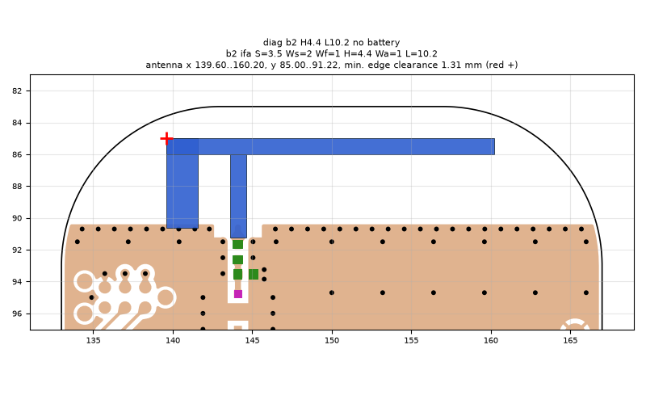
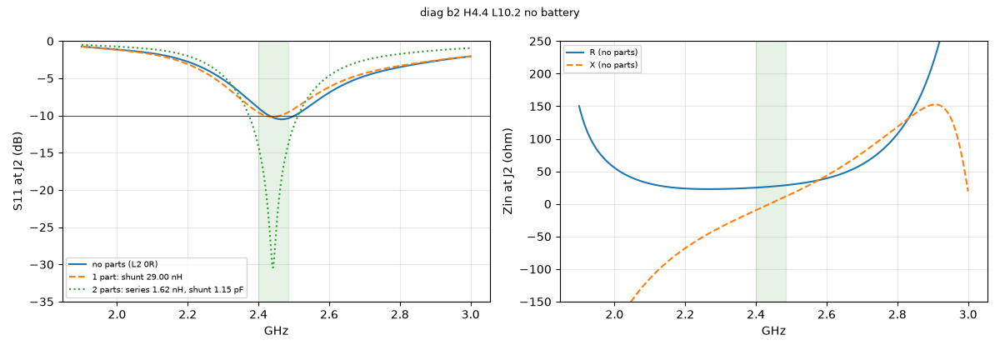

# diag b2 H4.4 L10.2 no battery

**Why this run:** Diagnostics of the sim model: battery removed, stricter end criterion, lossless FR4.

Run `8d353c0ac3`, tag `diag1`, model v4, board `build/b2/board.json`, battery no, mask none.

## Antenna

ifa, ground edge base b2: S 3.5 mm, Ws 2 mm, Wf 1 mm, H 4.4 mm, Wa 1 mm, L 10.2 mm

| part | KiCad x0 | y0 | x1 | y1 |
|---|---|---|---|---|
| short leg | 139.60 | 85.00 | 141.60 | 90.65 |
| feed leg | 143.60 | 86.00 | 144.60 | 91.22 |
| arm | 139.60 | 85.00 | 160.20 | 86.00 |

Copper extent x 139.60..160.20, y 85.00..91.22 (KiCad), smallest distance to the board edge 1.31 mm.

## Impedance and match at J2

Best match without parts -10.5 dB at 2.466 GHz, worst BLE channel -9.0 dB, -10 dB band [2430, 2503] MHz.

Z at J2: 2.40 GHz 25.0-9.7j ohm, 2.44 GHz 26.5+0.1j ohm, 2.48 GHz 28.4+10.1j ohm

| matching (ideal parts at J2, L2 series, L3 shunt) | worst BLE S11 |
|---|---|
| none (L2 0R) | -9.0 dB |
| 1 part: shunt 29.00 nH | -9.6 dB |
| 2 parts: series 1.62 nH, shunt 1.15 pF | -14.1 dB |

## Efficiency and pattern

Not valid: this run used the openEMS NF2FF transform (model v4), which is wrong for this board.

Mesh 1796256 cells, run time 24 min.
