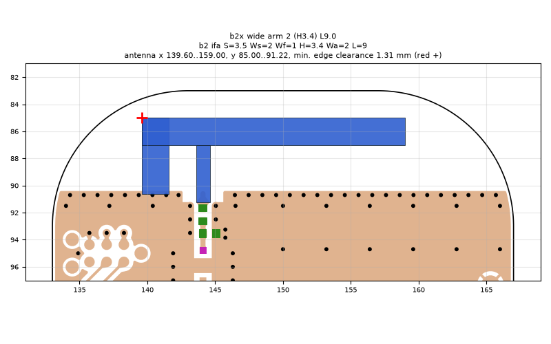
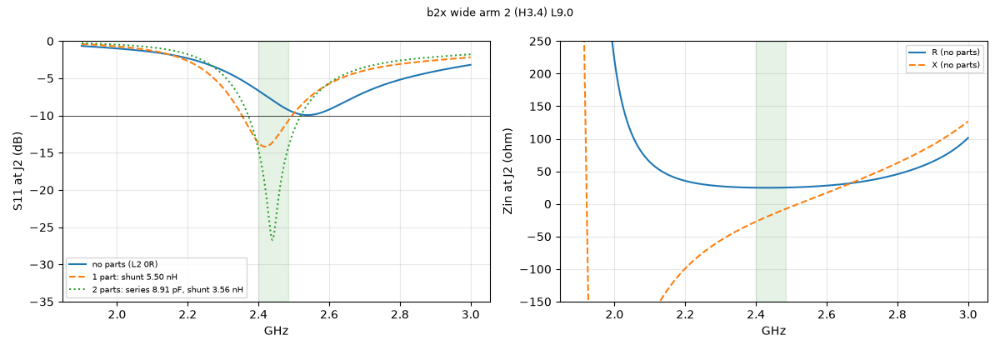
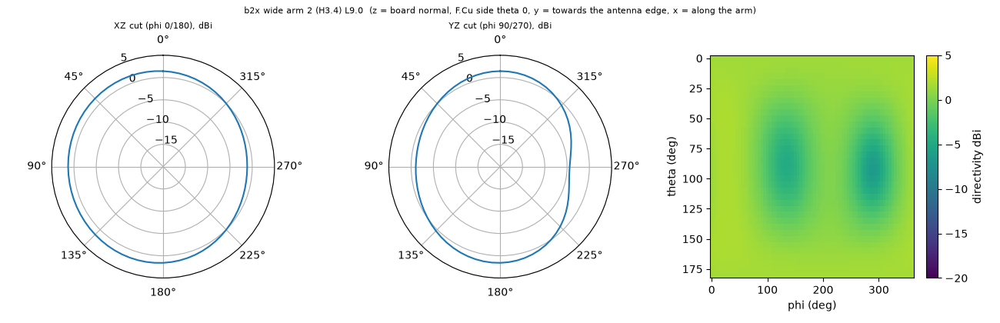

# b2x wide arm 2 (H3.4) L9.0

**Why this run:** Length bracket for the 2 mm arm (resonance shifts with arm width)

Run `953eedb7e3`, tag `b2_explore1`, model v5, board `build/b2/board.json`, battery yes, mask none.

## Antenna

ifa, ground edge base b2: S 3.5 mm, Ws 2 mm, Wf 1 mm, H 3.4 mm, Wa 2 mm, L 9 mm

| part | KiCad x0 | y0 | x1 | y1 |
|---|---|---|---|---|
| short leg | 139.60 | 85.00 | 141.60 | 90.65 |
| feed leg | 143.60 | 87.00 | 144.60 | 91.22 |
| arm | 139.60 | 85.00 | 159.00 | 87.00 |

Copper extent x 139.60..159.00, y 85.00..91.22 (KiCad), smallest distance to the board edge 1.31 mm.

## Impedance and match at J2

Best match without parts -9.9 dB at 2.539 GHz, worst BLE channel -6.7 dB, -10 dB band none MHz.

Z at J2: 2.40 GHz 24.9-27.2j ohm, 2.44 GHz 24.8-17.6j ohm, 2.48 GHz 25.1-8.6j ohm

| matching (ideal parts at J2, L2 series, L3 shunt) | worst BLE S11 |
|---|---|
| none (L2 0R) | -6.7 dB |
| 1 part: shunt 5.50 nH | -10.8 dB |
| 2 parts: series 8.91 pF, shunt 3.56 nH | -14.5 dB |

## Efficiency and pattern

| f GHz | radiation eff. | total eff. (no parts) | Dmax dBi |
|---|---|---|---|
| 2.40 | 85 % | 67 % | 1.9 |
| 2.44 | 86 % | 73 % | 2.0 |
| 2.48 | 88 % | 77 % | 2.0 |

Own far-field transform, about ±15 % (validation in farfield.py). Total efficiency is without matching parts.

Mesh 1958580 cells, run time 54 min.
