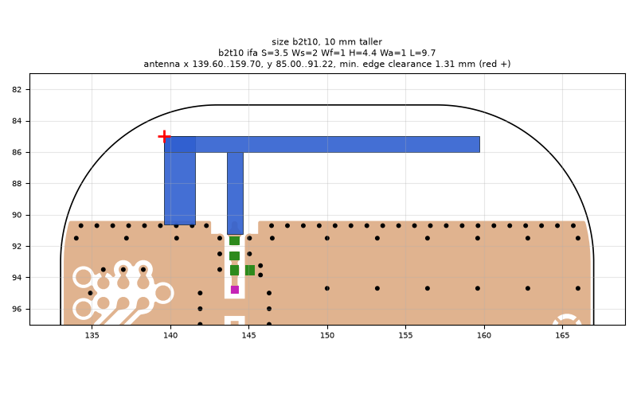
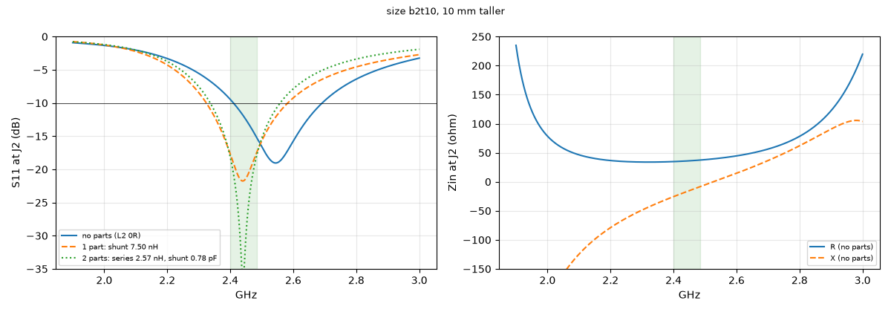
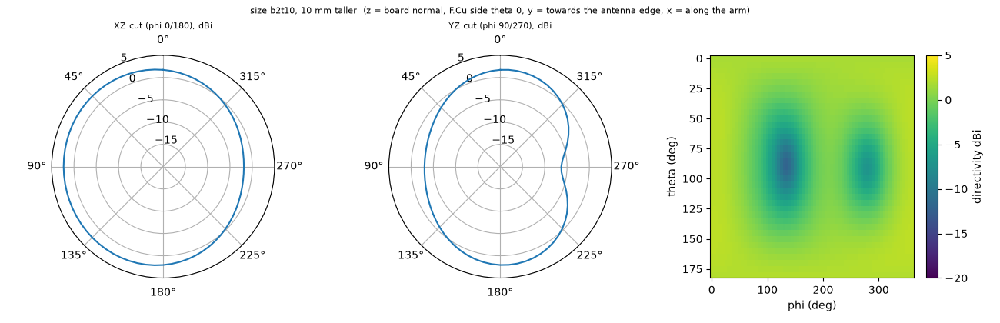

# size b2t10, 10 mm taller

**Why this run:** Bigger board: how much does a larger ground plane improve the matched bandwidth and efficiency of the same IFA (H4.4 L9.7)?

Run `97ca986a4f`, tag `size1`, model v5, board `build/b2t10/board.json`, battery yes, mask none.

## Antenna

ifa, ground edge base b2t10: S 3.5 mm, Ws 2 mm, Wf 1 mm, H 4.4 mm, Wa 1 mm, L 9.7 mm

| part | KiCad x0 | y0 | x1 | y1 |
|---|---|---|---|---|
| short leg | 139.60 | 85.00 | 141.60 | 90.65 |
| feed leg | 143.60 | 86.00 | 144.60 | 91.22 |
| arm | 139.60 | 85.00 | 159.70 | 86.00 |

Copper extent x 139.60..159.70, y 85.00..91.22 (KiCad), smallest distance to the board edge 1.31 mm.

## Impedance and match at J2

Best match without parts -19.1 dB at 2.544 GHz, worst BLE channel -9.5 dB, -10 dB band [2411, 2691] MHz.

Z at J2: 2.40 GHz 34.7-25.6j ohm, 2.44 GHz 35.8-17.3j ohm, 2.48 GHz 37.2-9.3j ohm

| matching (ideal parts at J2, L2 series, L3 shunt) | worst BLE S11 |
|---|---|
| none (L2 0R) | -9.5 dB |
| 1 part: shunt 7.50 nH | -17.6 dB |
| 2 parts: series 2.57 nH, shunt 0.78 pF | -18.1 dB |

## Efficiency and pattern

| f GHz | radiation eff. | total eff. (no parts) | Dmax dBi |
|---|---|---|---|
| 2.40 | 88 % | 78 % | 2.5 |
| 2.44 | 89 % | 83 % | 2.5 |
| 2.48 | 90 % | 87 % | 2.6 |

Own far-field transform, about ±15 % (validation in farfield.py). Total efficiency is without matching parts.

Mesh 2123238 cells, run time 45 min.
