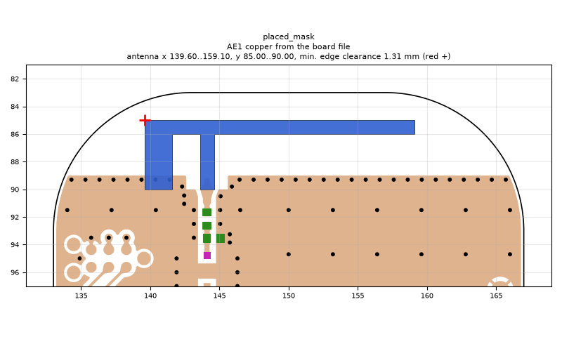
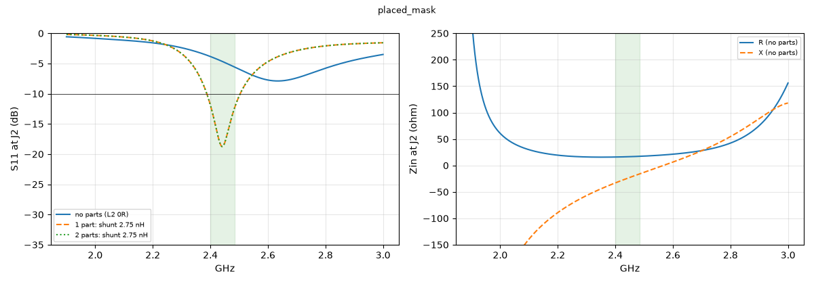

# placed_mask

**Why this run:** Reference: AE1 as first placed on the rev B board (b1), with explicit solder mask and with lossless FR4 to measure the mask shift and the FR4 loss.

Run `9a66338216`, tag `ref`, model v4, board `build/board.json`, battery yes, mask explicit.

## Antenna

placed (AE1 copper from the board file)

Copper extent x 139.60..159.10, y 85.00..90.00 (KiCad), smallest distance to the board edge 1.31 mm.

## Impedance and match at J2

Best match without parts -7.9 dB at 2.634 GHz, worst BLE channel -3.8 dB, -10 dB band none MHz.

Z at J2: 2.40 GHz 16.0-33.0j ohm, 2.44 GHz 16.5-24.7j ohm, 2.48 GHz 17.2-16.8j ohm

| matching (ideal parts at J2, L2 series, L3 shunt) | worst BLE S11 |
|---|---|
| none (L2 0R) | -3.8 dB |
| 1 part: shunt 2.75 nH | -11.9 dB |
| 2 parts: shunt 2.75 nH | -11.9 dB |

## Efficiency and pattern

Not valid: this run used the openEMS NF2FF transform (model v4), which is wrong for this board.

Mesh 3712488 cells, run time 251 min.
