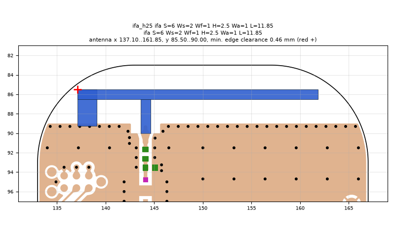
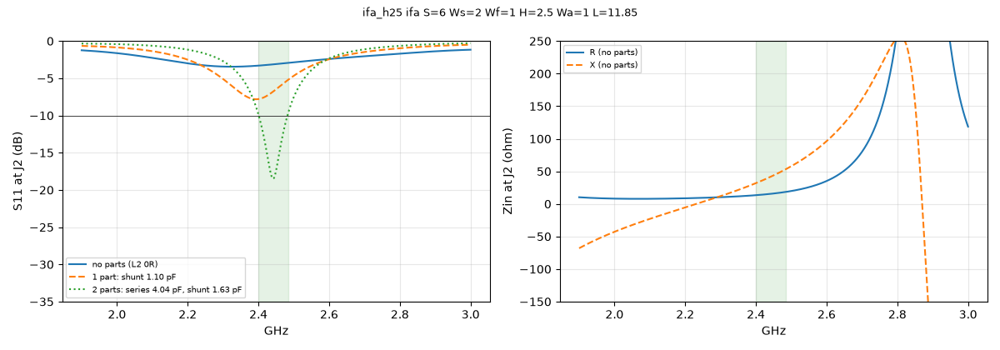

# ifa_h25 ifa S=6 Ws=2 Wf=1 H=2.5 Wa=1 L=11.85

**Why this run:** Tuner start points: straight IFA with the arm 2.5 mm above the ground edge (b1).

Run `9a97810cdc`, tag `tune_ifa_h25`, model v4, board `build/board.json`, battery yes, mask none.

## Antenna

ifa, ground edge base b1: S 6 mm, Ws 2 mm, Wf 1 mm, H 2.5 mm, Wa 1 mm, L 11.85 mm

| part | KiCad x0 | y0 | x1 | y1 |
|---|---|---|---|---|
| short leg | 137.10 | 85.50 | 139.10 | 89.25 |
| feed leg | 143.60 | 86.50 | 144.60 | 90.00 |
| arm | 137.10 | 85.50 | 161.85 | 86.50 |

Copper extent x 137.10..161.85, y 85.50..90.00 (KiCad), smallest distance to the board edge 0.46 mm.

## Impedance and match at J2

Best match without parts -3.4 dB at 2.325 GHz, worst BLE channel -2.9 dB, -10 dB band none MHz.

Z at J2: 2.40 GHz 13.4+31.9j ohm, 2.44 GHz 15.4+41.3j ohm, 2.48 GHz 18.1+52.0j ohm

| matching (ideal parts at J2, L2 series, L3 shunt) | worst BLE S11 |
|---|---|
| none (L2 0R) | -2.9 dB |
| 1 part: shunt 1.10 pF | -5.2 dB |
| 2 parts: series 4.04 pF, shunt 1.63 pF | -9.9 dB |

## Efficiency and pattern

Not valid: this run used the openEMS NF2FF transform (model v4), which is wrong for this board.

Mesh 1982760 cells, run time 25 min.
