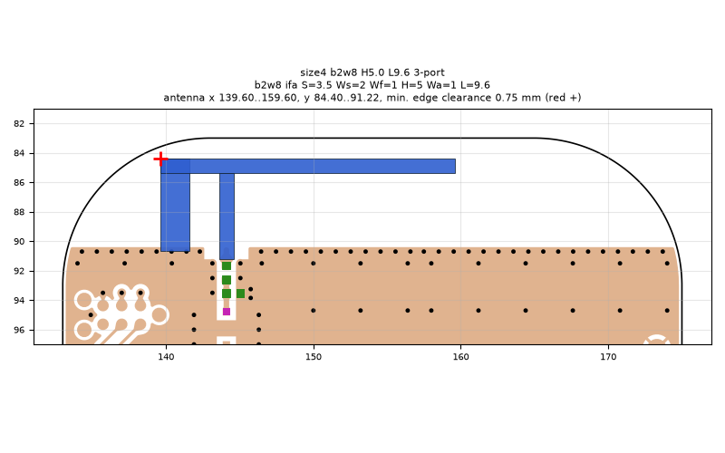
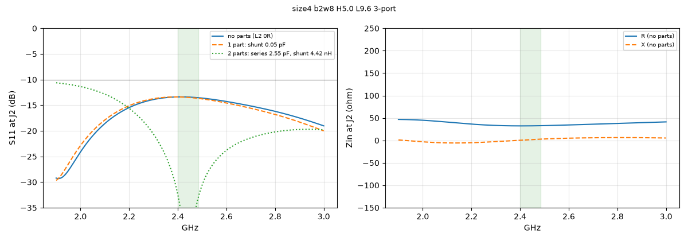
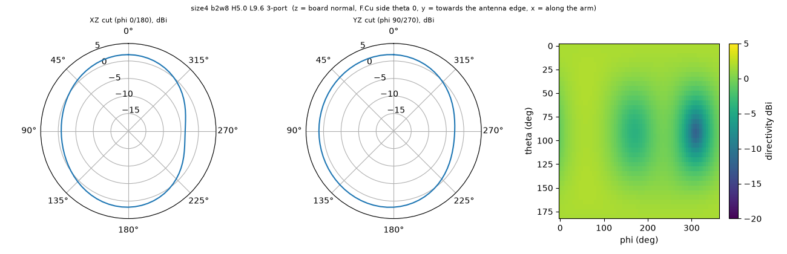

# size4 b2w8 H5.0 L9.6 3-port

**Why this run:** Bigger-board option (8 mm wider) at its best arm length: 3-port (J2, L2, L3) for the real parts table, no mask (mask moves about -19 MHz)

Run `9b0c89d717`, tag `size4_3port`, model v5, board `build/b2w8/board.json`, battery yes, mask none.

## Antenna

ifa, ground edge base b2w8: S 3.5 mm, Ws 2 mm, Wf 1 mm, H 5 mm, Wa 1 mm, L 9.6 mm

| part | KiCad x0 | y0 | x1 | y1 |
|---|---|---|---|---|
| short leg | 139.60 | 84.40 | 141.60 | 90.65 |
| feed leg | 143.60 | 85.40 | 144.60 | 91.22 |
| arm | 139.60 | 84.40 | 159.60 | 85.40 |

Copper extent x 139.60..159.60, y 84.40..91.22 (KiCad), smallest distance to the board edge 0.75 mm.

## Impedance and match at J2

Best match without parts -29.3 dB at 1.910 GHz, worst BLE channel -13.4 dB, -10 dB band [1900, 3000] MHz.

Z at J2: 2.40 GHz 32.4+0.5j ohm, 2.44 GHz 32.5+1.7j ohm, 2.48 GHz 32.8+2.8j ohm

| matching (ideal parts at J2, L2 series, L3 shunt) | worst BLE S11 |
|---|---|
| none (L2 0R) | -13.4 dB |
| 1 part: shunt 0.05 pF | -13.4 dB |
| 2 parts: series 2.55 pF, shunt 4.42 nH | -32.4 dB |

## Efficiency and pattern

| f GHz | radiation eff. | total eff. (no parts) | Dmax dBi |
|---|---|---|---|
| 2.40 | 16 % | 15 % | 2.0 |
| 2.44 | 16 % | 15 % | 2.1 |
| 2.48 | 15 % | 15 % | 2.1 |

Own far-field transform, about ±15 % (validation in farfield.py). Total efficiency is without matching parts.

Mesh 2130804 cells, run time 24 min.
