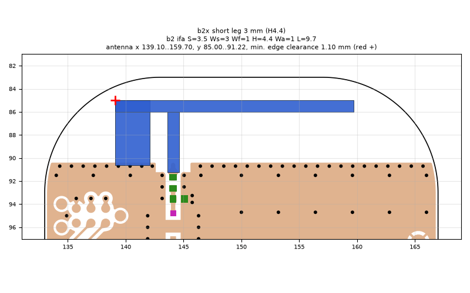
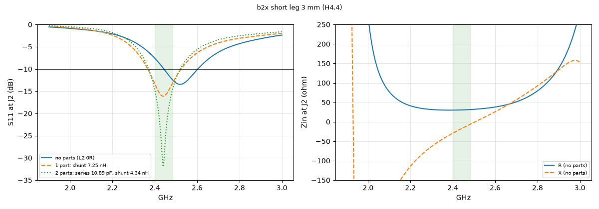
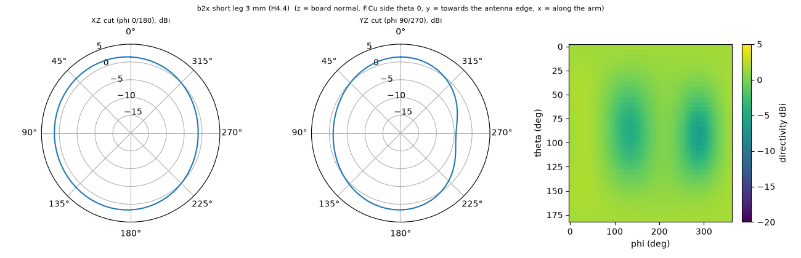

# b2x short leg 3 mm (H4.4)

**Why this run:** Short-leg width: wider short leg

Run `9e3967cbcd`, tag `b2_explore1`, model v5, board `build/b2/board.json`, battery yes, mask none.

## Antenna

ifa, ground edge base b2: S 3.5 mm, Ws 3 mm, Wf 1 mm, H 4.4 mm, Wa 1 mm, L 9.7 mm

| part | KiCad x0 | y0 | x1 | y1 |
|---|---|---|---|---|
| short leg | 139.10 | 85.00 | 142.10 | 90.65 |
| feed leg | 143.60 | 86.00 | 144.60 | 91.22 |
| arm | 139.10 | 85.00 | 159.70 | 86.00 |

Copper extent x 139.10..159.70, y 85.00..91.22 (KiCad), smallest distance to the board edge 1.10 mm.

## Impedance and match at J2

Best match without parts -13.5 dB at 2.520 GHz, worst BLE channel -7.6 dB, -10 dB band [2443, 2603] MHz.

Z at J2: 2.40 GHz 29.9-29.4j ohm, 2.44 GHz 30.4-17.9j ohm, 2.48 GHz 31.3-7.0j ohm

| matching (ideal parts at J2, L2 series, L3 shunt) | worst BLE S11 |
|---|---|
| none (L2 0R) | -7.6 dB |
| 1 part: shunt 7.25 nH | -13.3 dB |
| 2 parts: series 10.89 pF, shunt 4.34 nH | -14.7 dB |

## Efficiency and pattern

| f GHz | radiation eff. | total eff. (no parts) | Dmax dBi |
|---|---|---|---|
| 2.40 | 85 % | 70 % | 1.9 |
| 2.44 | 86 % | 77 % | 2.0 |
| 2.48 | 87 % | 82 % | 2.0 |

Own far-field transform, about ±15 % (validation in farfield.py). Total efficiency is without matching parts.

Mesh 1982760 cells, run time 56 min.
