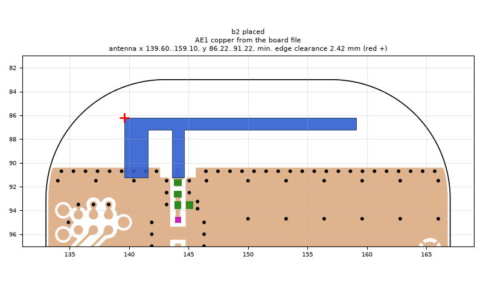
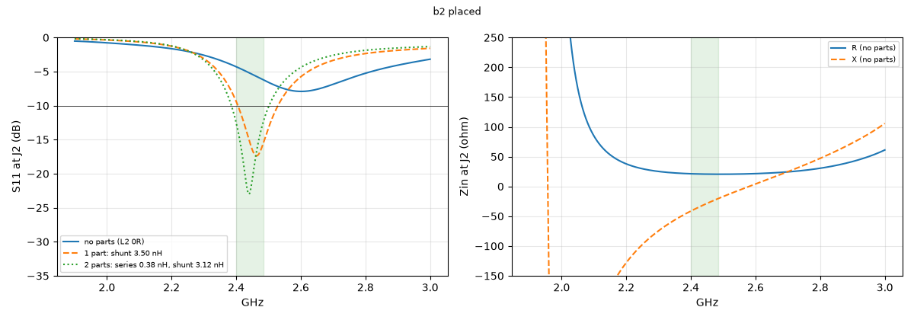

# b2 placed

**Why this run:** First look at the b2 layout (antenna-side shunt pads removed, ground edge 1.4 mm lower): does the lower ground edge help?

Run `a3abde20e9`, tag `b2_quick`, model v4, board `build/b2/board.json`, battery yes, mask none.

## Antenna

placed (AE1 copper from the board file)

Copper extent x 139.60..159.10, y 86.22..91.22 (KiCad), smallest distance to the board edge 2.42 mm.

## Impedance and match at J2

Best match without parts -7.9 dB at 2.601 GHz, worst BLE channel -4.3 dB, -10 dB band none MHz.

Z at J2: 2.40 GHz 21.3-41.3j ohm, 2.44 GHz 20.7-30.8j ohm, 2.48 GHz 20.5-21.4j ohm

| matching (ideal parts at J2, L2 series, L3 shunt) | worst BLE S11 |
|---|---|
| none (L2 0R) | -4.3 dB |
| 1 part: shunt 3.50 nH | -9.4 dB |
| 2 parts: series 0.38 nH, shunt 3.12 nH | -12.5 dB |

## Efficiency and pattern

Not valid: this run used the openEMS NF2FF transform (model v4), which is wrong for this board.

Mesh 1983384 cells, run time 46 min.
