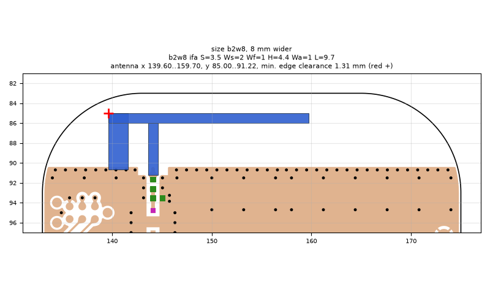
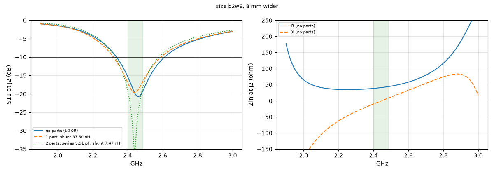
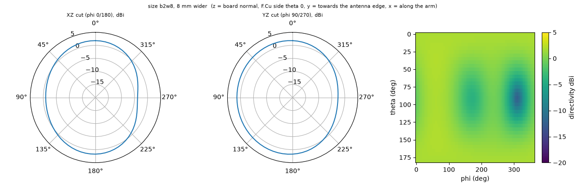

# size b2w8, 8 mm wider

**Why this run:** Bigger board: how much does a larger ground plane improve the matched bandwidth and efficiency of the same IFA (H4.4 L9.7)?

Run `a3d7b52f39`, tag `size1`, model v5, board `build/b2w8/board.json`, battery yes, mask none.

## Antenna

ifa, ground edge base b2w8: S 3.5 mm, Ws 2 mm, Wf 1 mm, H 4.4 mm, Wa 1 mm, L 9.7 mm

| part | KiCad x0 | y0 | x1 | y1 |
|---|---|---|---|---|
| short leg | 139.60 | 85.00 | 141.60 | 90.65 |
| feed leg | 143.60 | 86.00 | 144.60 | 91.22 |
| arm | 139.60 | 85.00 | 159.70 | 86.00 |

Copper extent x 139.60..159.70, y 85.00..91.22 (KiCad), smallest distance to the board edge 1.31 mm.

## Impedance and match at J2

Best match without parts -20.7 dB at 2.460 GHz, worst BLE channel -15.3 dB, -10 dB band [2336, 2611] MHz.

Z at J2: 2.40 GHz 38.4-10.0j ohm, 2.44 GHz 40.7-1.3j ohm, 2.48 GHz 43.6+7.2j ohm

| matching (ideal parts at J2, L2 series, L3 shunt) | worst BLE S11 |
|---|---|
| none (L2 0R) | -15.3 dB |
| 1 part: shunt 37.50 nH | -17.0 dB |
| 2 parts: series 3.91 pF, shunt 7.47 nH | -19.0 dB |

## Efficiency and pattern

| f GHz | radiation eff. | total eff. (no parts) | Dmax dBi |
|---|---|---|---|
| 2.40 | 91 % | 88 % | 2.1 |
| 2.44 | 92 % | 91 % | 2.1 |
| 2.48 | 92 % | 91 % | 2.1 |

Own far-field transform, about ±15 % (validation in farfield.py). Total efficiency is without matching parts.

Mesh 2091570 cells, run time 48 min.
