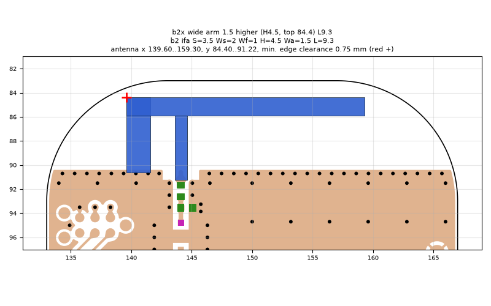
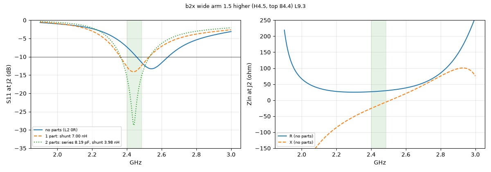
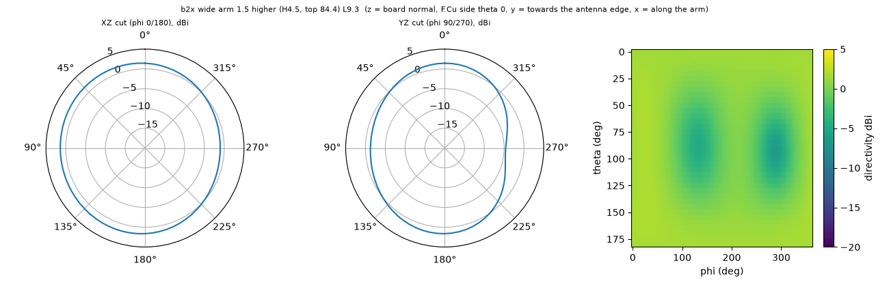

# b2x wide arm 1.5 higher (H4.5, top 84.4) L9.3

**Why this run:** Combine height and width: 1.5 mm arm with its top 0.6 mm higher

Run `ac813f4590`, tag `b2_explore1`, model v5, board `build/b2/board.json`, battery yes, mask none.

## Antenna

ifa, ground edge base b2: S 3.5 mm, Ws 2 mm, Wf 1 mm, H 4.5 mm, Wa 1.5 mm, L 9.3 mm

| part | KiCad x0 | y0 | x1 | y1 |
|---|---|---|---|---|
| short leg | 139.60 | 84.40 | 141.60 | 90.65 |
| feed leg | 143.60 | 85.90 | 144.60 | 91.22 |
| arm | 139.60 | 84.40 | 159.30 | 85.90 |

Copper extent x 139.60..159.30, y 84.40..91.22 (KiCad), smallest distance to the board edge 0.75 mm.

## Impedance and match at J2

Best match without parts -13.3 dB at 2.541 GHz, worst BLE channel -7.3 dB, -10 dB band [2455, 2637] MHz.

Z at J2: 2.40 GHz 26.5-25.5j ohm, 2.44 GHz 27.8-16.2j ohm, 2.48 GHz 29.5-7.1j ohm

| matching (ideal parts at J2, L2 series, L3 shunt) | worst BLE S11 |
|---|---|
| none (L2 0R) | -7.3 dB |
| 1 part: shunt 7.00 nH | -12.5 dB |
| 2 parts: series 8.19 pF, shunt 3.98 nH | -15.5 dB |

## Efficiency and pattern

| f GHz | radiation eff. | total eff. (no parts) | Dmax dBi |
|---|---|---|---|
| 2.40 | 87 % | 71 % | 2.0 |
| 2.44 | 88 % | 78 % | 2.0 |
| 2.48 | 89 % | 83 % | 2.0 |

Own far-field transform, about ±15 % (validation in farfield.py). Total efficiency is without matching parts.

Mesh 1983384 cells, run time 55 min.
