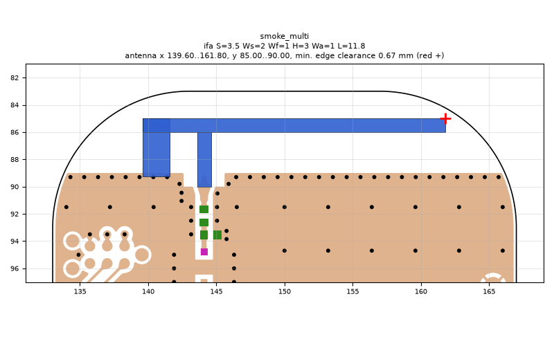
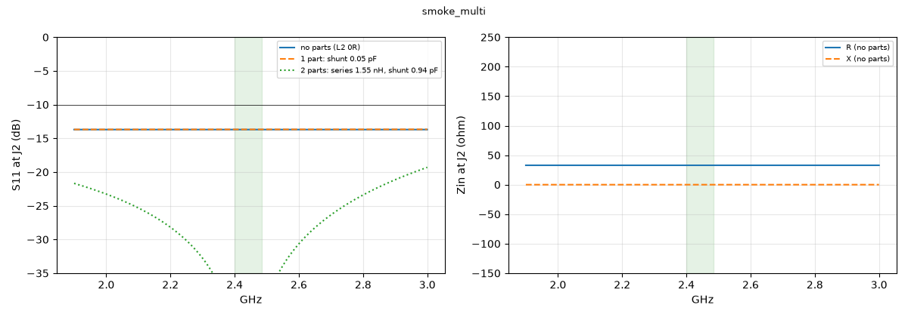

# smoke_multi

**Why this run:** Smoke test of the pipeline.

Run `b89837992e`, tag `smoke`, model v3, board `build/board.json`, battery yes, mask none.

## Antenna

ifa, ground edge base b1: S 3.5 mm, Ws 2 mm, Wf 1 mm, H 3 mm, Wa 1 mm, L 11.8 mm

| part | KiCad x0 | y0 | x1 | y1 |
|---|---|---|---|---|
| short leg | 139.60 | 85.00 | 141.60 | 89.25 |
| feed leg | 143.60 | 86.00 | 144.60 | 90.00 |
| arm | 139.60 | 85.00 | 161.80 | 86.00 |

Copper extent x 139.60..161.80, y 85.00..90.00 (KiCad), smallest distance to the board edge 0.67 mm.

## Impedance and match at J2

Best match without parts -13.7 dB at 1.900 GHz, worst BLE channel -13.7 dB, -10 dB band [1900, 3000] MHz.

Z at J2: 2.40 GHz 32.9+0.0j ohm, 2.44 GHz 32.9+0.0j ohm, 2.48 GHz 32.9+0.0j ohm

| matching (ideal parts at J2, L2 series, L3 shunt) | worst BLE S11 |
|---|---|
| none (L2 0R) | -13.7 dB |
| 1 part: shunt 0.05 pF | -13.7 dB |
| 2 parts: series 1.55 nH, shunt 0.94 pF | -41.6 dB |

## Efficiency and pattern

Not valid: this run used the openEMS NF2FF transform (model v3), which is wrong for this board.

Mesh 2106312 cells, run time 1 min.
