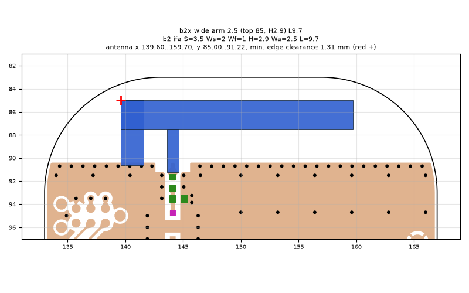
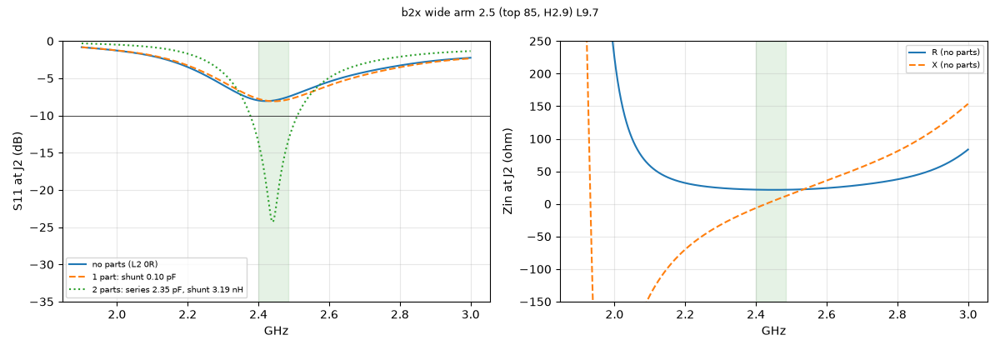
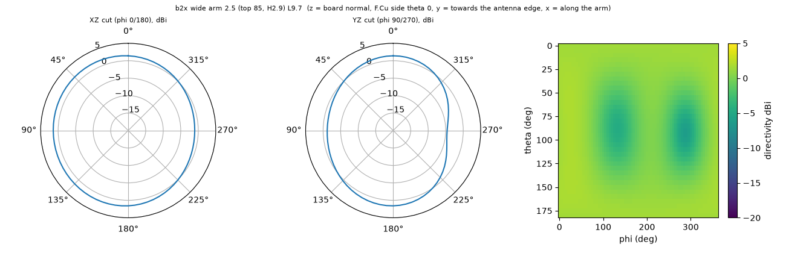

# b2x wide arm 2.5 (top 85, H2.9) L9.7

**Why this run:** Wide planar arm like the commercial beacon (2-2.5 mm): more bandwidth, lower Q?

Run `bbb1dae8b1`, tag `b2_explore1`, model v5, board `build/b2/board.json`, battery yes, mask none.

## Antenna

ifa, ground edge base b2: S 3.5 mm, Ws 2 mm, Wf 1 mm, H 2.9 mm, Wa 2.5 mm, L 9.7 mm

| part | KiCad x0 | y0 | x1 | y1 |
|---|---|---|---|---|
| short leg | 139.60 | 85.00 | 141.60 | 90.65 |
| feed leg | 143.60 | 87.50 | 144.60 | 91.22 |
| arm | 139.60 | 85.00 | 159.70 | 87.50 |

Copper extent x 139.60..159.70, y 85.00..91.22 (KiCad), smallest distance to the board edge 1.31 mm.

## Impedance and match at J2

Best match without parts -8.1 dB at 2.422 GHz, worst BLE channel -7.5 dB, -10 dB band none MHz.

Z at J2: 2.40 GHz 21.9-6.3j ohm, 2.44 GHz 21.6+2.6j ohm, 2.48 GHz 21.7+11.1j ohm

| matching (ideal parts at J2, L2 series, L3 shunt) | worst BLE S11 |
|---|---|
| none (L2 0R) | -7.5 dB |
| 1 part: shunt 0.10 pF | -7.8 dB |
| 2 parts: series 2.35 pF, shunt 3.19 nH | -13.6 dB |

## Efficiency and pattern

| f GHz | radiation eff. | total eff. (no parts) | Dmax dBi |
|---|---|---|---|
| 2.40 | 86 % | 72 % | 1.9 |
| 2.44 | 87 % | 73 % | 1.9 |
| 2.48 | 88 % | 73 % | 2.0 |

Own far-field transform, about ±15 % (validation in farfield.py). Total efficiency is without matching parts.

Mesh 1970670 cells, run time 56 min.
