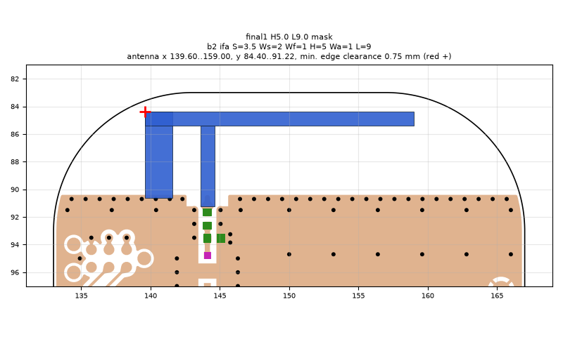
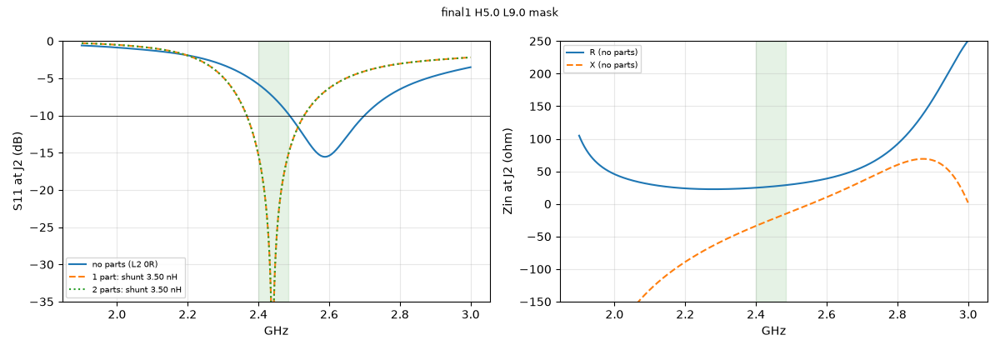
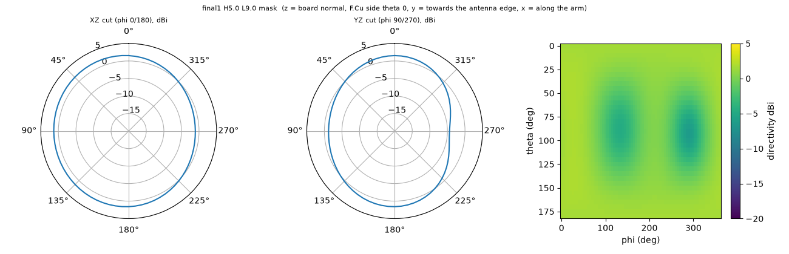

# final1 H5.0 L9.0 mask

**Why this run:** Final candidate H5.0 L9.0 (one shunt inductor on L3, mask-corrected length): explicit 20 um solder mask, the as-built case

Run `cae851224d`, tag `final1`, model v5, board `build/b2/board.json`, battery yes, mask explicit.

## Antenna

ifa, ground edge base b2: S 3.5 mm, Ws 2 mm, Wf 1 mm, H 5 mm, Wa 1 mm, L 9 mm

| part | KiCad x0 | y0 | x1 | y1 |
|---|---|---|---|---|
| short leg | 139.60 | 84.40 | 141.60 | 90.65 |
| feed leg | 143.60 | 85.40 | 144.60 | 91.22 |
| arm | 139.60 | 84.40 | 159.00 | 85.40 |

Copper extent x 139.60..159.00, y 84.40..91.22 (KiCad), smallest distance to the board edge 0.75 mm.

## Impedance and match at J2

Best match without parts -15.6 dB at 2.588 GHz, worst BLE channel -5.8 dB, -10 dB band [2489, 2699] MHz.

Z at J2: 2.40 GHz 24.8-33.7j ohm, 2.44 GHz 26.5-24.8j ohm, 2.48 GHz 28.6-16.2j ohm

| matching (ideal parts at J2, L2 series, L3 shunt) | worst BLE S11 |
|---|---|
| none (L2 0R) | -5.8 dB |
| 1 part: shunt 3.50 nH | -15.3 dB |
| 2 parts: shunt 3.50 nH | -15.3 dB |

## Efficiency and pattern

| f GHz | radiation eff. | total eff. (no parts) | Dmax dBi |
|---|---|---|---|
| 2.40 | 94 % | 69 % | 1.9 |
| 2.44 | 94 % | 77 % | 2.0 |
| 2.48 | 95 % | 85 % | 2.0 |

Own far-field transform, about ±15 % (validation in farfield.py). Total efficiency is without matching parts.

Mesh 3689712 cells, run time 160 min.
