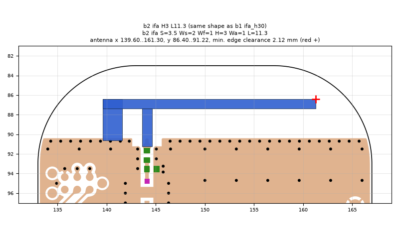
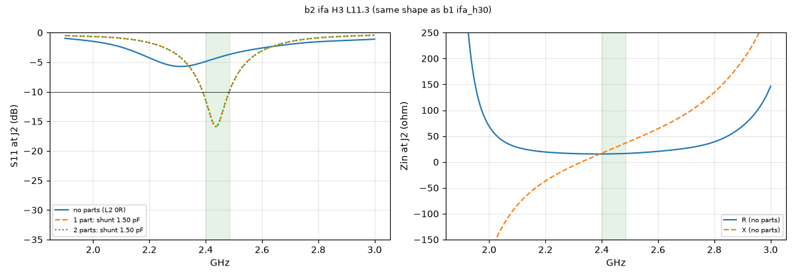

# b2 ifa H3 L11.3 (same shape as b1 ifa_h30)

**Why this run:** First look at the b2 layout (antenna-side shunt pads removed, ground edge 1.4 mm lower): does the lower ground edge help?

Run `cec47809c7`, tag `b2_quick`, model v4, board `build/b2/board.json`, battery yes, mask none.

## Antenna

ifa, ground edge base b2: S 3.5 mm, Ws 2 mm, Wf 1 mm, H 3 mm, Wa 1 mm, L 11.3 mm

| part | KiCad x0 | y0 | x1 | y1 |
|---|---|---|---|---|
| short leg | 139.60 | 86.40 | 141.60 | 90.65 |
| feed leg | 143.60 | 87.40 | 144.60 | 91.22 |
| arm | 139.60 | 86.40 | 161.30 | 87.40 |

Copper extent x 139.60..161.30, y 86.40..91.22 (KiCad), smallest distance to the board edge 2.12 mm.

## Impedance and match at J2

Best match without parts -5.7 dB at 2.311 GHz, worst BLE channel -3.7 dB, -10 dB band none MHz.

Z at J2: 2.40 GHz 15.4+17.0j ohm, 2.44 GHz 15.7+26.1j ohm, 2.48 GHz 16.3+35.4j ohm

| matching (ideal parts at J2, L2 series, L3 shunt) | worst BLE S11 |
|---|---|
| none (L2 0R) | -3.7 dB |
| 1 part: shunt 1.50 pF | -10.1 dB |
| 2 parts: shunt 1.50 pF | -10.1 dB |

## Efficiency and pattern

Not valid: this run used the openEMS NF2FF transform (model v4), which is wrong for this board.

Mesh 1983384 cells, run time 51 min.
