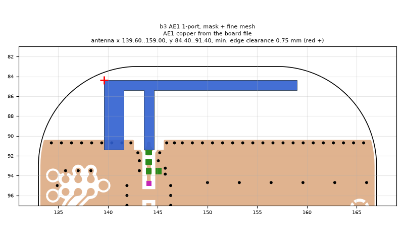
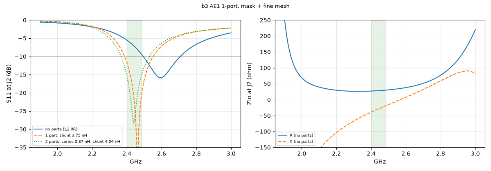
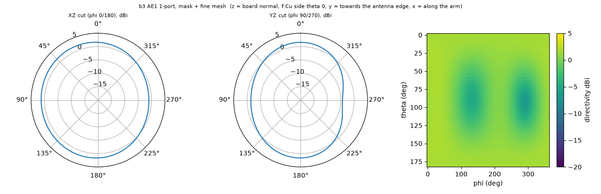

# b3 AE1 1-port, mask + fine mesh

**Why this run:** Report run: antenna impedance at J2 without parts (L2 0R, L3 open), pattern and radiation efficiency on the board as ordered

Run `d349ba0674`, tag `b3_2_1port`, model v5, board `build/b3/board.json`, battery yes, mask explicit.

## Antenna

placed (AE1 copper from the board file)

Copper extent x 139.60..159.00, y 84.40..91.40 (KiCad), smallest distance to the board edge 0.75 mm.

## Impedance and match at J2

Best match without parts -15.8 dB at 2.594 GHz, worst BLE channel -5.5 dB, -10 dB band [2495, 2707] MHz.

Z at J2: 2.40 GHz 26.9-39.5j ohm, 2.44 GHz 28.1-29.7j ohm, 2.48 GHz 29.6-20.3j ohm

| matching (ideal parts at J2, L2 series, L3 shunt) | worst BLE S11 |
|---|---|
| none (L2 0R) | -5.5 dB |
| 1 part: shunt 3.75 nH | -11.7 dB |
| 2 parts: series 0.37 nH, shunt 4.04 nH | -15.3 dB |

## Efficiency and pattern

| f GHz | radiation eff. | total eff. (no parts) | Dmax dBi |
|---|---|---|---|
| 2.40 | 90 % | 65 % | 2.0 |
| 2.44 | 92 % | 74 % | 2.0 |
| 2.48 | 92 % | 81 % | 2.0 |

Own far-field transform, about ±15 % (validation in farfield.py). Total efficiency is without matching parts.

Mesh 6905654 cells, run time 73 min.
