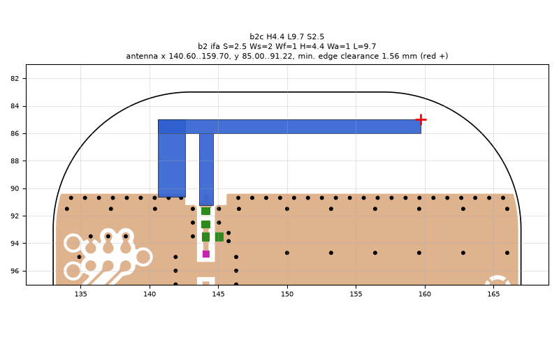
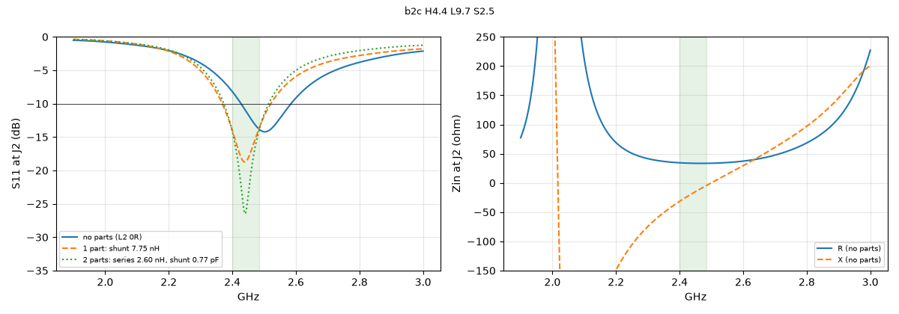
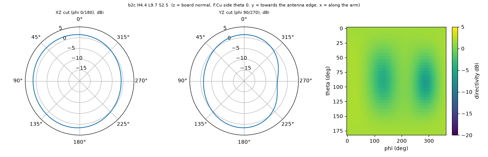

# b2c H4.4 L9.7 S2.5

**Why this run:** Candidates on b2 around the best quick result (arm top at KiCad y 85): length, short-leg spacing, arm width, arm height.

Run `e0db7223f0`, tag `b2_cand1`, model v5, board `build/b2/board.json`, battery yes, mask none.

## Antenna

ifa, ground edge base b2: S 2.5 mm, Ws 2 mm, Wf 1 mm, H 4.4 mm, Wa 1 mm, L 9.7 mm

| part | KiCad x0 | y0 | x1 | y1 |
|---|---|---|---|---|
| short leg | 140.60 | 85.00 | 142.60 | 90.65 |
| feed leg | 143.60 | 86.00 | 144.60 | 91.22 |
| arm | 140.60 | 85.00 | 159.70 | 86.00 |

Copper extent x 140.60..159.70, y 85.00..91.22 (KiCad), smallest distance to the board edge 1.56 mm.

## Impedance and match at J2

Best match without parts -14.2 dB at 2.502 GHz, worst BLE channel -8.2 dB, -10 dB band [2428, 2584] MHz.

Z at J2: 2.40 GHz 34.5-31.5j ohm, 2.44 GHz 33.7-18.1j ohm, 2.48 GHz 33.5-5.7j ohm

| matching (ideal parts at J2, L2 series, L3 shunt) | worst BLE S11 |
|---|---|
| none (L2 0R) | -8.2 dB |
| 1 part: shunt 7.75 nH | -13.8 dB |
| 2 parts: series 2.60 nH, shunt 0.77 pF | -14.2 dB |

## Efficiency and pattern

| f GHz | radiation eff. | total eff. (no parts) | Dmax dBi |
|---|---|---|---|
| 2.40 | 92 % | 78 % | 1.9 |
| 2.44 | 94 % | 86 % | 1.9 |
| 2.48 | 95 % | 91 % | 2.0 |

Own far-field transform, about ±15 % (validation in farfield.py). Total efficiency is without matching parts.

Mesh 1982760 cells, run time 60 min.
