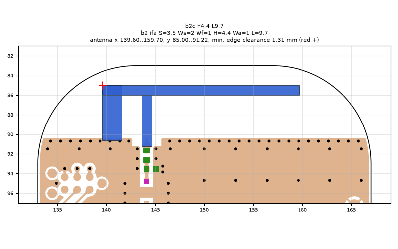
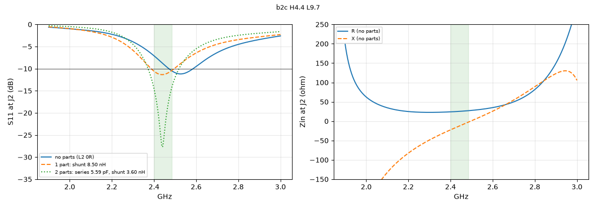
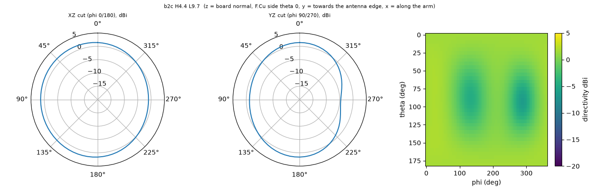

# b2c H4.4 L9.7

**Why this run:** Candidates on b2 around the best quick result (arm top at KiCad y 85): length, short-leg spacing, arm width, arm height.

Run `e2bdfff60d`, tag `b2_cand1`, model v5, board `build/b2/board.json`, battery yes, mask none.

## Antenna

ifa, ground edge base b2: S 3.5 mm, Ws 2 mm, Wf 1 mm, H 4.4 mm, Wa 1 mm, L 9.7 mm

| part | KiCad x0 | y0 | x1 | y1 |
|---|---|---|---|---|
| short leg | 139.60 | 85.00 | 141.60 | 90.65 |
| feed leg | 143.60 | 86.00 | 144.60 | 91.22 |
| arm | 139.60 | 85.00 | 159.70 | 86.00 |

Copper extent x 139.60..159.70, y 85.00..91.22 (KiCad), smallest distance to the board edge 1.31 mm.

## Impedance and match at J2

Best match without parts -11.2 dB at 2.526 GHz, worst BLE channel -7.1 dB, -10 dB band [2471, 2585] MHz.

Z at J2: 2.40 GHz 24.1-22.4j ohm, 2.44 GHz 25.3-12.9j ohm, 2.48 GHz 26.9-3.5j ohm

| matching (ideal parts at J2, L2 series, L3 shunt) | worst BLE S11 |
|---|---|
| none (L2 0R) | -7.1 dB |
| 1 part: shunt 8.50 nH | -10.5 dB |
| 2 parts: series 5.59 pF, shunt 3.60 nH | -14.5 dB |

## Efficiency and pattern

| f GHz | radiation eff. | total eff. (no parts) | Dmax dBi |
|---|---|---|---|
| 2.40 | 93 % | 75 % | 1.9 |
| 2.44 | 94 % | 81 % | 2.0 |
| 2.48 | 95 % | 86 % | 2.0 |

Own far-field transform, about ±15 % (validation in farfield.py). Total efficiency is without matching parts.

Mesh 1970670 cells, run time 53 min.
