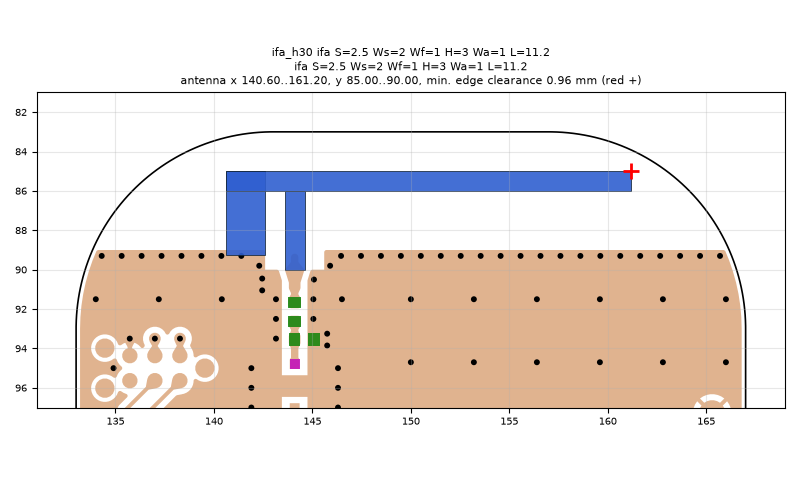
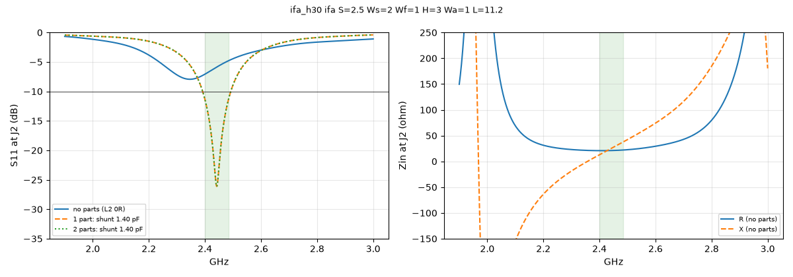

# ifa_h30 ifa S=2.5 Ws=2 Wf=1 H=3 Wa=1 L=11.2

**Why this run:** Tuner start points: straight IFA with the arm 3 mm above the ground edge (b1), tuning L and S towards 50 ohm at J2.

Run `ec6a57f835`, tag `tune_ifa_h30`, model v4, board `build/board.json`, battery yes, mask none.

## Antenna

ifa, ground edge base b1: S 2.5 mm, Ws 2 mm, Wf 1 mm, H 3 mm, Wa 1 mm, L 11.2 mm

| part | KiCad x0 | y0 | x1 | y1 |
|---|---|---|---|---|
| short leg | 140.60 | 85.00 | 142.60 | 89.25 |
| feed leg | 143.60 | 86.00 | 144.60 | 90.00 |
| arm | 140.60 | 85.00 | 161.20 | 86.00 |

Copper extent x 140.60..161.20, y 85.00..90.00 (KiCad), smallest distance to the board edge 0.96 mm.

## Impedance and match at J2

Best match without parts -7.9 dB at 2.346 GHz, worst BLE channel -4.8 dB, -10 dB band none MHz.

Z at J2: 2.40 GHz 20.8+12.8j ohm, 2.44 GHz 21.0+24.5j ohm, 2.48 GHz 21.9+36.3j ohm

| matching (ideal parts at J2, L2 series, L3 shunt) | worst BLE S11 |
|---|---|
| none (L2 0R) | -4.8 dB |
| 1 part: shunt 1.40 pF | -11.3 dB |
| 2 parts: shunt 1.40 pF | -11.3 dB |

## Efficiency and pattern

Not valid: this run used the openEMS NF2FF transform (model v4), which is wrong for this board.

Mesh 1982760 cells, run time 33 min.
