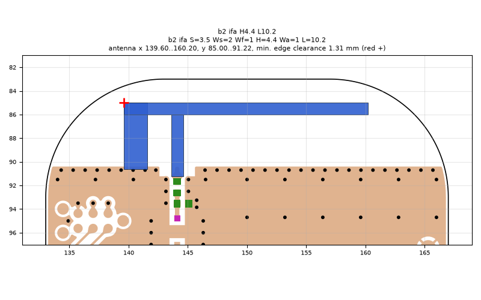
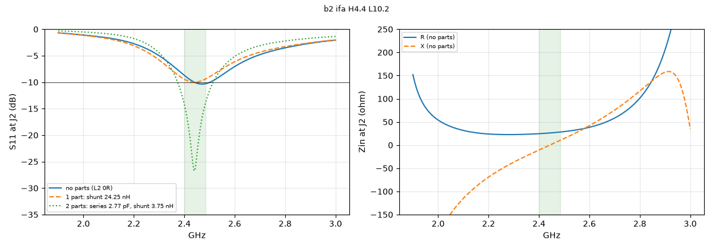

# b2 ifa H4.4 L10.2

**Why this run:** First look at the b2 layout (antenna-side shunt pads removed, ground edge 1.4 mm lower): does the lower ground edge help?

Run `ee452147dc`, tag `b2_quick`, model v4, board `build/b2/board.json`, battery yes, mask none.

## Antenna

ifa, ground edge base b2: S 3.5 mm, Ws 2 mm, Wf 1 mm, H 4.4 mm, Wa 1 mm, L 10.2 mm

| part | KiCad x0 | y0 | x1 | y1 |
|---|---|---|---|---|
| short leg | 139.60 | 85.00 | 141.60 | 90.65 |
| feed leg | 143.60 | 86.00 | 144.60 | 91.22 |
| arm | 139.60 | 85.00 | 160.20 | 86.00 |

Copper extent x 139.60..160.20, y 85.00..91.22 (KiCad), smallest distance to the board edge 1.31 mm.

## Impedance and match at J2

Best match without parts -10.4 dB at 2.471 GHz, worst BLE channel -8.7 dB, -10 dB band [2441, 2502] MHz.

Z at J2: 2.40 GHz 24.6-10.8j ohm, 2.44 GHz 26.0-0.9j ohm, 2.48 GHz 27.9+9.0j ohm

| matching (ideal parts at J2, L2 series, L3 shunt) | worst BLE S11 |
|---|---|
| none (L2 0R) | -8.7 dB |
| 1 part: shunt 24.25 nH | -9.4 dB |
| 2 parts: series 2.77 pF, shunt 3.75 nH | -14.1 dB |

## Efficiency and pattern

Not valid: this run used the openEMS NF2FF transform (model v4), which is wrong for this board.

Mesh 1970670 cells, run time 49 min.
