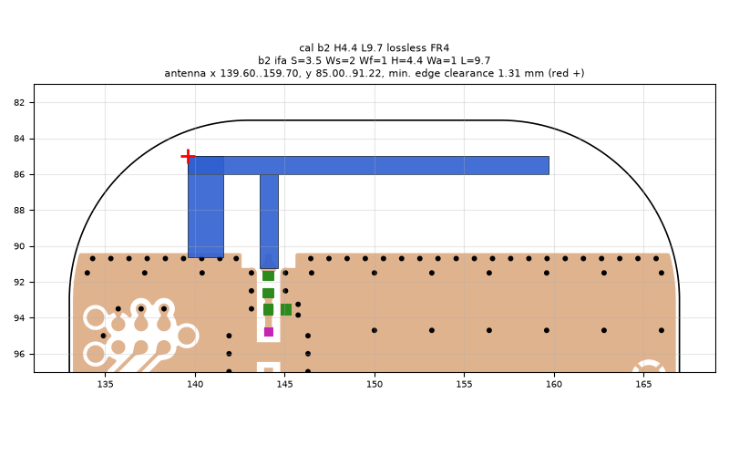
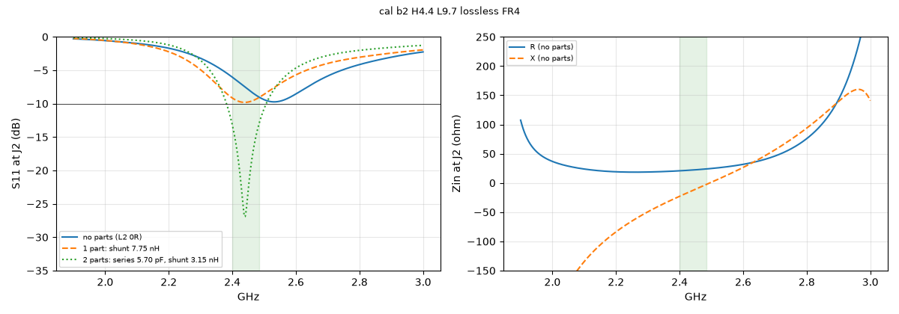
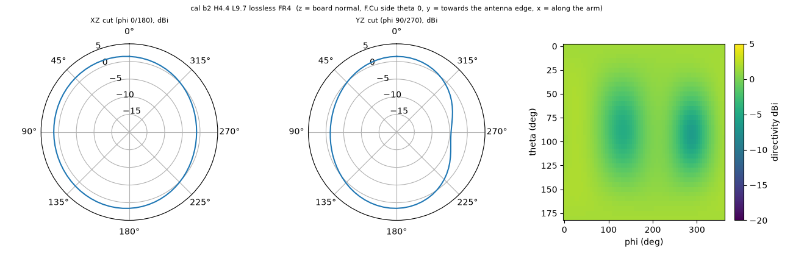

# cal b2 H4.4 L9.7 lossless FR4

**Why this run:** Efficiency calibration: with lossless FR4 the true radiation efficiency is 100 %, so this shows the bias of the far-field method on this exact board (own transform and Poynting flux).

Run `f9702c74b7`, tag `cal1`, model v5, board `build/b2/board.json`, battery yes, mask none.

## Antenna

ifa, ground edge base b2: S 3.5 mm, Ws 2 mm, Wf 1 mm, H 4.4 mm, Wa 1 mm, L 9.7 mm

| part | KiCad x0 | y0 | x1 | y1 |
|---|---|---|---|---|
| short leg | 139.60 | 85.00 | 141.60 | 90.65 |
| feed leg | 143.60 | 86.00 | 144.60 | 91.22 |
| arm | 139.60 | 85.00 | 159.70 | 86.00 |

Copper extent x 139.60..159.70, y 85.00..91.22 (KiCad), smallest distance to the board edge 1.31 mm.

## Impedance and match at J2

Best match without parts -9.7 dB at 2.532 GHz, worst BLE channel -6.0 dB, -10 dB band none MHz.

Z at J2: 2.40 GHz 20.8-22.9j ohm, 2.44 GHz 22.1-13.2j ohm, 2.48 GHz 23.8-3.6j ohm

| matching (ideal parts at J2, L2 series, L3 shunt) | worst BLE S11 |
|---|---|
| none (L2 0R) | -6.0 dB |
| 1 part: shunt 7.75 nH | -9.1 dB |
| 2 parts: series 5.70 pF, shunt 3.15 nH | -13.2 dB |

## Efficiency and pattern

| f GHz | radiation eff. | total eff. (no parts) | Dmax dBi |
|---|---|---|---|
| 2.40 | 100 % | 75 % | 1.9 |
| 2.44 | 100 % | 82 % | 2.0 |
| 2.48 | 100 % | 87 % | 2.0 |

Own far-field transform, about ±15 % (validation in farfield.py). Total efficiency is without matching parts.

Mesh 1970670 cells, run time 33 min.
