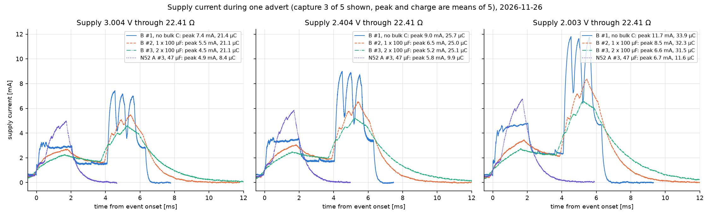
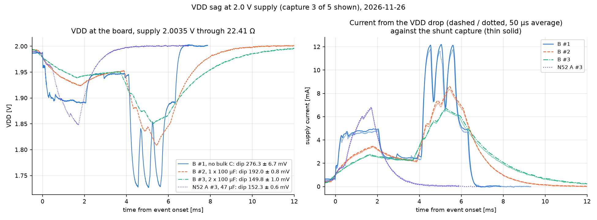
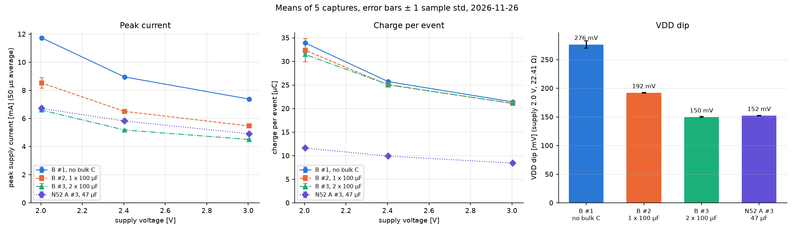
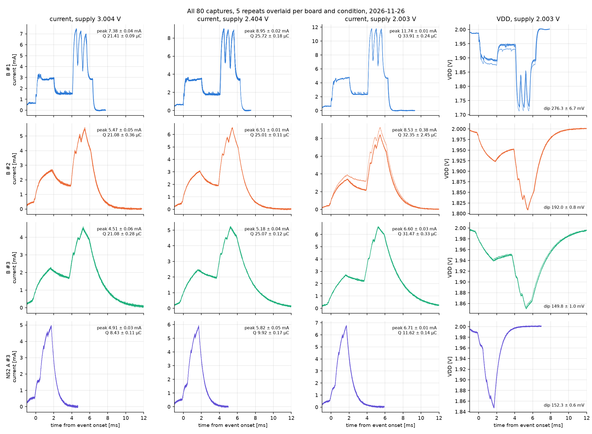
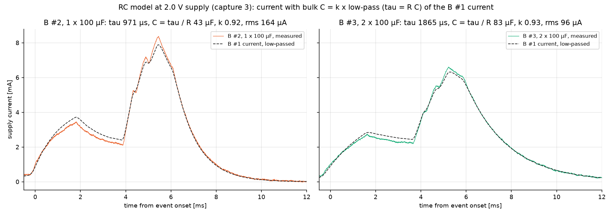

# Supply current and VDD sag during an advert, against bulk capacitance (T3)

BSN-C23-B with 0, 1 and 2 × 100 µF bulk capacitance, and BSN-N52-A A #3 for comparison, on a bench supply with a
fixed series resistor in place of the CR2032. Session on the morning of 2026-11-26, before 12:00. The file times
on the scope (17:37–18:38) are wrong, the scope clock is not set.

This replaces the first session on CR2032 cells (2026-11-20). That run is not valid for comparing the boards: the
cell was shorted at every removal from the holder, so the cell state and its internal resistance changed between
boards and were not known. Its data, script and plots are in git history (commit `de434e7`).

- Raw data: [`vdd_sag_2026-11-26/`](vdd_sag_2026-11-26/), named `<board>_<shunt|vdd>_<supply>_<n>.csv`, 60 files.
  The 20 N52 files are in [`hardware/N52/testing/Power/vdd_sag_2026-11-26/`](../../../../N52/testing/Power/vdd_sag_2026-11-26/).
  [`scope_file_map.csv`](vdd_sag_2026-11-26/scope_file_map.csv) maps them to the original `scope_0.csv` to
  `scope_79.csv`.
- Script: [`vdd_sag.py`](vdd_sag.py) computes the metrics (the CSV holds only the trace), writes
  [`vdd_sag_summary.csv`](vdd_sag_summary.csv) and the plots below.

## Setup

- Bench supply in series with **R = 22.41 Ω** (measured 2026-11-25) into the board's battery input. Supply set to
  3.004, 2.4036 and 2.0035 V. The R is close to the 19–23 Ω instant IR drop measured on a no-brand CR2032
  on 2026-11-17 ([`CW_CURRENT.md`](CW_CURRENT.md)).
- Keysight InfiniiVision MSO-X 4154G, one probe, for both kinds of capture. Chain: supply + → R → board VDD,
  board GND → supply −. Two kinds of capture:
  - **shunt:** the probe across R (tip and ground clip on the two ends of R), so the supply current is I = V / R.
    At all three supply voltages. The ground clip ties one end of R to the scope ground, so the supply output
    was floating: with an earthed output the clip would short either the supply or the board through R, and the
    captures would not show the event (they do, and the charge agrees with T1).
  - **vdd:** the probe from board VDD to board GND, behind the same R, so the drop across R shows as the VDD dip.
    At 2.0035 V only. The current from it is (V_base − VDD) / R.
- 5 captures per board and condition. The time base was not the same for all sets: 1.3 to 4 µs per sample, a
  6.5 to 20 ms window, about 5000 points each. The scope pads the last rows of each CSV with empty values, the
  script drops them.
- Firmware and TX power, unchanged from 2026-11-25 (confirmed by the user): B #1, B #2, B #3
  `ble_sensor LOG=0 DRDY=4 RELOAD=0` (5 s, 0 dBm), A #3 `ble_beacon_min DRDY=4` (5 s, 0 dBm).

| Board | Bulk capacitance on VDD |
|---|---|
| B #1 | none (C6 not fitted) |
| B #2 | 1 × 100 µF (C6, Murata GRM21BR60J107ME15, 6.3 V X5R 0805) |
| B #3 | 2 × 100 µF |
| N52 A #3 | 47 µF (C2, Cal-Chip GMC21X5R476M6R3NT, 6.3 V X5R 0805) |

**Capture order.** The scope files run by supply voltage first, then by board: `scope_0`–`19` shunt at 3.0 V
(B #1, B #2, B #3, N52, five each), `20`–`39` at 2.4 V, `40`–`59` at 2.0 V, `60`–`79` VDD at 2.0 V. This is
confirmed by the file times (a 13 min gap at each supply change, the clock is wrong but the gaps hold) and by the waveforms: the B #1 sets have sharp
edges, the B #2 and B #3 sets are low-passed with about twice the time constant on B #3, and the N52 event is
about 2.5 ms long against 6.5 ms on the C23.

## Data check

- 80 CSVs, no clipping, offset of the shunt channel −1.7 to −3.4 mV before the event (subtracted per capture).
- Repeats agree: peak current σ 0.01–0.06 mA and charge σ 0.1–0.4 µC within each 5-capture set, except two
  first captures:
  - **B #2 shunt 2.0 V, capture 1** (`scope_45`): higher current through the whole event, 36.7 µC against
    31.0–31.5 µC in the other four.
  - **B #1 VDD 2.0 V, capture 1** (`scope_60`): lower VDD through the whole event, 39.6 µC against 34.7–35.9 µC.
  Both are the first capture after a change. Cause not investigated. Means below include them, values without
  them are given where they matter.
- The two ways of getting the current at 2.0 V agree on the shape (`vdd_sag_vdd.png`, right). The charge agrees
  within 2 % on B #2, B #3 and N52. On B #1 the VDD capture gives 35.2 µC (without capture 1) against 33.9 µC
  from the shunt, 4 % higher. Cause not investigated.

## Results

Means of 5 captures ± sample σ. I_peak is on a 50 µs moving average. Q is the charge per event, E the energy into
the board (V_supply · Q minus the loss in R). τ is the decay after the last TX burst, C = τ / R.

| Board | Supply | I_peak | Q | E | Event length | τ | C = τ / R |
|---|---|---|---|---|---|---|---|
| B #1, no bulk C | 3.004 V | 7.38 ± 0.04 mA | 21.41 ± 0.09 µC | 62.3 µJ | 6.41 ms | – | – |
| B #2, 1 × 100 µF | 3.004 V | 5.47 ± 0.05 mA | 21.08 ± 0.36 µC | 61.8 µJ | 7.19 ms | 768 µs | 34.3 µF |
| B #3, 2 × 100 µF | 3.004 V | 4.51 ± 0.06 mA | 21.08 ± 0.28 µC | 61.9 µJ | 7.93 ms | 1453 µs | 64.8 µF |
| N52 A #3, 47 µF | 3.004 V | 4.91 ± 0.03 mA | 8.43 ± 0.11 µC | 24.7 µJ | 2.49 ms | 465 µs | 20.8 µF |
| B #1 | 2.404 V | 8.95 ± 0.02 mA | 25.72 ± 0.18 µC | 58.9 µJ | 6.44 ms | – | – |
| B #2 | 2.404 V | 6.51 ± 0.01 mA | 25.01 ± 0.11 µC | 58.0 µJ | 7.52 ms | 893 µs | 39.8 µF |
| B #3 | 2.404 V | 5.18 ± 0.04 mA | 25.07 ± 0.12 µC | 58.5 µJ | 8.49 ms | 1680 µs | 75.0 µF |
| N52 A #3 | 2.404 V | 5.82 ± 0.05 mA | 9.92 ± 0.17 µC | 23.0 µJ | 2.68 ms | 548 µs | 24.5 µF |
| B #1 | 2.004 V | 11.74 ± 0.01 mA | 33.91 ± 0.24 µC | 62.8 µJ | 6.50 ms | – | – |
| B #2 | 2.004 V | 8.53 ± 0.38 mA | 32.35 ± 2.45 µC (31.26 without capture 1) | 61.3 µJ | 8.06 ms | 1014 µs | 45.3 µF |
| B #3 | 2.004 V | 6.60 ± 0.03 mA | 31.47 ± 0.33 µC | 60.3 µJ | 9.31 ms | 1894 µs | 84.5 µF |
| N52 A #3 | 2.004 V | 6.71 ± 0.01 mA | 11.62 ± 0.14 µC | 22.2 µJ | 2.88 ms | 618 µs | 27.6 µF |

VDD at the board, supply 2.0035 V through 22.41 Ω:

| Board | VDD dip (50 µs average) | Lowest VDD (raw sample, any capture) |
|---|---|---|
| B #1, no bulk C | 276.3 ± 6.7 mV (273.4 without capture 1) | 1.712 V |
| B #2, 1 × 100 µF | 192.0 ± 0.8 mV | 1.808 V |
| B #3, 2 × 100 µF | 149.8 ± 1.0 mV | 1.850 V |
| N52 A #3, 47 µF | 152.3 ± 0.6 mV | 1.847 V |

### What the data show

- **The charge per event agrees with the T1 meter results.** At 3.0 V: B #1 21.41 µC here against 21.3 µC per
  advert in T1 (2026-11-20), N52 A #3 8.43 µC against 8.57 µC (2026-11-25). Two different instruments and
  methods.
- **The bulk capacitance moves the charge in time but does not change it.** At 3.0 V and 2.4 V the three C23
  boards are within 3 % of each other. The peak supply current falls from 7.38 mA (no bulk C) to 5.47 mA
  (1 × 100 µF) and 4.51 mA (2 × 100 µF) at 3.0 V, −26 % and −39 %. At 2.0 V the VDD dip falls from 276 mV to
  192 mV and 150 mV, −31 % and −46 %.
- **The charge per event rises as the supply falls, the energy stays about the same.** C23: 21.4 µC at 3.0 V,
  33.9 µC at 2.0 V (+58 %), 58–63 µJ at all three. N52: 8.4 to 11.6 µC, 22–25 µJ. This is what a DC-DC
  converter on the supply does (likely the cause, the converter settings were not checked). For the battery
  projection the charge at the cell voltage is the number to use, not the 3.0 V value.
- **The N52 uses about 40 % of the C23's energy per event** (24.7 against 62 µJ at 3.0 V), and its event is
  about 2.5 ms against 6.5 ms.
- **Capacitance from τ.** B #3 / B #2 = 1.89 at 3.0 V, 1.88 at 2.4 V, 1.87 at 2.0 V, close to the 2 fitted
  parts. The effective C is 34–45 µF for one 100 µF part and rises as the voltage falls, which fits the DC-bias
  loss of an 0805 X5R part (likely, the datasheet curve was not looked up). Same trend on the N52 47 µF part,
  21–28 µF. These are approximate: the R the capacitor sees is 22.41 Ω plus the supply and wiring, in parallel
  with the board's own load, and the other decoupling on the board is included.
- **RC model.** The B #2 and B #3 current is the B #1 current through a first-order low-pass, with C = τ / R
  within 1 µF of the tail fit (33.9 and 64.5 µF at 3.0 V). The fit residual is 33–41 µA rms at 3.0 V and 2.4 V.
  At 2.0 V the residual is larger (96–164 µA) and the B #1 current is above the model before the TX bursts. A
  likely reason: B #1 has the lowest VDD, and the converter draws more current at a lower input. Not
  investigated.
- **Lowest VDD at 2.0 V supply.** B #1 reached 1.712 V on the raw trace, 2 mV above the CC2340R5 minimum
  operating supply of 1.71 V and 42 mV above the typical brown-out falling threshold of 1.67 V (datasheet
  SWRS272F, tables 7.3 and 7.6, the BOD has only a typical value). The five B #1 captures all show the same
  complete event, so the node did not reset. With bulk capacitance the lowest point is 1.81–1.85 V.
- **Falling VDD slew rate.** The datasheet gives a maximum falling supply slew rate of 1 mV/µs (table 7.3), with
  a note that coin cells with a high end-of-life source resistance need a 10 µF VDDS input capacitor to meet it.
  Steepest fall in the VDD captures at 2.0 V (slope of the VDD trace averaged over 50 µs, then over 2 µs):

  | Board | 50 µs average | 2 µs average |
  |---|---|---|
  | B #1, no bulk C | 1.23–1.29 mV/µs | 2.4–2.7 mV/µs |
  | B #2, 1 × 100 µF | 0.20–0.22 mV/µs | 0.45–0.59 mV/µs |
  | B #3, 2 × 100 µF | 0.12–0.13 mV/µs | 0.30–0.36 mV/µs |

  B #1 is above the 1 mV/µs limit at both averages, B #2 and B #3 are below it. The 2 µs value includes scope
  noise, so it is an upper bound. The rev B BOM has two 10 µF parts (C1, C10), which of them is on VDDS was not
  checked here. With 22.41 Ω as the source this is a cell near the end of its life (19–23 Ω measured on
  2026-11-17), so this is the case the datasheet note is about. B #1 ran through every capture, what the limit
  guards against was not investigated. The N52 VDD files are not in this folder and were not checked.

## Open

- nRF52805 minimum supply and brown-out level, for the N52 end-of-life argument with T2 (no nRF52805 datasheet in
  `docs/datasheets/` yet). The CC2340R5 values are above.
