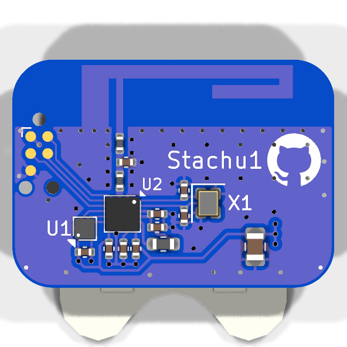

# BSN-N52 (Nordic nRF52805 variant)

> **Side variant, outside the original requirements.** A smaller, cheaper node, designed as a separate
> project ("AirTag") and moved into this repository on 2026-11-23. It uses the same HDC2010 sensor and a printed
> inverted-F antenna like `BSN-C23-B`, but it is smaller, runs on a CR1632 and probably has worse RF performance.
> It does not replace `BSN-C23-B`. Whether and how it appears in the report is still open.

KiCad project: `BSN-N52.kicad_pro`. See the root README for the board naming scheme. Firmware, bring-up procedure
and per-board results: [`firmware/N52`](../../firmware/N52) and [`firmware/N52/BRINGUP.md`](../../firmware/N52/BRINGUP.md).



[Schematic](schematic.pdf) · [PCB](PCB.pdf)

## Rev A (`BSN-N52-A`)

- **24 × 17 mm**, 2 layers, 1.6 mm, 3 mm corner radius. The CR1632 holder is on the back and the cell overhangs
  the bottom edge.
- **nRF52805-CAAA** (WLCSP-28, 2.48 × 2.46 mm, 192 kB flash, 24 kB RAM) with the DC/DC converter (L3 10 µH), a 32 MHz
  crystal and no 32 kHz crystal (the low-frequency clock is the internal RC).
- **HDC2010** temperature/humidity sensor on I2C with its interrupt line (DRDY) to the SoC. No external I2C
  pull-ups (the nRF internal ones are used).
- **Printed meandered inverted-F antenna (MIFA)** along the top edge in a 20 × 5 mm keep-out, designed in openEMS on
  this board ([`testing/RF/sim`](testing/RF/sim)). Fed through a Murata MM8130 switch connector and a T network
  L2 4.7 nH series, C1 0.5 pF shunt, L1 8.2 nH series (match and harmonic filter, from the r7 simulation with the
  solder mask and the cell).
- **SWD only**: Tag-Connect TC2030-NL (J1) with VCC, SWDIO, RESET, SWCLK, GND. No LED, no UART.
- The silkscreen carries the author's handle, not the board ID. The ID is in the KiCad title block only.

### Parts

| Ref | Part | DigiKey |
|---|---|---|
| U2 | Nordic nRF52805-CAAA (WLCSP-28) | `4823-NRF52805-CAAA-RCT-ND` |
| U1 | TI HDC2010 humidity / temperature sensor | `296-47774-1-ND` |
| X1 | ECS ECS-320-8-37B-CKY-TR, 32 MHz, 8 pF, ±10/±10 ppm, 2.0 × 1.6 mm | `50-ECS-320-8-37B-CKY-TRCT-ND` |
| L3 | Murata LQM18DN100M70L, 10 µH, 0603, DC/DC inductor | `490-LQM18DN100M70LCT-ND` |
| C2 | Cal-Chip GMC21X5R476M6R3NT, 47 µF 6.3 V X5R, 0805, bulk cap | `4713-GMC21X5R476M6R3NTCT-ND` |
| BT1 | CR1632 in Assmann A-BAT-CH-C6-EA-CSR1 (the clip is +, a bare pad under the cell is −) | `123-A-BAT-CH-C6-EA-CSR1CT-ND` |
| L2 / C1 / L1 | RF T network: 4.7 nH / 0.5 pF / 8.2 nH | `490-16635-1-ND` / `490-11250-1-ND` / `490-18131-1-ND` |

The BOM export (`BSN-N52.csv`) and the order sheet (`bom/`) are kept locally like those of the other variants.
The schematic is the source.

### Manufacturing

Ordered on 2026-11-16 as a **3 × 3 panel** (KiKit 1.8.1, [`panel/panel.json`](panel/panel.json)), hand assembled,
so no fiducials or tooling holes. The commit that added this folder is tagged `hw/BSN-N52-A`. The board files are
the ordered ones, only renamed and given a title block.

- 2 mm gaps between boards, 5 mm rails top and bottom only.
- Tabs 2.2 mm wide, mouse bites of 3 × 0.5 mm holes at 0.8 mm pitch, **offset −0.5 mm** so the holes sit in the gap
  and not on the antenna. The boards keep an FR4 nub of about 0.25–0.5 mm after breaking (no copper in it).
- The top-edge tabs sit on the antenna edge. Move them off that edge in a later revision if needed.

Regenerate the panel after a board change (from `hardware/N52`):

```
"C:\Program Files\KiCad\10.0\bin\python.exe" -m kikit.ui panelize -p panel/panel.json BSN-N52.kicad_pcb panel/BSN-N52_panel.kicad_pcb
```

### Bring-up status

Three boards assembled, all pass the 11-point hardware self-test (`hwtest`). Details in
[`firmware/N52/BRINGUP.md`](../../firmware/N52/BRINGUP.md). Parts for about seven more are on hand.

| Board | BLE address | Status |
|---|---|---|
| A #1 | DF:55:EE:37:04:CD | `hwtest` 11/11. Used to develop the tests |
| A #2 | C2:D7:6D:9C:B3:20 | A\*: HDC2010 reworked (SDA and INT held low). Then `hwtest` 11/11, `ble_sensor` flashed |
| A #3 | DB:1C:AA:DB:F2:9D | `hwtest` 11/11, BTHome seen on the scanner. `ble_beacon_min` measured at 1.706 µA average |

### Test results

- **Current:** [`testing/Power/POWER_MEASUREMENTS.md`](testing/Power/POWER_MEASUREMENTS.md). 1.706 µA average at
  the 5 s DRDY interval on A #3 with the bare-metal `ble_beacon_min` (System OFF between adverts), about 2.5 times
  lower than `BSN-C23-B` (4.36 to 4.39 µA). Single reading on the 10 mA range, see the caveats there.
- **RF:** simulated only ([`testing/RF/sim`](testing/RF/sim)). Not measured on a built board yet.

### Rework log

Hand-modified boards are marked `A*` (see the root README).

| Board | Date | Change | Reason |
|---|---|---|---|
| A #2 | by 2026-11-23 | HDC2010 (U1) reworked | First `hwtest` failed: SDA and INT held low by U1 (bad joint or short) |
