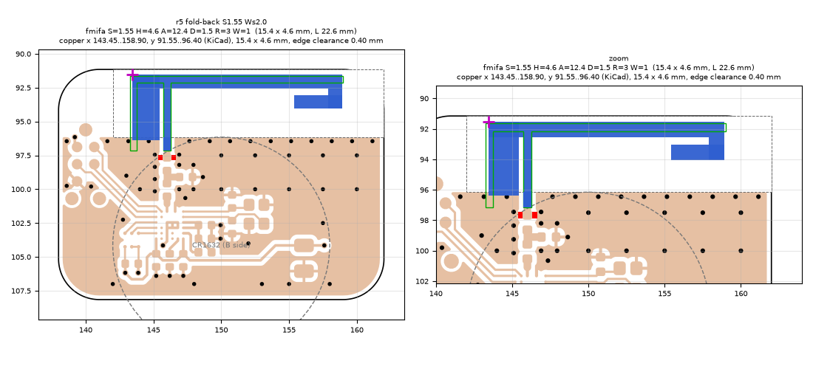
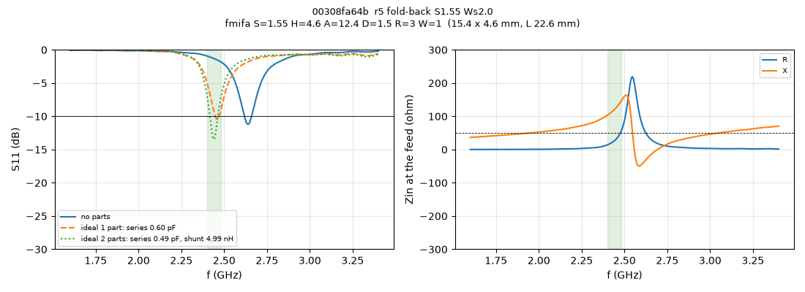

# 00308fa64b  r5 fold-back S1.55 Ws2.0

**Purpose:** r5 fold-back it0 (a18ad9bd49): clean single resonance at 2.46 GHz but Rmax 360 ohm, no match without parts. Short leg at the minimum 0.3 mm gap to the feed leg, short width 2.0 mm: how far does Rmax drop?

## Antenna

`fmifa S=1.55 H=4.6 A=12.4 D=1.5 R=3 W=1  (15.4 x 4.6 mm, L 22.6 mm)`

| parameter | value |
|---|---|
| W | 1 |
| Wf | 0.5 |
| Ws | 2 |
| S | 1.55 |
| H | 4.6 |
| A | 12.4 |
| D | 1.5 |
| R | 3 |
| Nd | 1 |
| Nw | 0 |
| K | 1 |
| site | {"x": -4.0, "y": 3.55, "rot": 0, "mirror": false} |

Copper 15.45 x 4.60 mm above the ground edge (71.1 mm2), centre-line length 22.6 mm.
KiCad position of the copper: x 143.45..158.90, y 91.55..96.40, edge clearance 0.40 mm.

## Impedance at the feed (port across the notch)

| | |
|---|---|
| S11 minimum | -11.2 dB at 2.639 GHz |
| Z at 2.44 GHz | 26.0 +119.8j ohm |
| -10 dB band | 2.619-2.660 GHz |
| worst BLE S11, no parts | -0.9 dB |
| worst BLE S11, best ideal 1 part | -4.9 dB (series 0.60 pF) |
| worst BLE S11, best ideal 2 parts | -6.9 dB (series 0.49 pF, shunt 4.99 nH) |

Ideal lossless parts right at the feed, listed from the antenna toward the chip (shunt first = shunt on the antenna side). Real parts on pads with a trace and Q 30-50 give less (BSN: -15.3 dB ideal became -10.9 dB).

## Efficiency (raw own far-field transform, about +-10 %)

| f (GHz) | radiation eff. | total eff. (no match) | Dmax (dBi) |
|---|---|---|---|
| 2.40 | 66 % | 13 % | 1.6 |
| 2.44 | 67 % | 17 % | 1.6 |
| 2.48 | 73 % | 25 % | 1.6 |

## Run

board `build/r5/board.json`, battery True, mask none, model m3, 2004992 cells, 2204 s.
