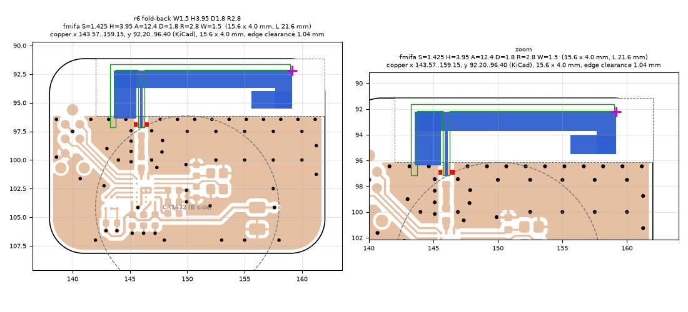
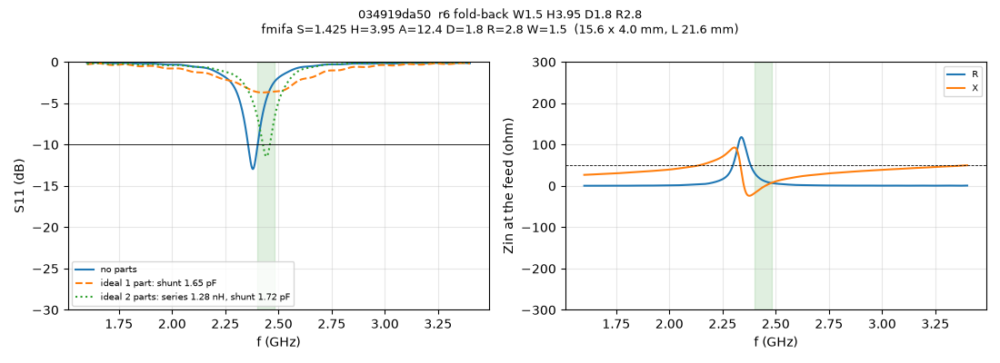

# 034919da50  r6 fold-back W1.5 H3.95 D1.8 R2.8

**Purpose:** Matching parts allowed, lowest antenna Q wanted. feb8a63c15 resonated at 2.20 GHz (Q 26 there): return row shortened so the resonance lands near 2.44 GHz, then compare Q and the match_tee result with the base 1d83d77615 (Q 30-33, -1.16 dB worst channel).

## Antenna

`fmifa S=1.425 H=3.95 A=12.4 D=1.8 R=2.8 W=1.5  (15.6 x 4.0 mm, L 21.6 mm)`

| parameter | value |
|---|---|
| W | 1.5 |
| Wf | 0.25 |
| Ws | 2 |
| S | 1.425 |
| H | 3.95 |
| A | 12.4 |
| D | 1.8 |
| R | 2.8 |
| Nd | 1 |
| Nw | 0 |
| K | 1 |
| site | {"x": -4.0, "y": 3.55, "rot": 0, "mirror": false} |

Copper 15.57 x 3.95 mm above the ground edge (61.5 mm2), centre-line length 21.6 mm.
KiCad position of the copper: x 143.57..159.15, y 92.20..96.40, edge clearance 1.04 mm.

## Impedance at the feed (port across the notch)

| | |
|---|---|
| S11 minimum | -13.0 dB at 2.380 GHz |
| Z at 2.44 GHz | 13.4 -2.9j ohm |
| -10 dB band | 2.358-2.402 GHz |
| worst BLE S11, no parts | -2.3 dB |
| worst BLE S11, best ideal 1 part | -3.6 dB (shunt 1.65 pF) |
| worst BLE S11, best ideal 2 parts | -6.6 dB (series 1.28 nH, shunt 1.72 pF) |

Ideal lossless parts right at the feed, listed from the antenna toward the chip (shunt first = shunt on the antenna side). Real parts on pads with a trace and Q 30-50 give less (BSN: -15.3 dB ideal became -10.9 dB).

## Efficiency (raw own far-field transform, about +-10 %)

| f (GHz) | radiation eff. | total eff. (no match) | Dmax (dBi) |
|---|---|---|---|
| 2.40 | 55 % | 50 % | 1.7 |
| 2.44 | 61 % | 41 % | 1.7 |
| 2.48 | 65 % | 28 % | 1.7 |

## Run

board `build/r6/board.json`, battery True, mask none, model m3, 1953372 cells, 2473 s.
