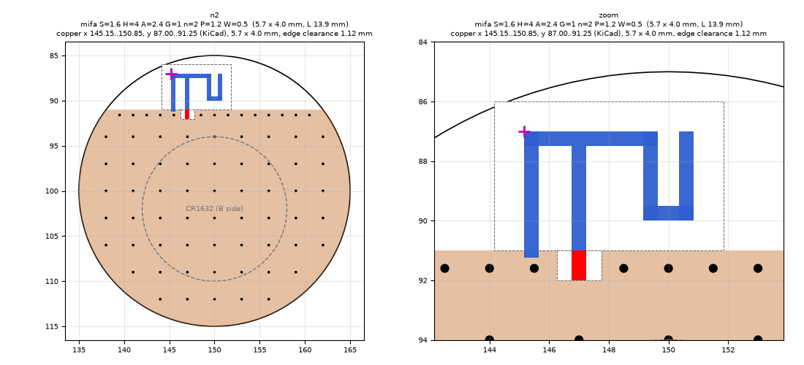
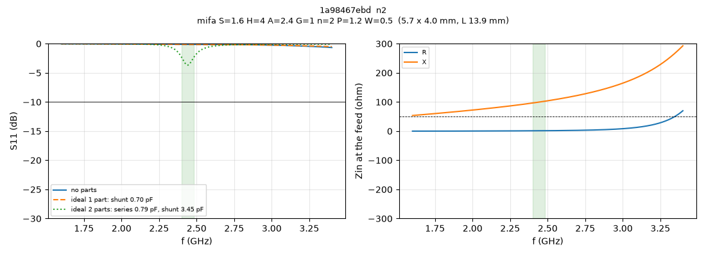

# 1a98467ebd  n2

**Purpose:** Smoke test of the AirTag pipeline (synthetic 30 mm disc board, CR1632 on the bottom)

## Antenna

`mifa S=1.6 H=4 A=2.4 G=1 n=2 P=1.2 W=0.5  (5.7 x 4.0 mm, L 13.9 mm)`

| parameter | value |
|---|---|
| W | 0.5 |
| Wf | 0.5 |
| Ws | 0.5 |
| S | 1.6 |
| H | 4 |
| A | 2.4 |
| G | 1 |
| n | 2 |
| P | 1.2 |
| Nd | 1 |
| Nw | 1.5 |
| K | 1 |
| site | {"x": -3.0, "y": 9.0, "rot": 0, "mirror": false} |

Copper 5.70 x 4.00 mm above the ground edge (22.8 mm2), centre-line length 13.9 mm.
KiCad position of the copper: x 145.15..150.85, y 87.00..91.25, edge clearance 1.12 mm.

## Impedance at the feed (port across the notch)

| | |
|---|---|
| S11 minimum | -0.7 dB at 3.400 GHz |
| Z at 2.44 GHz | 1.3 +99.5j ohm |
| -10 dB band | - |
| worst BLE S11, no parts | -0.1 dB |
| worst BLE S11, best ideal 1 part | -0.1 dB (shunt 0.70 pF) |
| worst BLE S11, best ideal 2 parts | -2.3 dB (series 0.79 pF, shunt 3.45 pF) |

Ideal parts sit right at the feed. Real parts on pads with a trace and Q 30-50 give less, see the BSN lessons.

## Efficiency (raw own far-field transform, about +-10 %)

| f (GHz) | radiation eff. | total eff. (no match) | Dmax (dBi) |
|---|---|---|---|
| 2.40 | 62 % | 1 % | 1.7 |
| 2.44 | 65 % | 1 % | 1.8 |
| 2.48 | 69 % | 2 % | 1.8 |

## Run

board `build/disc30/board.json`, battery True, mask none, model m1, 1486674 cells, 616 s.
