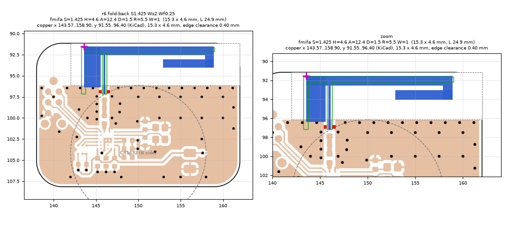
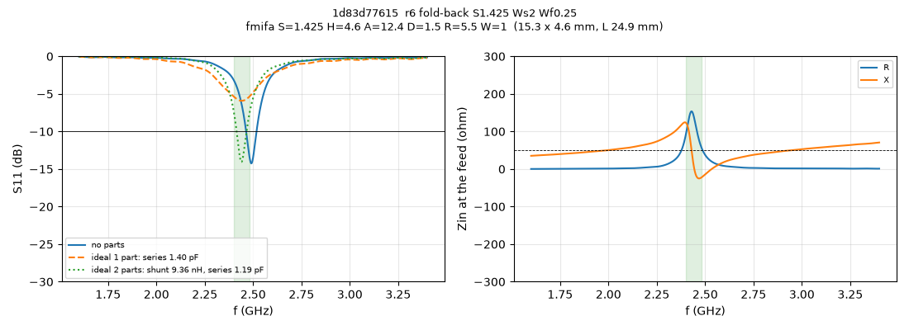

# 1d83d77615  r6 fold-back S1.425 Ws2 Wf0.25

**Purpose:** Board r6 = AirTag.kicad_pcb of 2026-11-14 23:46: L1 moved 0.75 mm up against the AE1 feed pad (feed trace in the pour almost gone), 7 vias moved. Fills the idle slot while r5_e tunes: narrow feed leg (0.25 mm) with the short leg moved in to keep the 0.3 mm gap (S 1.425 instead of 1.55), R 5.5. Sensitivity of Rmax and the match to S at this feed width.

## Antenna

`fmifa S=1.425 H=4.6 A=12.4 D=1.5 R=5.5 W=1  (15.3 x 4.6 mm, L 24.9 mm)`

| parameter | value |
|---|---|
| W | 1 |
| Wf | 0.25 |
| Ws | 2 |
| S | 1.425 |
| H | 4.6 |
| A | 12.4 |
| D | 1.5 |
| R | 5.5 |
| Nd | 1 |
| Nw | 0 |
| K | 1 |
| site | {"x": -4.0, "y": 3.55, "rot": 0, "mirror": false} |

Copper 15.32 x 4.60 mm above the ground edge (70.5 mm2), centre-line length 24.9 mm.
KiCad position of the copper: x 143.57..158.90, y 91.55..96.40, edge clearance 0.40 mm.

## Impedance at the feed (port across the notch)

| | |
|---|---|
| S11 minimum | -14.2 dB at 2.491 GHz |
| Z at 2.44 GHz | 142.7 +11.4j ohm |
| -10 dB band | 2.464-2.517 GHz |
| worst BLE S11, no parts | -3.2 dB |
| worst BLE S11, best ideal 1 part | -5.3 dB (series 1.40 pF) |
| worst BLE S11, best ideal 2 parts | -7.3 dB (shunt 9.36 nH, series 1.19 pF) |

Ideal lossless parts right at the feed, listed from the antenna toward the chip (shunt first = shunt on the antenna side). Real parts on pads with a trace and Q 30-50 give less (BSN: -15.3 dB ideal became -10.9 dB).

## Efficiency (raw own far-field transform, about +-10 %)

| f (GHz) | radiation eff. | total eff. (no match) | Dmax (dBi) |
|---|---|---|---|
| 2.40 | 64 % | 33 % | 1.7 |
| 2.44 | 68 % | 52 % | 1.7 |
| 2.48 | 70 % | 67 % | 1.7 |

## Run

board `build/r6/board.json`, battery True, mask none, model m3, 1921866 cells, 2329 s.
