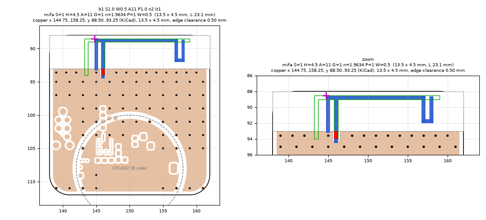
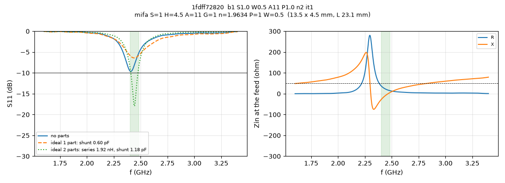

# 1fdff72820  b1 S1.0 W0.5 A11 P1.0 n2 it1

**Purpose:** Real board copy b1 (sim/boards/b1: AirTag.kicad_pcb of 2026-11-14 01:21 with GND pours and a via fence, AE1 = generic 24 x 5 keep-out, feed at (146, 93) above L1, port across the notch). Can it match 50 ohm without parts? The peak R cannot reach 50 ohm (keepout24 it1: 742 -> 412 ohm for S 2.5 -> 1.5) but the S11 minimum on the slope above the resonance deepens as S shrinks, so: S at its minimum, length tuned so the S11 MINIMUM sits at 2.465 GHz (2.44 + 1 % for the mask). Variant: more meander, 1 mm shorter arm (more compact).

## Antenna

`mifa S=1 H=4.5 A=11 G=1 n=1.9634 P=1 W=0.5  (13.5 x 4.5 mm, L 23.1 mm)`

| parameter | value |
|---|---|
| W | 0.5 |
| Wf | 0.5 |
| Ws | 0.5 |
| S | 1 |
| H | 4.5 |
| A | 11 |
| G | 1 |
| n | 1.9634 |
| P | 1 |
| Nd | 1 |
| Nw | 1 |
| K | 1 |
| site | {"x": -4.0, "y": 7.0, "rot": 0, "mirror": false} |

Copper 13.50 x 4.50 mm above the ground edge (60.8 mm2), centre-line length 23.1 mm.
KiCad position of the copper: x 144.75..158.25, y 88.50..93.25, edge clearance 0.50 mm.

## Impedance at the feed (port across the notch)

| | |
|---|---|
| S11 minimum | -9.7 dB at 2.409 GHz |
| Z at 2.44 GHz | 23.0 -9.1j ohm |
| -10 dB band | - |
| worst BLE S11, no parts | -5.2 dB |
| worst BLE S11, best ideal 1 part | -5.8 dB (shunt 0.60 pF) |
| worst BLE S11, best ideal 2 parts | -8.4 dB (series 1.92 nH, shunt 1.18 pF) |

Ideal lossless parts right at the feed, listed from the antenna toward the chip (shunt first = shunt on the antenna side). Real parts on pads with a trace and Q 30-50 give less (BSN: -15.3 dB ideal became -10.9 dB).

## Efficiency (raw own far-field transform, about +-10 %)

| f (GHz) | radiation eff. | total eff. (no match) | Dmax (dBi) |
|---|---|---|---|
| 2.40 | 87 % | 78 % | 1.9 |
| 2.44 | 91 % | 77 % | 1.9 |
| 2.48 | 95 % | 67 % | 2.0 |

## Run

board `build/b1/board.json`, battery True, mask none, model m3, 2168574 cells, 4986 s.
